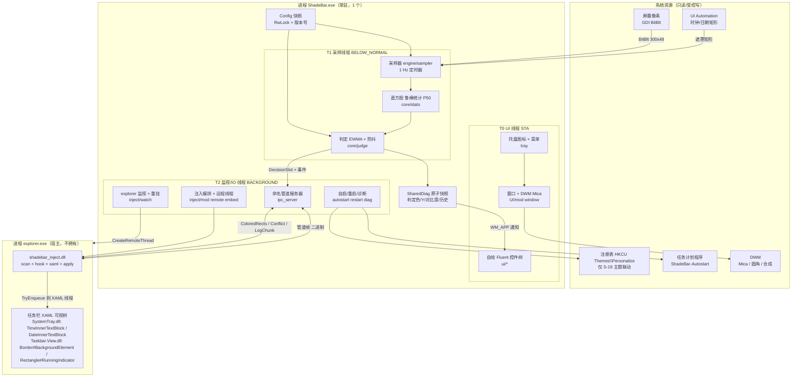
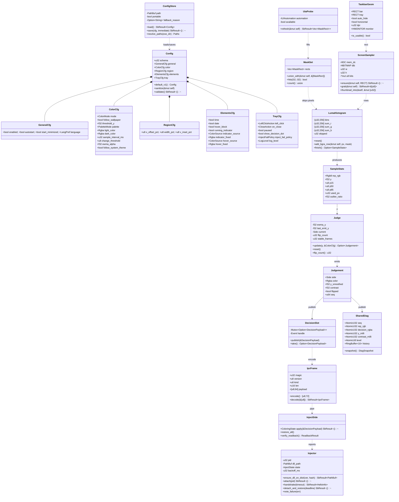
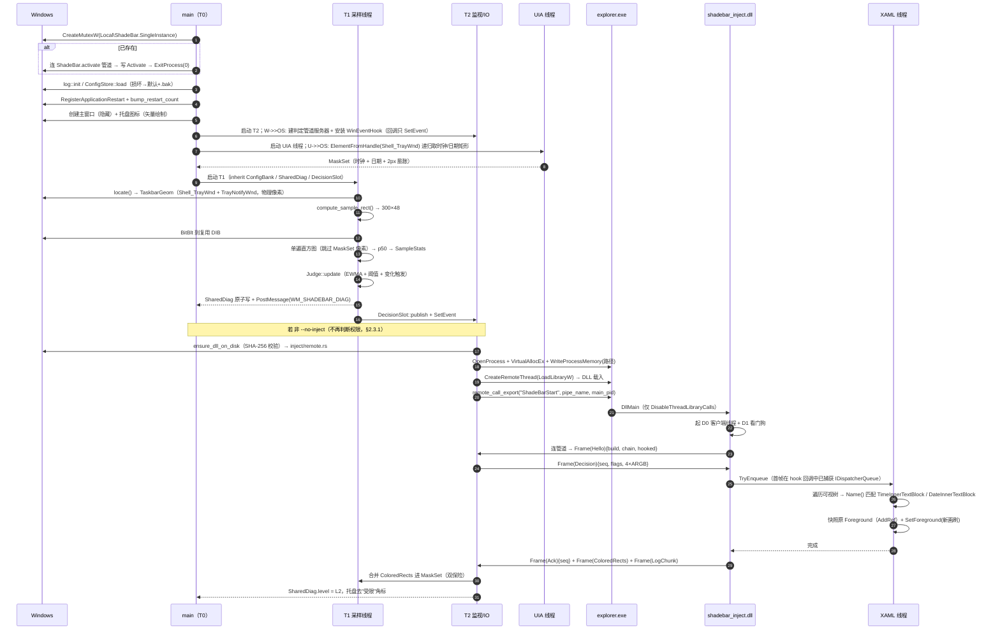
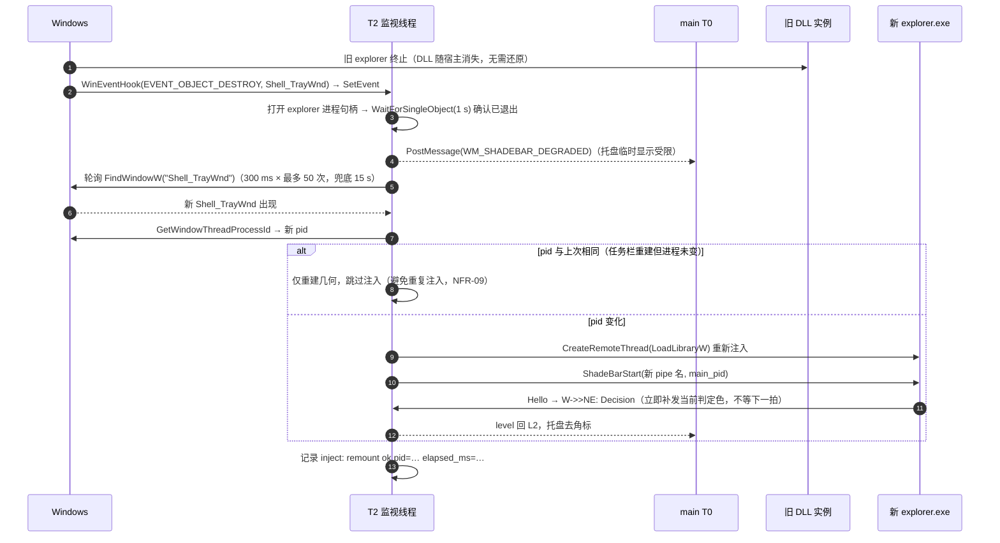
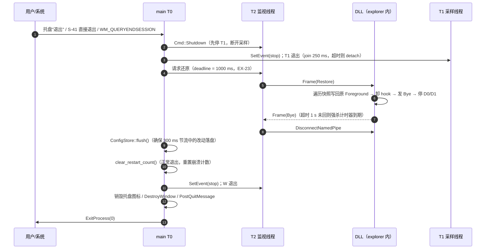

# 随影 ShadeBar — 系统架构设计与任务分解

| 项 | 内容 |
|---|---|
| 文档编号 | SHD-ARC-001 |
| 文档版本 | **2.1**（A-29 真机证伪终局：§13.2 新增 **R10**（近跳转 fail-fast 是真机缺陷、非沙箱特异）；T05 **永久移出**（§8.0 / §8.5 / §8.8），总工时维持 31.5；§12 SP-2 改判「真机证伪，改色路线移出」并保留全部技术资产；附录 C 标记 A-29 已执行、收敛第三档、新增 C.5 实际结果；§13.3 F4/F5/F6 定性更新、R9 终局；§13.4 补 A-29 真机行与恢复旁证；架构侧新增第 ⑫ 条（= 需求侧 K-08；§8.6 已明确「架构 12 / README 8 / QA 7」三层关系）；§1.4 加 v2.1 范围声明。**§9.5 / §9 验收矩阵冻结未动**）｜**v2.1 同步 v1.6 裁定（末次改动，之后冻结）**：T04.2/3/5 转 v1.1 候选、T04.4 永久移出与 T05 对齐；§8.8 补 v1.6 三态定义与 P0 门禁 25 项；Q-1 转 v1.5 待办 |
| 对应需求基线 | `docs/01-requirements.md` **v1.6**（SHD-REQ-001，含勘误 E-01；判据口径以 §9 / §9.5 冻结区为准） |
| 目标产品版本 | v1.0.0（SemVer） |
| 编写 | 高见远（架构师） |
| 文档语言 | 简体中文（代码、标识符、crate 名用英文） |
| 技术栈 | Rust 1.99.1 + MSVC 2022 + 纯 Win32/Direct2D 自绘 + WinRT/XAML 注入 |
| 交付形态 | 便携单文件 `随影_ShadeBar_v1.0.0.exe` |

**阅读指引**

| 角色 | 必读 |
|---|---|
| 工程师 | §3 线程模型、§4 文件列表、§5 数据结构、§6 接口签名、§8 任务列表、§11 共享知识 |
| QA | §10 构建产物、§12 spike 判据、附录 A 需求追溯 |
| 主理人 | §2 决策表、§8 任务清单与依赖图、§13 已拍板结论、§12 风险 |

> 本文档**不重复抄写需求**，一律以编号引用（FR-xx / S-xx / NFR-xx / EX-xx / A-xx / B-xx / C-xx）。

---

## 1. 架构总览

### 1.1 一句话架构

**单进程常驻（1 个 exe）+ 按需注入（1 个内嵌 DLL 落盘后 LoadLibrary）+ 命名管道单向下发判定色 + 三层降级链（L2/L3 注入着色 → 主题联动兜底 → 纯诊断）。**

### 1.2 分层与进程视图



### 1.3 数据流（判定闭环）

```
[任务栏几何] → [采样矩形] → BitBlt 到复用 DIB → 单遍灰度直方图(含 R/G/B 累加)
   → 鲁棒中位数 P50（"15% 截尾"口径见 §5.1 术语说明）+ P15/P85 护栏 → 代表色 + 感知亮度 Y
   → EWMA 平滑 → 阈值判定(亮端/暗端) → 变化触发阈值过滤
   → Decision（唯一出口）
       ├─→ SharedDiag（给 UI 诊断面板，1 Hz 只在面板可见时重绘）
       └─→ DecisionSlot + SetEvent → T2 编码成帧 → 命名管道 → DLL
             → DispatcherQueue.TryEnqueue → XAML 线程写 Foreground
             → 读回校验 → 失败/被覆盖 → Conflict → 退避
```

**关键闭合点**：采样区里压着我们自己改色的文字（EX-28）。双防线：
1. **鲁棒统计量**：P50（详见 D7，含口径说明），字符像素占比 20% 时偏移 ≤ 2/255；
2. **几何遮罩**：由 UI Automation 取得时钟/日期文字的实际屏幕矩形（**L1 即可用，不需要注入**），以及 L3 由 DLL 回传的悬停块/指示条矩形，在直方图单遍扫描中直接跳过这些像素。

### 1.4 降级链（NFR-05 / EX-12 / EX-14）

| 级别 | 触发条件 | 行为 | 用户可见 |
|---|---|---|---|
| L2/L3 全功能 | 注入成功 + 目标模块特征码命中（**不需要管理员权限**，实测 medium→medium 同级即可） | 时钟/日期/悬停块/指示条着色 | 正常托盘图标 |
| **L1 降级（注入不可用）** | 注入失败 / 特征码失效 / 目标模块版本不受支持 / 冲突退避 | 采样+判定+诊断+设置全可用；外观零改动 | 托盘图标"受限"角标 + 设置页顶部横幅（NFR-05） |
| L0 诊断模式 | 用户手动 `--no-inject` 或 S-01 关闭 | 仅采样与诊断面板 | 采样继续，无任何外观改动 |

> **⛔ v2.1 范围声明**：A-29 真机证伪后，**L2/L3 着色能力在 Windows 11 26H2 上不可用，T05 永久移出**（§8.0 / 附录 C C.5）。上表的 L2/L3 行与"单向可恢复重试"仅作**设计意图的历史记录**保留；v1.0.0 实际交付 = **L1 全量**（采样/判定/诊断/设置/双语/自启 + 降级横幅与 L2/L3 控件置灰，NFR-05 已实现）。如需重启 L2，须先提出不依赖近跳转、也不在模板应用期写属性的全新上屏方案并通过新 spike。

降级是**单向可恢复**的（设计意图，v1.0.0 因 T05 移出不激活）：每 300 s 一次轻量重试（或 explorer 进程变化时立即重试），成功即升回 L2/L3，不需要用户操作。

---

## 2. 关键技术决策

### 2.1 决策总表

| # | 决策项 | **选定方案** | 决定性理由 | 被否方案 | 主要风险 |
|---|---|---|---|---|---|
| D1 | GUI 方案 | **纯 Win32 宿主窗口 + Direct2D/DirectWrite 自绘 + 自带微型 Fluent 控件库；保留 DWM 标准标题栏承载 `backdrop=4` 的 Mica 材质，客户区纯色 `#F3F3F3`/`#202020`，上屏 = D2D 不透明目标（`alphaMode=IGNORE`）+ `BitBlt(SRCCOPY)` 覆盖写**（SP-1 定稿 B3 / T03.1 已交付，见 §2.2 D1） | 体积增量 ~0.3 MB（预算内）；标题栏 Mica + 客户区纯色**就是 Win11 原生形态**（资源管理器/设置同款）；不进 DComp，代码与内存都最省 | egui（3.5–5 MB，超预算）、slint（2–3 MB，无 Mica，构建重）、comctl32 原生控件（像 Win7）；**GDI `AlphaBlend` 上屏已否决**；**自绘标题栏已否决**（会把 frame 材质盖掉）；**DirectComposition 留 v1.1** | `backdrop=2`（Mica）在 26300 上静默失效，只能用 4；**Mica 不采样 Wallpaper Engine 动态壁纸**（退化为固定主题色） |
| D2 | 注入落地方式 | **DLL 以 `RCDATA`/`include_bytes!` 内嵌 exe，运行时释放到 `%LOCALAPPDATA%\ShadeBar\bin\<ver>-<hash8>\` 再 `LoadLibraryExW`** | 唯一能让 explorer 内的 Rust 代码拥有完整 SEH/`.pdata`/CRT 的路径，explorer 崩溃风险最低（FR-26） | manual mapping（无 `.pdata` 注册 → 异常即崩 explorer）、`%TEMP%`（被清理工具误删） | 杀软对"释放并 LoadLibrary"敏感（SP-2 含验证）；**实测 medium→medium 同级注入无需管理员**（§2.3） |
| D3 | Hook 引擎 | **自写 x64 inline hook（长度反汇编 + trampoline），不引第三方 hook crate；hook 结构写死为 14 字节绝对跳转（10/10 存活）；5 字节 `E9` 近跳转经沙箱 + A-29 真机双重证伪（fail-fast `0xC0000409`），永久禁用** | `retour`/`hudhook` 均无维护保障或引入额外体积；自写约 450 行，且必须自己控制 trampoline 生命周期以配合卸载；14 字节结构是唯一经验证存活的结构 | `retour` 0.3（无 x64 RIP 相对指令兜底）、`hudhook`（面向渲染 hook，非目标）、**5 字节近跳转（沙箱 ≤5 s 必崩 + A-29 真机 31 s `EXPLORER_DIED`）** | 指令长度解码器需覆盖 RIP-relative / 短跳转；**"真机复测通过后启用近跳转"的分支已关闭**（§13.2 R10 / §13.3 F4） |
| D4 | XAML 访问 | **手写 WinRT ABI**（`windows` crate **不提供** `Windows::UI::Xaml` 投影，必须自写 `IFrameworkElement`/`ITextBlock`/`IDependencyObject` 的 vtable + IID；`IInspectable`、`IActivationFactory`、`HSTRING`、`RoInitialize`/`RoGetActivationFactory` 可直接用 `windows` crate）+ 目标函数地址由"导出表 → 特征码扫描 → vtable 槽位探测"三级解析；L2/L3 分布在不同模块（`SystemTray.dll` / `Taskbar.View.dll`），各自独立定位链、可分别失效 | `windows` crate 的 raw COM 基础设施足够支撑手写 vtable；`Windows.UI.Xaml.dll` 的 `DllGetActivationFactory` 实测可用（`S_OK`），**不需要任何内部符号就能拿到 `TextBlock` 的工厂**——缺的只是"如何拿到任务栏里那个现成实例"，那是定位问题 | 依赖 `windows` crate 的 XAML 绑定（**该 feature 不存在，加了直接编译失败**）、硬编码偏移（EX-12）、纯 vtable 猜测、**自己 `ActivateInstance` 造元素再塞进 shell 的树**（实测返回 `RPC_E_WRONG_THREAD`，XAML 对象创建同样线程亲和，此路彻底排除） | **最大风险**：26H2 上"拿到现成实例"的路径未知，必须 SP-2；L3 需第二条链 → +2 人日；手写 vtable → +1 人日 |
| D5 | 线程 marshal | **hook 回调首次在 XAML 线程执行时捕获 `IDispatcherQueue` 原始指针（`AddRef`），之后所有 XAML 写操作 `TryEnqueue` 回该线程** | XAML 是 STA 且对象线程亲和；**实测 `ActivateInstance` 返回 `0x8001010E = RPC_E_WRONG_THREAD`，说明连"创建对象"都受线程限制**，跨线程写属性必然失败甚至崩 | 直接在注入线程写（违规）、`SendMessage` 到任务栏 HWND（XAML 不响应）、自建元素塞进 shell 的树（实测被 `RPC_E_WRONG_THREAD` 排除） | 队列失效（explorer 重启）需重建 |
| D6 | 进程间通信 | **命名管道 `\\.\pipe\ShadeBar.<主进程PID>`，消息模式，定长二进制帧（魔数+版本+类型+长度+校验和），主进程为服务器，DLL 为客户端** | 亚毫秒延迟（≤100 ms 要求余量 100 倍）；`ReadFile` 返回 `ERROR_BROKEN_PIPE` 天然就是"主进程已死"信号 → 触发 DLL 自还原 | 共享内存（无断连语义，需额外心跳）、窗口消息（UIPI 跨完整性被拦、需 MessageOnly 窗口且无背压）、JSON over pipe（+280 KB serde） | 管道名冲突/多会话（用 PID 后缀 + `Local\` 前缀解决） |
| D7 | 采样统计量 | **单遍 256 桶灰度直方图，取 P50 作为代表灰度（= 需求所称"15% 截尾中位数"，数学等价，见 §5.1）；同时输出 P15/P85 作为污染护栏；代表 RGB 由桶内 R/G/B 累加均值得到** | O(n + 256)，无排序无分配；中位数的崩溃点是 50%，20% 字符污染下偏移量级为 0；满足 A-03/A-28 的 ≤2/255 | 算术平均（需求明令禁止）、trimmed mean（崩溃点仅 15%，20% 污染拉动 ~20/255，**过不了 A-28**）、排序取中位数（O(n log n)，仍可但浪费）、`nth_element`（需可变缓冲，破坏零分配） | 无（口径已由主理人拍板，见 §13-1） |
| D8 | 崩溃恢复 | **`RegisterApplicationRestart` + `state.json` 重启计数（≥5 次停止并气泡提示），进程数恒为 1** | FR-14 明令；无守护进程 → 满足 NFR-01/NFR-02 | 守护进程（违反 FR-14）、`Watchdog` 服务（需安装，违反便携） | Restart Manager 时延 2–10 s（验收已放宽到 ≤10 s 且按 **4/5** 计，A-27） |
| D9 | 配置持久化 | **`serde` + `serde_json`；便携优先 `exe\data\config.json`，写入探针失败回退 `%LOCALAPPDATA%\ShadeBar\`；原子写用 `WriteFile(tmp)+FlushFileBuffers+ReplaceFileW(bak)`** | `ReplaceFileW` 一次调用同时得到"原子替换 + 自动 .bak"，正好满足 NFR-16 的 .bak 要求 | 自写 JSON 解析（~350 行，省 280 KB 但引入解析 bug 面）、TOML/INI（无嵌套，35 项分组表达差） | 体积 280 KB（仍满足 ≤4 MB） |
| D10 | i18n | **`include_str!` 两份 UTF-8 TSV 资源，`build.rs` 生成按 key 排序的 `&'static [(&'static str, &'static str)]`，运行时二分查找；`Lang` 存 `AtomicU8`，切换时重建控件文本并 `InvalidateRect`** | 零运行时依赖、零解析、增量（仅 en）≈ 22–28 KB ≤ 40 KB（NFR-19）；无 ICU/Fluent | `rust-i18n`（宏展开大 + 运行时查表）、`fluent`（>100 KB，语法冗余）、`sys-locale`+Windows 资源（需外部 DLL） | 键表需保持排序（build.rs 断言） |
| D11 | 托盘图标 | **程序内 Direct2D 矢量绘制，按 (DPI, 尺寸, 判定色点) 缓存 `HICON`；exe 文件图标额外内嵌 1 份多尺寸 ICO** | 支持 S-43 动态判定色点（ICO 资源做不到）；省 ~15 KB 资源；绘制 < 2 ms | 预生成多尺寸 ICO（无法做动态点，需 14 张位图） | 首帧图标必须在 1.5 s 内出现（NFR-04），绘制在 T0 启动前 5 ms 完成 |
| D12 | 单实例与激活 | **`CreateMutexW(Local\ShadeBar.SingleInstance)` 判重 + 命名管道 `\\.\pipe\ShadeBar.activate` 通知已有实例打开设置** | 广播消息会被 UIPI 拦（提权实例 vs 普通实例），管道不受影响 | `HWND_BROADCAST` + `RegisterWindowMessage`（UIPI 拦截，且消息窗口收不到广播）、文件锁（无激活语义） | 已有实例未响应时第二实例需 1 s 超时退出（A-01 要求 ≤1 s） |

### 2.2 逐项论证（团队要求重点回答的 7 项）

#### D1 GUI 方案：为什么是"自绘"而不是现成框架

体积实测口径：`opt-level="z"` + `lto="fat"` + `codegen-units=1` + `strip="symbols"` + `panic="abort"` + 静态 CRT，MSVC x64。

| 方案 | 估算最终体积 | 估算依据 | Win11 观感 | 结论 |
|---|---|---|---|---|
| **Win32 + Direct2D/DirectWrite 自绘** | 主 exe 中 GUI 部分 **+0.25 ~ 0.45 MB** | `windows` 绑定零代码成本（仅导入表）+ 自绘控件与布局约 5000 行 × 编译密度 60 B/行 | 可做到：11 px 圆角、**标题栏 Mica（backdrop=4）+ 客户区纯色**（= Win11 原生形态）、Segoe UI Variable 14 px、Fluent 开关/滑块/下拉/1 px 描边卡片 | **选定** |
| egui 0.29 + eframe（glow） | **3.5 – 5.0 MB** | 社区实测 egui+eframe 空窗口 strip 后 3.2 MB 起，含 CJK 字形后 +1 MB | 明显不像 Win11（无原生 Mica、控件比例不同） | 否决：**直接击穿 NFR-01** |
| slint 1.x（software renderer） | 2.0 – 3.0 MB | 官方 hello-world 软件渲染 ~1.8 MB，加 winit 后端与 CJK 后 2.5 MB+ | 近似但不native；透明窗口 + DWM Mica 需自己打补丁 | 否决：体积吃掉 60% 预算 + 无法做 Mica |
| 纯 Win32 原生控件（comctl32 v6） | +0.05 MB | 零依赖 | 像 Win7，不像 Win11（FR-40 必挂） | 否决：观感不达标 |

**D1 定稿：B3 =「标题栏 Mica（backdrop=4）+ 客户区不透明纯色」（SP-1 已结案）**

> 结论不是"退让"，而是**对齐 Win11 原生行为**：文件资源管理器与"设置"本身就是"标题栏 Mica + 客户区纯色"，客户区从来不是 Mica。B3 比原设想更接近系统真实样子。

**SP-1 逐值实测（干净环境：TranslucentTB 已退、两个 TAP DLL 已卸载、explorer 已重启）**

| `DWMWA_SYSTEMBACKDROP_TYPE` | 标题栏采样 | 是否渲染 |
|---|---|---|
| 1 NONE | `#F3F3F3` | — |
| **2 MAINWINDOW（Mica）** | **`#F3F3F3`** | **否 —— 与 NONE 完全相同（静默失效）** |
| 3 TRANSIENTWINDOW（Acrylic） | `#D8DAD8` | 是 |
| 4 TABBEDWINDOW（Mica Alt） | `#D9DADC` | 是 |

交叉验证：记事本用 backdrop=4，采样同为 `#D9DADC` → 4 的渲染路径在本机畅通；`DwmGetWindowAttribute` 对 2 与 4 都回读为设定值 → **DWM 收下了参数，只是 2 不产生任何视觉**。故 **backdrop 取 4**（有同机基准），不用 3。

**调用顺序（写死，按此实现；每步标注「服务于哪个目标」，**任何两步的目标互相抵消即为设计错误**）**：

| 步 | 动作 | 服务的目标 |
|---|---|---|
| 1 | 窗口样式 `WS_OVERLAPPEDWINDOW`，**不加** `WS_EX_LAYERED` | 保留 DWM 原有的 frame 与重定向表面 → 给第 3 步的材质留出承载面 |
| 2 | ⛔ **不调 `DwmExtendFrameIntoClientArea`** | 避免无效代码；实测它不会把 backdrop 拉进客户区（客户区像素与"无窗口基线"逐字节相同） |
| 3 | `DwmSetWindowAttribute(hwnd, DWMWA_SYSTEMBACKDROP_TYPE /* 38 */, DWMSBT_TABBEDWINDOW /* 4 */)`；**值可配置**（默认 4）；设置后 `DwmGetWindowAttribute` **回读校验** | **Mica 材质**（FR-40 标题栏项）。注意 `backdrop=2` 也回读成功却不产生视觉，故回读只证明"参数被接受"，**真正判据是标题栏采样**（§12 SP-1） |
| 4 | `DwmSetWindowAttribute(hwnd, DWMWA_WINDOW_CORNER_PREFERENCE /* 33 */, DWMWCP_ROUND /* 2 */)` | 圆角（FR-08） |
| 5 | ✅ **保留 DWM 标准标题栏：不接管 `WM_NCCALCSIZE`。** 标题文字/图标用 `SetWindowTextW` 交给 DWM 绘制；页面级标题（如"常规""颜色"）作为**客户区内容**自绘 | **保住第 3 步的 Mica 收益** —— 材质画在 frame 上；一旦把非客户区归零自绘标题栏，材质被客户区盖掉，B3 唯一的 Mica 收益归零，只剩"不透明窗口 + 假标题栏"，比标准标题栏更差。v1.1 若改走 DComp（材质来自 swapchain 而非 frame），届时恢复自绘标题栏才有意义 |
| 6 | **客户区：不透明纯色 `FillRect`**（浅 `#F3F3F3` / 深 `#202020`），整块填满客户区 | 解决"客户区收不到 backdrop"（第 2 步实测），得到 Win11 原生观感。**实测确认 `backdrop=4` 的强制底不会盖掉本步的 `FillRect`**（客户区采样 `#F3F3F3` 而非 `#FFFFFF`）——不需要额外对抗 |
| 7 | **上屏：D2D 渲染到不透明目标（`alphaMode = IGNORE`）→ `BitBlt(SRCCOPY)` 覆盖式上屏**；**每帧从干净表面重建**（先铺不透明底色再画内容） | 观感与性能。`SRCCOPY` 是覆盖写、不做 alpha 混合，**与 `AlphaBlend` 有本质区别**：α 累积缺陷在实现层面就不存在；`IGNORE` 又保证渲染目标层面不可能碰 α 通道 |
| 8 | 客户区内的卡片/控件是**不透明底上的半透明叠加**（`#FFFFFF` 白卡片叠在 `#F3F3F3` 上），不涉及窗口级 alpha | ClearType 可正常使用；若后续发现彩边再切 `D2D1_TEXT_ANTIALIAS_MODE_GRAYSCALE` |
| 9 | 拖拽/尺寸变化：重建/`Resize` 渲染目标 + 重新 `BitBlt`；无自定义 DIB 后缓冲 | 性能（无每帧分配） |

> ⛔ **GDI `AlphaBlend` 上屏：否决，永久排除**（注意与第 7 步的 `BitBlt(SRCCOPY)` 区分，后者是覆盖写）。理由：
> - **理由 A（决定性）**：DWM backdrop 只画窗口 frame（标题栏），**客户区永远拿不到** —— 干净环境实测客户区像素与"无窗口基线"逐字节相同（`#202020`/`#141414`），有无 `DwmExtendFrameIntoClientArea(-1)` 都一样。所以"半透明卡片叠在 Mica 上"在客户区根本不可达，与上屏方式无关。
> - **理由 B**：`WM_ERASEBKGND→TRUE` + 每帧 `AlphaBlend` 会让不透明度按 `1 − 0.3ⁿ` 累积（2 帧 91%、3 帧 97%），卡片越来越白、文字发虚 —— 因为是在上一帧结果上再叠一层。
> - **注（已撤回的旧结论）**：早期"α=0.70 白卡片混成 `#B3B3B3`"**已由数据来源方撤回** —— `0.70×255 ≈ 0xB3`，`#B3B3B3` 是**正确的 70% 白合成**；"永久破坏 DWM 重定向表面 alpha 通道"亦未经对照证实。**不得再引用这两条作为理由。**
> - ⛔ **DirectComposition：v1.0.0 不采用**（不进依赖、不进代码）。留作 v1.1 实现"Mica 客户区"的手段。

> **T03.1 已交付实测（与本文档一致，可作为回归基准）**：`caption (DWM) (380,12) = #DADADB`（frame 材质在渲染）/ `client bg (380,588) = #F3F3F3`（我们的 `FillRect`，未被 backdrop 强制底覆盖）/ `card fill (380,300) = #FFFFFF` / `left margin (6,300) = #D5AA7E`（窗口外圆角+阴影区）。

> **Mica 的环境限制（实测，写入 README）**：Mica 染色**不采样 Wallpaper Engine 等独立进程渲染的动态壁纸**。窗口移到屏幕三个差异极大的位置，标题栏色差 ≤ 1/255 —— 因为动态壁纸渲染在独立的 `WorkerW` 窗口里，DWM 的 Mica 采样器看不到它。此时 Mica 退化为固定主题色，**不随壁纸变化**。

> **FR-40 拆分定级**：
> - **Mica 标题栏 → 可交付**（backdrop=4 实测有染色），照常验收；
> - **Mica 客户区 → v1.0.0 记入 README 已知限制**，v1.1 用 DirectComposition 补齐。客户区为纯色**不影响** A-08/A-25 等任何验收项。

#### D2 单文件 vs 注入 DLL（候选 (a)/(b)/(c) 评估）

| 方案 | 符合"单文件"承诺 | 杀软风险 | 可卸载性 | 失败恢复 | 版本冲突 |
|---|---|---|---|---|---|
| **(a) 内嵌 + 落盘 + LoadLibrary（选定）** | ✅ 用户视角仍是一个 exe，无需管理额外文件（NFR-19"发布目录仅 1 个 exe"是验收口径，落盘发生在 `%LOCALAPPDATA%` 运行期，不是发布目录） | 中：`写文件 + LoadLibrary` 是常见启发式；缓解=固定路径、文件名带版本与 hash、不加壳、不加密、DLL 可见不隐藏、README 说明 | ✅ 提供"卸载注入"= 删除 `bin\` 目录；进程退出后无句柄占用 | ✅ 哈希校验失败→重写；写失败→降级 L1 并提示 | ✅ 路径含 `<ver>-<hash8>`，旧版本永不命中；启动时清理非当前版本目录（`FILE_FLAG_DELETE_ON_CLOSE` 打不开则留待下次） |
| (b) manual mapping 不落盘 | ✅ 更纯粹 | 低（无落盘） | ✅ | ❌ **致命**：需自实现 PE 加载，且 x64 必须 `RtlAddFunctionTable` 注册 `.pdata`；一旦漏注册，Rust 里的任何异常/栈回溯直接崩 explorer → 违反 FR-26 | ✅ |
| (c) 无 DLL：把着色逻辑编成裸代码段手工映射 | ✅ | 低 | ✅ | ❌ 同 (b)，且失去 Rust 运行时（`std`）支持 | ✅ |

**结论：(a)**。DLL 构建独立 crate（`shadebar-inject`，cdylib），体积预算 ≤ 700 KB，主 exe 内嵌后总预算仍 < 4 MB（见 §9.3）。

细节约束（写进共享知识）：
- 释放路径：`%LOCALAPPDATA%\ShadeBar\bin\1.0.0-<sha256 前 8 位>\shadebar_inject.dll`；
- 释放用 `CreateFileW(CREATE_NEW)` 竞争安全（并发启动只有一个赢家），写完 `FlushFileBuffers`，再 `LoadLibraryExW(path, NULL, LOAD_WITH_ALTERED_SEARCH_PATH)`；
- 每次注入前校验文件 SHA-256；不一致立即重写；
- DLL 不进 PATH，不做 `SetDllDirectory` 污染；
- `explorer.exe` 卸载后我们无法强制 `FreeLibrary`（可能仍有 hook 引用）→ **不调 `FreeLibrary`**，改为让 DLL 自行"停止工作并还原"，句柄由 OS 在 explorer 退出时释放（避免卸载竞态崩溃，这是 FR-26 的硬要求）。

#### D3/D4 注入与 hook

**目标模块实测更正（v1.1 → v1.2，工程师只读侦察 `ReadProcessMemory` 搜 UTF-16 名字得出）**

| 层 | 目标元素 | **实际所在模块** | 说明 |
|---|---|---|---|
| L2 | `DateTimeIconContent` / `TimeInnerTextBlock` / `DateInnerTextBlock` | **`SystemTray.dll`** | 时间/日期着色 |
| L3 | `Taskbar.TaskListButton` / `BackgroundElement` / `RunningIndicator` | **`Taskbar.View.dll`** | 悬停块 + 运行指示条 |

> 原文档写的 `twinui.pcshell.dll` **作废**。**关键推论：L2 与 L3 分布在两个不同模块 → 必须建立两条相互独立的定位链**（各自的基址解析 + 特征码库 + vtable 探测），不能当作"同一棵 XAML 树里再找几个元素"。这意味着：①两条链可**分别失效**（L2 成立而 L3 失败是正常结果，不是 bug）；②L3 工时按"第二条链"重估（+2 人日）；③`scan.rs` 的模式表按 `(module, layer)` 二元组索引，而不是单层列表。

- **hook 只用 1~2 个点/链**，不是遍布式 hook。目标是拿"XAML 可视树根"，拿到后不再 hook。
- **hook 结构选型（SP-2 / A-29 终局写死）**：只用 **14 字节绝对跳转**（`mov rax, imm64; jmp rax`，10/10 存活）；**永久禁止 5 字节 `E9` 近跳转** —— 沙箱 ≤5 s 必崩（fail-fast `0xC0000409`）+ **A-29 真机 Phase A 31 s `EXPLORER_DIED`**，双重证伪，**"真机复测通过后启用"的分支已关闭**（§13.2 R10 / §13.3 F4）。14 字节结构本身仍成立，留作技术储备。
- 指令长度解码：自写 `len_of(insn)` 覆盖 x64 常见指令族（含 `0F` 双字节、REX、ModRM+SIB、`E8/E9` rel32、`0F 8x` rel32、`FF /2` `FF /4` 间接跳转）。**不要求** 100% 完备：命中无法解码的字节序列 → 判定"该点不可 hook"，换下一个候选点（定位链天然容错）。trampoline 需为 14 字节结构预留空间（可容纳被覆盖的 14 字节原文 + 一条 `jmp` 回原函数 +N）。
- 特征码：`mask` 通配立即数/偏移，pattern 按 `(module, build 区间)` 分组；26H2 = 26300 → `SystemTray.dll` 表项 `26300..26400`，`Taskbar.View.dll` 另建一套表项，各带 `_GENERIC` 兜底项。
- 线程模型见 §3；XAML 写操作全部 `IDispatcherQueue::TryEnqueue`。**`IDispatcherQueue` 没有现成绑定**（`windows` crate 不投影 XAML 命名空间，见 §9.1 注），与 `IFrameworkElement`/`ITextBlock` 同属"手写 ABI"那一套，只需从 hook 回调里捕获原始指针并 `AddRef`。
- **[SP-2 已验证]** `Windows.UI.Xaml.dll` 的 `DllGetActivationFactory` 可用：`LoadLibraryW("Windows.UI.Xaml.dll")` → `GetProcAddress("DllGetActivationFactory")` → 以类名 `Windows.UI.Xaml.Controls.TextBlock` 取工厂，返回 `S_OK`。**这意味着 ABI 侧不需要任何内部符号**，全部难点集中在"如何拿到任务栏里那个现成实例"。
- **[SP-2 已验证] 排除"自建元素"路线**：`ActivateInstance` 返回 `0x8001010E` = `RPC_E_WRONG_THREAD` —— XAML 对象的**创建**同样受线程亲和性限制（不只是属性写入）。因此"自己造一个 TextBlock 塞进 shell 的树"这条路彻底不可行，**只能拿现成对象**，这也正是转向符号/hook 方案的依据。
- 元素定位链（`locate.rs`，**两条链各自独立按顺序尝试，命中即缓存**）：

| 链 | 序 | 策略 | 说明 | 失败判据 |
|---|---|---|---|---|
| **L2 链**（`SystemTray.dll`） | C1 | **XAML 岛根表**：hook XAML 运行时中"获取当前岛根/FrameworkElement"的内部函数，回调里拿到 `IInspectable` 根，转 `IFrameworkElement` 后递归 `VisualTreeHelper` 遍历 | 首选，一次拿到整棵托盘树 | 特征码 0 命中 / 3 s 内回调未触发 |
| | C2 | **模板应用点 hook**：hook `FrameworkElement` 模板应用链路上的函数，从回调参数中识别属于托盘区的 `TextBlock` | 次选，能拿到具体元素但需要过滤 | 同上 |
| | C3 | **托盘窗口关联**：从 `TrayNotifyWnd` / `CTrayBand` 相关对象反查 XAML 根 | 兜底 | 同上 |
| **L3 链**（`Taskbar.View.dll`） | C1' | 同 C1 思路，但目标模块换成 `Taskbar.View.dll` 的导出/内部入口 | 复用引擎，模式表独立 | 同 C1 |
| | C2' | **任务按钮容器 hook**：hook `TaskListButton` 容器生成/模板应用点，回调里拿 `Border#BackgroundElement` / `Rectangle#RunningIndicator` | 能直接拿到 L3 目标 | 同上 |
| | C3' | **主窗口 XAML 根遍历后跨树回溯**：若 L2 链已拿到托盘树，尝试经 `Taskbar.View.dll` 的根再次遍历 | 兜底 | 同上 |

命中后在树里按 **`FrameworkElement::Name()`** 匹配：L2 链匹配 `TimeInnerTextBlock` / `DateInnerTextBlock`；L3 链匹配 `BackgroundElement`（类型 `Border`，父链含 `TaskListButton`）/ `RunningIndicator`（类型 `Rectangle`）。`Name` 是 XAML 公开属性，不依赖内部符号 → **版本鲁棒性远好于硬编码地址**。
遍历用 `VisualTreeHelper::GetChildrenCount` + `GetChild`（公开 API），深度优先，限制 8000 节点 / 20 ms（超限视为失败，避免拖死 explorer UI 线程）。
> 元素定位的具体可行路径需 **SP-2 实证**（见 §12），这是全项目第一风险。L2 失败 → v1.0.0 只发 L1；**L2 成立但 L3 失败 → 发 L1+L2**（悬停块/指示条保持默认，`elements` 页对应控件置灰），不视为整体失败。

#### D5/D6 IPC 与 delay 预算

| 环节 | 预算 | 依据 |
|---|---|---|
| 判定完成 → 写入 DecisionSlot + `SetEvent` | 0.02 ms | 原子写 + 一次事件 |
| T2 唤醒 → 编码帧 → `WriteFile` | 0.3 ~ 1 ms | 32 B 帧，消息模式管道 |
| DLL `ReadFile` 返回 → `TryEnqueue` | 0.2 ms | 一次队列投递 |
| XAML 线程执行 → `SetForeground` ×4 | 0.5 ~ 4 ms | 4 次属性写 + XAML 失效重绘排期 |
| **合计** | **< 6 ms**（要求 ≤100 ms） | 余量 16 倍 |

反向通道（DLL→主进程）承载：`Hello`（含 build 号、DLL 版本、定位链结果）、`ColoredRects`（供遮罩）、`Conflict`、`Ack`、`LogChunk`（DLL 日志经管道回传，**DLL 自身零文件 IO**，见 §13-8）。

#### D9 配置与状态

```jsonc
// config.json（schema=1，字段名与 S-xx 一一对应，注释仅文档用）
{
  "schema": 1,
  "general":  { "enabled": true, "autostart": false, "start_minimized": true, "language": "system" },
  "color":    { "mode": "auto", "follow_wallpaper": true, "threshold_y": 0.5,
                "palette": "mono", "light_color": "#FFFFFF", "dark_color": "#000000",
                "sample_interval_ms": 1000, "change_threshold": 3,
                "ewma_alpha": 0.3, "follow_system_theme": false },
  "region":   { "x_offset_pct": 0, "width_pct": 100, "v_inset_pct": 0 },
  "elements": { "time": true, "date": true, "hover_block": true, "running_indicator": true,
                "indicator_source": "auto", "indicator_fixed": "#38FFFFFF",
                "hover_source": "auto", "hover_fixed": "#38FFFFFF" },
  "tray":     { "left_click": "open_settings", "on_close": "minimize_to_tray",
                "paused": false, "show_decision_dot": true,
                "inject_fail_policy": "notify_once", "log_level": "info" }
}
```

> **S-35 / S-37 默认值**：`#38FFFFFF`（`#AARRGGBB`，alpha `0x38` ≈ 22%），**v1.5 已裁定统一、原冲突关闭**（§13-2）。取值范围含 alpha、禁用 `00` 全透明；需求基线旧表格的 `#FFFFFF` 作废，**不要再拿旧表对**。

- **原子写**：`config.json.tmp` → `FlushFileBuffers` → `ReplaceFileW(cfg, tmp, cfg.bak, REPLACEFILE_WRITE_THROUGH)`；写失败重试 1 次，仍失败则只写日志不阻塞 UI（FR-09 的"立即生效"以内存态为准）。
- **写盘节流**：滑块拖动期间只改内存 + 300 ms 合并后落盘，避免拖动 100 次写 100 次盘。
- **读盘容错**（NFR-16）：解析失败 / schema 不识别 → 原文件改名 `config.json.bak.<yyyymmddHHMMSS>`，用默认值启动，日志 `config: parse_failed`。
- **越界钳制**：反序列化后统一走 `Config::sanitize()`，每个字段 clamp 到 §6 范围；枚举非法值回默认（不报错）。
- **可写性探针**：在目标目录 `CreateFileW("data\.wtest", GENERIC_WRITE, DELETE_ON_CLOSE)`，成功即可写；失败则回退并日志 `config: fallback readonly dir`（EX-19）。
- `state.json`（`data\state.json`）：`{ restart_count, last_start_unix, inject_fail_count, original_system_light_theme: null|0|1, last_known_exe_path }`。**只由主进程写，且不参与回滚**（丢失只影响崩溃计数，不影响用户配置）。

#### D10 i18n 细节

- 资源格式：`resources/i18n/zh-CN.tsv` / `en.tsv`，每行 `key<TAB>text`，`#` 开头为注释。key 命名 `page.group.item`（例：`color.threshold.label`、`color.threshold.desc`、`tray.menu.pause`）。
- `build.rs`：解析 → 断言两份 key 集合完全相等（不相等则 `panic!` 编译失败，把 A-25 的"无遗漏"左移到编译期）→ 按 key 排序 → 生成 `OUT_DIR/i18n_table.rs`，形如 `pub static ZH: &[(&str,&str)] = &[...];`。
- 运行时：`pub fn t(key: &'static str) -> &'static str`，查表 `binary_search_by_key`；未命中 → 回退 `zh-CN` → 再未命中返回 `key` 本身并 `log_warn!("i18n: missing key {}", key)`（EX-26）。
- 切换：`Lang::set()` 写 `AtomicU8` → `view.rebuild_texts()` → `InvalidateRect`；托盘菜单在下一次 `TrackPopupMenu` 前重建（并立即重建当前 `HMENU`）；待弹出的气泡文案在弹出时才取（FR-18 第③条"待弹出的气泡"）。
- 体积：key 约 420 条，zh 约 12.5 KB UTF-8，en 约 11 KB；**en 增量 ≈ 11–28 KB（含查表代码）≤ 40 KB**。A-26 用 `cfg(feature="no-en")` 做对照构建。

#### D11 托盘图标

- 图形：**竖向对分的圆角方形（8 px 半径），左半 `#1A1A1A`、右半 `#FFFFFF`，中间 1.5 px 的竖向间隙（透空）**；外圈 1.5 px 描边取当前判定色的反色（浅色图标时用深描边），使图标在深浅任务栏下都有边界。
  - 与 TranslucentTB（横向任务栏条 + 弧形高光）在**轮廓（方 vs 横条）与分割方向（竖 vs 横）**上都不同，满足 A-06。
- 尺寸：16/20/24/32/40/48/64 × {100%,125%,150%,175%,200%}，按需生成并缓存（`CreateIconIndirect`，38 个 `HBITMAP` 上限，约 120 KB DIB）。
- S-43 判定色点：右下角 30% 直径实心圆，颜色 = 当前判定色，描边 = 其反色。开启/关闭只叠加绘制差异，不影响主轮廓。
- exe 文件图标：内嵌 `resources/app.ico`（16/24/32/48/256，256 用 PNG 压缩，合计 ~18 KB），仅用于资源管理器显示。

#### D12 单实例

```
第二个实例启动
  → CreateMutexW(L"Local\\ShadeBar.SingleInstance")，GetLastError()==ERROR_ALREADY_EXISTS
  → CreateFileW(L"\\\\.\\pipe\\ShadeBar.activate")（在 500 ms 内重试 3 次，等待服务器就绪）
  → WriteFile 一个 "ACTIVATE" 帧 → 关闭句柄 → ExitProcess(0)
已有实例
  → 管道服务器读到 ACTIVATE → 在 T0 上 PostMessage(WM_SHADEBAR_ACTIVATE) → ShowWindow + SetForegroundWindow
```

- 管道在同一用户 SID 下不受完整性级别影响（默认 DACL 允许普通进程连到任意同级/提权实例的管道）→ FR-01/A-01 的"第 2–5 次 ≤1 s 内退出"可满足。**注意**：本产品不自带提权逻辑（见 §2.3），所以正常情况下不存在跨完整性场景，这条只是防御性保留。
- 激活管道与判定管道**分开**（`ShadeBar.activate` vs `ShadeBar.<pid>`），避免主通道被第二实例干扰。

### 2.3 提权口径更正 + 已知第三方干扰项（实测结论，v1.2）

#### 2.3.1 注入**不需要管理员权限**（推翻 v1.0 假设）

[实测] explorer.exe 以 **medium IL** 运行，我方进程同为 medium IL → 同级 `OpenProcess` + `VirtualAllocEx`/`CreateRemoteThread` 即可完成注入；Defender 实时保护开启下**未被拦截**；注入前后 explorer pid 一致、未崩溃。

| 受影响项 | v1.0 写法 | **v1.2 更正** |
|---|---|---|
| §1.4 降级链触发条件 | "非管理员 / 注入失败 / …" | **移除"非管理员"**；降级只在注入失败 / 特征码失效 / 目标模块不受支持 / 冲突退避时触发 |
| 功能开关 | `is_elevated()` 作为 L2 可用性前置判断 | **删除该前置**。`is_elevated()` 仅保留为**诊断包里的环境信息字段**，不参与任何功能分支 |
| 计划任务 | "Windows 计划任务 + **最高权限**"，理由是规避 UAC | **保留计划任务，去掉 `RunLevel=HighestAvailable`，改 `LeastPrivilege`**。理由改为：①**延迟 15 s** 启动，等任务栏 XAML 就绪（对注入成功率有实质影响）②可配置失败重启。开机路径 UAC 仍为 0 次（NFR-11 不变） |
| 降级提示文案 | "需以管理员身份重启" | **改为"着色模块未能载入（系统版本可能不受支持）"**，不再提权限 |
| EX-14 | 前提是"未以管理员运行" | **前提失效**，需 PM 侧同步改写（建议改为"注入失败时降级并提示，不改变系统外观"）。已同步给 PM |

> **副产物**：任务创建（`schtasks`）本身仍需一次性提权，但这是**用户点开关时的一次性 UAC**，与"开机路径 0 次 UAC"不冲突；且**不开自启就不需要任何提权**。

#### 2.3.2 已知第三方干扰项（EX-13 扩展）

本机 explorer.exe 内实测存在 3 个第三方注入模块，全部会干预任务栏渲染/着色。EX-13 的"已知干扰项"清单必须收录：

| 模块 | 来源 | 用户可否卸载 | 影响 | 处理策略 |
|---|---|---|---|---|
| `CTM_88796883_CTMTMTAP.dll`（`%LOCALAPPDATA%\Temp\`） | CTM 工具 | 可 | 干预任务栏渲染，抢 hook | 读回不符 → `conflict: suspected` + 60 s 退避 + 横幅提示（EX-13 原设计） |
| `ExplorerTAP.dll`（TranslucentTB 的 `TempState\`） | TranslucentTB | 可（但本产品常与其共存） | **行为级冲突（v1.7 改判，原"抢 hook"定性作废）**：`--memdiff` 逐页对比证实其对 `SystemTray.dll` **零代码 patch** —— 代码区（含 `OnApplyTemplate` 0x2F28C 附近）与磁盘完全一致，全部差异区都是正常加载行为（IAT 解析、重定位、BSS）。冲突的真实机制是它走 **XAML/Composition API** 干预任务栏外观，与我们的事件订阅/时机**竞争** | 策略不变：「检测在场 → 受限模式」+ 读回退避；**不规避、不干扰**；绝不尝试卸别人的 hook。**注**：共存问题存在随主路 hook 点更换而自然消失的可能（待实测，主路结论见 §13.3） |
| `systembeautify_bundle64.dll`（`C:\…\SogouInput\Components\systembeautify\…`） | 搜狗输入法"系统美化"组件 | **否 —— 用户必需软件，不可卸载** | 疑似同样 hook 任务栏渲染/着色 | 归入 EX-13「已知干扰项」并与 CTM 并列记录；文案明确写"由第三方输入法（搜狗系统美化组件）导致、**无法自动规避**"，只提供"重试一次 + 记日志"，不承诺修复 |

> 设计影响：**冲突检测必须是"读回校验 + 退避 + 一次性提示"，而不是"检测到就抢回"**。与第三方抢 hook 的结局是 explorer 崩溃或互相刷色（EX-13）。`Conflict` 帧里带上 `conflict_source: {Unknown, Ctm, TranslucentTb, SogouInput}`（能识别就填，识别不了填 `Unknown`），只用于日志与提示文案，不改变控制流。

> **EX-13 部分结案（v1.3）**：经干净环境复测，**"Mica 不出图"与上述三个模块无关**（真因是 `backdrop=2` 在 26300 上静默失效，见 §2.2 D1）。冲突检测机制**仍然保留**，理由改为：它们确实会在运行期覆盖我们对任务栏元素的着色 —— 这是原设计要解决的问题，与 Mica 无关。
>
> **EX-13 根因改判（v1.7）**：TranslucentTB 与我们的共存崩溃**不是补丁碰撞**（memdiff 证明其对 `SystemTray.dll` 零代码 patch），定性从「补丁碰撞」改为「**行为级冲突**」。EX-13 的处理策略（检测在场 → 受限模式 + 读回退避）**维持不变**，改的只是理由与排查方向：以后排查共存崩溃时先做 `--memdiff` 排除"谁改了代码"，再查事件订阅/时机竞争。

---

## 3. 进程与线程模型

### 3.1 主进程 `ShadeBar.exe`（恒为 1 个）

| 线程 | 角色 | 优先级 | 栈 | COM | 拥有 | 禁止 |
|---|---|---|---|---|---|---|
| **T0 主线程（STA）** | 消息循环、窗口、D2D 绘制、托盘、`SetWinEventHook` 安装、i18n 切换、主题联动 | `THREAD_PRIORITY_NORMAL` | 默认 | `CoInitializeEx(COINIT_APARTMENTTHREADED)` | `HWND`、`HICON`、D2D/DWrite 工厂 | 阻塞 >16 ms；UIA 调用；文件大 IO；注入 |
| **T1 采样线程** | 等待定时器 → 采样 → 统计 → 判定 → 更新 `SharedDiag` / `DecisionSlot` | `THREAD_PRIORITY_BELOW_NORMAL` | 256 KB | 不需要（GDI 无需 COM） | 采样 HDC + DIB + 直方图缓冲 | 触碰任何 `HWND`（只 `PostMessage`）；堆分配 |
| **T2 监视/IO 线程** | `WaitForMultipleObjects` 复用：①判断管道事件 ②explorer/任务栏变化事件 ③停止事件；负责注入、重挂、还原时序、诊断包、自启、日志轮转 | `THREAD_MODE_BACKGROUND_BEGIN` | 256 KB | `COINIT_MULTITHREADED` | 管道服务器、注入句柄 | 触碰 `HWND` |

- **T0 上的 WinEvent 回调只做一件事**：`SetEvent(g_explorer_event)`（回调内禁止任何耗时操作，否则拖慢 explorer 的 UI 线程）。
- **T2 是唯一的"决策执行者"**：所有对外副作用（注入、写盘、改注册表、跑 schtasks）都在 T2，避免 UI 卡顿。
- **T1 与 T04 的分工（v1.9，T02 交付后明确）**：采样**逻辑**在 `shadebar-core::engine::Engine`（`run()` 为同步循环、不 spawn 线程）；T1 **线程本身**在 `shadebar-app`，职责 = 构造真实 Win32/COM 适配器（`FindWindowW` / `BitBlt` / `IUIAutomation` / `CreateWaitableTimerW` / `DecisionSlot` / `SharedDiag`）→ 装进 `EngineDeps` → 调用 `Engine::run(...)`。详见 §6.2 的 T04 接线清单。
- 线程创建失败 → 逐一降级（无 T1 则进入 L0；无 T2 则 L1 纯诊断）。

### 3.2 注入 DLL `shadebar_inject.dll`（活在 explorer.exe 内）

| 线程 | 角色 | 优先级 | 说明 |
|---|---|---|---|
| `DllMain` | **只做 `DisableThreadLibraryCalls` + 返回 TRUE** | — | 严禁在 DllMain 里 `LoadLibrary`/等锁（loader lock 死锁 → explorer 挂起） |
| **D0 客户端线程** | `CreateThread` 在 `DllMain` 之后由导出函数 `ShadeBarStart(pipeName, mainPid)` 建立：连接管道 → 循环 `ReadFile` → 应用着色 → 回 `Ack`；日志攒在内存环形缓冲随 `Ack` 帧捎带回传 | NORMAL，128 KB | 主进程死亡 → `ERROR_BROKEN_PIPE` → 执行还原 → 停线程 |
| **D1 看门狗** | `WaitForSingleObject(主进程句柄, 5 s)`，超时/信号 → 与 D0 相同路径的还原（双保险，覆盖"管道卡住"） | NORMAL，64 KB | 主进程句柄由 `ShadeBarStart` 传入的 pid `OpenProcess(SYNCHRONIZE)` 得到 |
| XAML 线程（explorer 自己的） | 由我们 `TryEnqueue` 进来执行属性写 | explorer 自定 | **绝不**在 D0 直接写 XAML 属性 |

**DLL 铁律**：
1. 任何 `extern "C"` 边界（导出函数、hook 回调）都必须 `catch_unwind`；`panic=unwind`（DLL profile，见 §10.1），绝不允许 panic 穿过 C 边界或 abort 宿主。
2. 所有 hook 都登记在 `HookRegistry`，还原流程 = 先还原 XAML 属性 → 再卸 hook → 再停线程（顺序不可颠倒）。
3. 不调用 `FreeLibrary` 自己；不注册任何全局 atexit；不创建窗口。
4. **DLL 内禁止任何文件 IO**（禁 `CreateFileW`/`WriteFile`/日志落盘/读配置）。日志只进内存环形缓冲（64 条），随下一次 `Ack`/`LogChunk` 帧经命名管道回传，由主进程统一落盘。理由：explorer 进程内做文件 IO 是被 AV 启发式命中的典型特征，而 DLL 本身已因注入行为敏感（NFR-13），不能叠加可疑行为。崩溃前现场由主进程侧 `ipc: peer disconnected` + 最后一次心跳还原。
5. **XAML 元素引用生命周期纪律（§11.10，UAF 教训）**：当次有效当次使用，**严禁跨时点持有**元素指针。任何"缓存句柄/指针，下次定时器再 QI/再写属性"的写法都视为实现错误。

### 3.3 优先级与 CPU 预算

- 采样线程 `BELOW_NORMAL` + 设计估算单次 1.5 ms/1000 ms → 单核占用约 0.15%，8 核机器任务管理器显示约 **0.019% < 0.1%**（NFR-03 主判据）。**v1.4 口径提醒**：主判据以 `GetProcessTimes` 的 `KernelTime+UserTime` 增量 ÷ 墙钟为准（T04 实测 **0.0312%**），墙钟 `cost_us` 含 DWM 阻塞等待、不作 CPU 指标（§9.5）。
- T2 `BACKGROUND_BEGIN`：CPU 抢占降到最低，注入/写盘延后不影响功能。
- 无忙等、无 `Sleep(1)` 轮询：T1 用 `CreateWaitableTimerW` + `WaitForMultipleObjects`，T2 全事件驱动。

---

## 4. 模块划分与文件列表

工作区结构（Cargo workspace，3 个成员 + 资源 + 文档）：

```
随影ShadeBar/
├─ Cargo.toml                         # workspace 定义 + 4 套 profile
├─ .cargo/config.toml                 # MSVC 链接参数、crt-static、target
├─ rust-toolchain.toml                # 固定 channel + target
├─ build.ps1                          # 一键构建（DLL → 主 exe → 改名 → 校验体积）
└─ crates/
   ├─ shadebar-core/                  # 【共享库】无 UI、无 Win32 窗口，可单测
   ├─ shadebar-app/                   # 【主 exe，bin】
   └─ shadebar-inject/                # 【注入 DLL，cdylib】
```

| # | 相对路径 | 职责（一句话） | 预估行数 | 归属任务 | 层 |
|---|---|---|---|---|---|
| 1 | `Cargo.toml` | workspace 成员、4 套 profile（release / release-inject / release-l1 / release-no-en） | 60 | T01 | L1 |
| 2 | `.cargo/config.toml` | `+crt-static`、`/OPT:REF /OPT:ICF`、`target-cpu`、链接器路径 | 25 | T01 | L1 |
| 3 | `rust-toolchain.toml` | 固定 `channel` 与 `x86_64-pc-windows-msvc` | 8 | T01 | L1 |
| 4 | `build.ps1` | 顺序构建 DLL → 生成 `include_bytes` 输入 → 构建 exe → 文件改名与体积校验 | 90 | T01 | L1 |
| 5 | `resources/app.rc` | `VERSIONINFO`（1.0.0.0、产品名、原始文件名）+ `ICON` | 45 | T01 | L1 |
| 6 | `resources/app.ico` | 多尺寸文件图标（二进制） | — | T01 | L1 |
| 7 | `resources/app.manifest` | `PerMonitorV2`、`asInvoker`、`supportedOS` Win10/11、`longPathAware` | 40 | T01 | L1 |
| 8 | `resources/i18n/zh-CN.tsv` | 中文文案（420 键） | 440 | T01 | L1 |
| 9 | `resources/i18n/en.tsv` | 英文文案（420 键） | 440 | T01 | L1 |
| 10 | `crates/shadebar-core/src/lib.rs` | 模块导出、`SbError`/`SbResult`、全局常量（版本、管道名格式） | 80 | T01 | L1 |
| 11 | `crates/shadebar-core/src/error.rs` | 错误枚举（20 变体）+ `Display` 映射到 i18n key | 130 | T01 | L1 |
| 12 | `crates/shadebar-core/src/config.rs` | `Config` 树、默认值、`sanitize()`、serde、`Deref` 到各段 | 420 | T01 | L1 |
| 13 | `crates/shadebar-core/src/config_store.rs` | 路径探测、原子写、回退、损坏恢复、写盘节流 | 260 | T01 | L1 |
| 14 | `crates/shadebar-core/src/state.rs` | `state.json` 读写（重启计数、原始主题值） | 120 | T01 | L1 |
| 15 | `crates/shadebar-core/src/color.rs` | `Rgba`/`Rgb8`、感知亮度 `Y`、WCAG 相对亮度 `L_rel`、对比度、`#RRGGBB` 解析/格式化 | 200 | T01 | L1 |
| 16 | `crates/shadebar-core/src/stats.rs` | `LumaHistogram`（256 桶 + RGB 累加）、`percentile`、`SampleStats` | 230 | T01 | L1 |
| 17 | `crates/shadebar-core/src/judge.rs` | `Judge` 状态机：EWMA、阈值、变化触发、双阈值迟滞、翻转统计 | 260 | T01 | L1 |
| 18 | `crates/shadebar-core/src/ipc.rs` | 帧格式、编解码、`MsgKind`、`DecisionPayload`、管道名构造 | 300 | T01 | L1 |
| 19 | `crates/shadebar-core/src/log.rs` | 分级日志、按天切分、7 天轮转、2 MB 上限、内存环形缓冲 200 条、**每 5 分钟一行采样汇总**（§11.6） | 300 | T01 | L1 |
| 20 | `crates/shadebar-core/src/zipstore.rs` | 无压缩 ZIP 写入器（store 方法、本地头 + 中央目录） | 160 | T01 | L1 |
| 21 | `crates/shadebar-core/src/i18n.rs` | `Lang`、`LangPref`、`set`、`t()`、二分查表、回退链 | 170 | T01 | L1 |
| 22 | `crates/shadebar-core/build.rs` | TSV 解析、键集断言、生成 `i18n_table.rs` | 110 | T01 | L1 |
| 23 | `crates/shadebar-core/src/win/mod.rs` | 共享 FFI 小工具（`wide!` 宏、`HResultExt`、字符串互转） | 140 | T01 | L1 |
| 24 | `crates/shadebar-app/src/main.rs` | 入口：单实例 → 日志 → 配置 → 恢复注册 → 起线程 → 消息循环 → 退出时序 | 320 | T04 | L1 |
| 25 | `crates/shadebar-app/src/app.rs` | `App` 聚合体：`Arc<RwLock<Config>>`、通道、`SharedDiag`、降级状态机、命令分发 | 380 | T04 | L1 |
| 26 | `crates/shadebar-app/src/window.rs` | 窗口创建、DPI（PerMonitorV2）、**保留 DWM 标准标题栏**（不接管 `WM_NCCALCSIZE`）、Mica/圆角设置与回读校验、命中与滚动、键盘/焦点、`WM_DPICHANGED` | 480 | T03 | L1 |
| 27 | `crates/shadebar-app/src/render.rs` | D2D/DWrite 上下文、**D2D 不透明目标（`IGNORE`）+ `BitBlt(SRCCOPY)` 覆盖上屏、每帧从干净表面重建、客户区纯色填充**（B3 定案：无 `AlphaBlend`、无 DComp、无自绘标题栏）、字体与度量缓存 | 440 | T03 | L1 |
| 28 | `crates/shadebar-app/src/ui/mod.rs` | `View` 根：控件树组织、事件分发、脏标记、`rebuild_texts()` | 300 | T03 | L1 |
| 29 | `crates/shadebar-app/src/ui/theme.rs` | Fluent 度量常量（圆角 11 dip、间距 8/16/24、控件高 32/20）、浅/深色配色、字体族与字号 | 220 | T03 | L1 |
| 30 | `crates/shadebar-app/src/ui/layout.rs` | 纵向流式布局、分组卡片、滚动视口、文本换行/省略号 + 悬浮提示 | 380 | T03 | L1 |
| 31 | `crates/shadebar-app/src/ui/widgets.rs` | Toggle / Slider / Dropdown / ColorField / Button / Banner / GroupHeader / ReadOnlyField | 900 | T03 | L1 |
| 32 | `crates/shadebar-app/src/ui/pages/general.rs` | S-01~S-06 | 200 | T03 | L1 |
| 33 | `crates/shadebar-app/src/ui/pages/color.rs` | S-10~S-19（含 S-19 警告文案） | 300 | T03 | L1 |
| 34 | `crates/shadebar-app/src/ui/pages/region.rs` | S-20~S-23（含采样框预览 + **采样区过小时的红色预警文案**） | 250 | T03 | L1 |
| 35 | `crates/shadebar-app/src/ui/pages/elements.rs` | S-30~S-37（按降级状态置灰） | 260 | T03 | L1/L3 |
| 36 | `crates/shadebar-app/src/ui/pages/tray_behavior.rs` | S-40~S-46 | 220 | T03 | L1 |
| 37 | `crates/shadebar-app/src/ui/pages/diagnostics.rs` | 诊断面板：缩略图、代表色、判定色、Y(3 位)、对比度、10 次曲线、警告区 | 330 | T03 | L1 |
| 38 | `crates/shadebar-app/src/ui/pages/about.rs` | S-05 版本、许可、已知限制、GitHub 链接（只读文本，不联网） | 130 | T03 | L1 |
| 39 | `crates/shadebar-app/src/tray.rs` | 图标矢量生成与缓存、菜单构建与重建、气泡通知、单击行为、受限角标 | 380 | T03 | L1 |
| 40 | `crates/shadebar-core/src/engine/mod.rs` | **T02 实际归属**：`Engine` 纯逻辑引擎、`EngineDeps`、`EngineConfig`、`EngineReport`、几何工具函数；不 spawn 线程 | 1268 | T02 | L1 |
| 40a | `crates/shadebar-core/src/engine/testing.rs` | `#[cfg(test)]` 假实现：假几何/假像素/假时钟/假等待器/假停止令牌（T02 96 单测的基础） | 653 | T02 | L1 |
| 41 | `crates/shadebar-core/src/engine/taskbar.rs` | `TaskbarSource` trait + `RectPx`/`TaskbarGeom` 纯几何、自动隐藏/侧边判定、采样矩形计算 | 535 | T02 | L1 |
| 42 | `crates/shadebar-core/src/engine/screen.rs` | `ScreenSource` trait + `ScreenBuffer` 复用缓冲（BGRA8、零热路径分配）、边界裁剪、缩略图 | 429 | T02 | L1 |
| 43 | `crates/shadebar-core/src/engine/uia.rs` | `ClockRectSource` trait + 时钟/日期矩形逻辑、失败退回固定几何 | 405 | T02 | L1 |
| 44 | `crates/shadebar-core/src/engine/mask.rs` | `MaskSet`：合并 UIA 矩形 + DLL 回传矩形，膨胀 2 px，命中测试 | 364 | T02 | L1 |
| 45 | `crates/shadebar-core/src/engine/sampler.rs` | 10 个对象安全 trait 中的 7 个（`Clock`/`PowerSource`/`ConfigSource`/`DecisionSink`/`DiagSink`/`Sleeper`/`StopToken`）+ 一拍调度与统计 | 1304 | T02 | L1 |
| 46 | `crates/shadebar-app/src/autostart.rs` | 计划任务 XML 生成（**`LeastPrivilege`**，非 HighestAvailable）、`schtasks` 调用（`CREATE_NO_WINDOW`）、查询/删除、注册入口 | 300 | T04 | L1 |
| 47 | `crates/shadebar-app/src/restart.rs` | `RegisterApplicationRestart`、`RegisterApplicationRecoveryCallback`、计数与停止条件 | 220 | T04 | L1 |
| 48 | `crates/shadebar-app/src/thememode.rs` | S-19 主题联动：读存原值、写 `SystemUsesLightTheme`、广播 `ImmersiveColorSet`、**恢复前校验当前值是否仍为我们写入的值**（§13-3④） | 250 | T04 | L1 |
| 49 | `crates/shadebar-app/src/diag.rs` | 诊断包：环境信息采集、脱敏配置、日志截取、写出（用 `zipstore`） | 280 | T04 | L1 |
| 50 | `crates/shadebar-app/src/ipc_server.rs` | 判定管道服务器（overlapped）、激活管道、帧收发、断连处理 | 300 | T04 | L1 |
| 51 | `crates/shadebar-app/src/inject/mod.rs` | 注入编排：注入前置检查（**不含权限判断**，§2.3.1）、explorer 定位、DLL 释放与校验、远程注入、握手、还原时序、退避与冲突策略 | 460 | T04 | L2 |
| 52 | `crates/shadebar-app/src/inject/remote.rs` | `OpenProcess`/`VirtualAllocEx`/`WriteProcessMemory`/`CreateRemoteThread(LoadLibraryW)`、错误码映射 | 260 | T04 | L2 |
| 53 | `crates/shadebar-app/src/inject/embed.rs` | `include_bytes!` 内嵌 DLL、SHA-256、落盘与版本清理 | 180 | T04 | L2 |
| 54 | `crates/shadebar-app/src/inject/watch.rs` | explorer 生命周期监视（事件驱动 + 1 s 兜底轮询）、重挂节流 | 240 | T04 | L2 |
| 55 | `crates/shadebar-inject/src/lib.rs` | `DllMain`（仅 `DisableThreadLibraryCalls`）、导出 `ShadeBarStart/Stop/Ping`、`catch_unwind` 包装 | 200 | T05 | L2 |
| 56 | `crates/shadebar-inject/src/host.rs` | 管道客户端、D0/D1 线程、主进程存活检测、还原与停机编排 | 320 | T05 | L2 |
| 57 | `crates/shadebar-inject/src/scan.rs` | PE 解析（导出表、`.text` 范围）、掩码特征码扫描、vtable 槽位探测、**模式表按 `(module, layer)` 二元组索引**（`SystemTray.dll` / `Taskbar.View.dll` 各一套） | 640 | T05 | L2 |
| 58 | `crates/shadebar-inject/src/hook.rs` | x64 指令长度解码、trampoline 分配（near page）、`VirtualProtect` 改写、`HookRegistry`、卸载 | 560 | T05 | L2 |
| 59 | `crates/shadebar-inject/src/xaml.rs` | WinRT 初始化、**手写 `IFrameworkElement`/`ITextBlock`/`IDependencyObject`/`IDispatcherQueue` 的 vtable + IID**（crate 无 XAML 投影）、`SolidColorBrush` 创建、`TryEnqueue` | 620 | T05 | L2 |
| 60 | `crates/shadebar-inject/src/locate.rs` | **两条独立定位链**（L2→`SystemTray.dll`：C1/C2/C3；L3→`Taskbar.View.dll`：C1'/C2'/C3'）、可视树遍历、按 `Name`/类型匹配、缓存与失效重扫、双链独立状态机 | 700 | T05 | L2/L3 |
| 61 | `crates/shadebar-inject/src/apply.rs` | 属性写入、原值快照与还原、读回校验、冲突检测与退避、元素级开关 | 380 | T05 | L2/L3 |
| 62 | `crates/shadebar-inject/src/log.rs` | DLL 侧日志**只入内存环形缓冲并经命名管道回传主进程落盘；禁止任何文件 IO**（§3.2 铁律、§13-8） | 110 | T05 | L2 |
| 63 | `crates/shadebar-inject/build.rs` | 生成 `OUT_DIR/patterns.rs`（可选：构建期把模式表编译为常量） | 60 | T05 | L2 |
| 64 | `README.md` | 构建步骤、系统要求、**已知限制**（NFR-14 / D-04） | 200 | T04 尾段 | L1 |
| 65 | `LICENSE` | MIT | 21 | T04 尾段 | L1 |
| 66 | `CHANGELOG.md` | 版本记录 | 40 | T05 尾段 | L2 |
| 67 | `crates/shadebar-app/src/engine/mod.rs` | `EngineSession` 组装 10 类真实依赖、`CreateWaitableTimerW` 驱动 600 s 闭环 | 238 | **T04 ✅** | L1 |
| 68 | `crates/shadebar-app/src/engine/taskbar.rs` | `FindWindowW`/`FindWindowExW`/`SHAppBarMessage`/`EnumDisplayMonitors`/`GetDpiForWindow` → `TaskbarSource` | 433 | **T04 ✅** | L1 |
| 69 | `crates/shadebar-app/src/engine/screen.rs` | 复用 HDC + `CreateDIBSection` + `BitBlt`、`grab_window`、EX-24 真实失败注入 → `ScreenSource` | 359 | **T04 ✅** | L1 |
| 70 | `crates/shadebar-app/src/engine/uia.rs` | `IUIAutomation2` 独立 MTA 线程 + 350 ms 看门狗 + 4 组 `(CLSID,CLSCTX)` 回退 → `ClockRectSource` | 424 | **T04 ✅** | L1 |
| 71 | `crates/shadebar-app/src/engine/platform.rs` | `SystemClock`/`WaitableTimerSleeper`/`ClockBackedStop`/`GetSystemPowerStatus`/两个 `RecordingSink`/`GetProcessTimes` | 494 | **T04 ✅** | L1 |
| 72 | `crates/shadebar-app/src/engine/evidence.rs` | 四项真机证据编排 + 日志/截图/汇总（`--verify fast\|full [dir]`） | 1152 | **T04 ✅** | L1 |
| 73 | `crates/shadebar-app/src/engine/png.rs` | 零依赖 PNG 编码器（stored DEFLATE + 自实现 CRC32/Adler32），不引 `image`/`png` crate | 337 | **T04 ✅** | L1 |
| 74 | `crates/shadebar-app/src/engine/visual.rs` | 自建 `WS_EX_NOACTIVATE\|WS_EX_TOOLWINDOW` 诊断/纯色窗口 | 366 | **T04 ✅** | L1 |

> 行数合计约 **22 200 行**（含注释与单元测试）。重算依据：v1.9 的 18 400 行（已含 T02 引擎七个文件 **4958 行**）+ T04 适配层八个文件 **3803 行**（`238+433+359+424+494+1152+337+366`，代码 `wc -l` 实测）= **22 203 ≈ 22 200 行**；两层引擎相加 8761 行，远高于原估约 1460 行（trait 化 + 96 单测假实现 + 真机取证编排是主要增量）。注：T04 接线前 core 引擎代码会被 `lto="fat"` 消除（§9.3 的体积假象），接线后产物实测见 §9.3。

---

## 5. 核心数据结构

> **⚠️ 阅读顺序（v1.9）**：本节与下方类图是**概念模型**（描述数据/职责关系），`ScreenSampler`、`UiaProbe`、`TaskbarGeom` 等带 `HDC`/`RECT` 的字段是设计期的抽象表达。**T02 实际实现已 trait 化**（`ScreenSource` / `ClockRectSource` / `RectPx` / `EngineDeps`），**T04 接线时以 §6.2 的真实签名与 `crates/shadebar-core/src/engine/` 代码为准**；类名不一致时按 §11.8 第 ⑤ 条处理（此处属"文档概念层 vs 实现层"，不是冲突）。



### 5.1 关键类型定义（可直接照抄）

> **术语校正（已拍板）**：本节及全文所称的"15% 截尾中位数"，在数学上**等价于全集中位数 P50**——对称截尾只去掉两端元素，不改变中间元素的位次，故截尾后再取中位数恒等于未截尾的中位数。其中"15%"用于表述**对最多 15% 极端像素的免疫承诺**（中位数实际崩溃点为 50%，承诺远严于必要），实现取 **P50**。**禁止**实现为 trimmed mean（其崩溃点仅 15%，20% 字符污染即会拉动约 20/255，过不了 A-28）。

```rust
// ---------- core/color.rs ----------
#[derive(Clone, Copy, PartialEq, Eq, Debug)]
pub struct Rgba { pub r: u8, pub g: u8, pub b: u8, pub a: u8 }

#[derive(Clone, Copy, PartialEq, Eq, Debug)]
pub struct Rgb8 { pub r: u8, pub g: u8, pub b: u8 }

/// FR-12 判据用：感知亮度 Y = 0.299R + 0.587G + 0.114B，输入 gamma 编码 sRGB，输出 0..=1
pub fn perceptual_y(c: Rgb8) -> f32;

/// NFR-17 用：WCAG 相对亮度（先线性化）
pub fn rel_luminance(c: Rgb8) -> f32;

/// NFR-17 用：对比度 = (L1+0.05)/(L2+0.05)，L1 为较亮者
pub fn contrast_ratio(a: Rgb8, b: Rgb8) -> f32;

pub fn parse_hex(s: &str) -> Option<Rgba>;      // "#RRGGBB" / "#AARRGGBB"
pub fn to_hex(c: Rgba) -> String;               // 恒 "#RRGGBB"（a=255 时省略 alpha）

// ---------- core/stats.rs ----------
#[derive(Clone, Copy, Debug)]
pub struct SampleStats {
    pub rep_rgb: Rgb8,
    pub y: f32,          // perceptual_y(rep_rgb)
    pub p15: u8,
    pub p50: u8,
    pub p85: u8,
    pub used_px: u32,    // 遮罩后参与统计的像素数
    pub outlier_ratio: f32, // (p15 以下 + p85 以上像素占比)，用于 EX-24 异常帧检测
}

pub struct LumaHistogram { /* 256 桶 × 4 数组，栈上 4 KB */ }
impl LumaHistogram {
    pub const fn new() -> Self;
    pub fn reset(&mut self);
    /// BGRA8 行输入；mask 为 None 表示整行参与
    pub unsafe fn add_bgra_row(&mut self, row_bgra: *const u8, width: u32, mask: Option<&MaskSet>, y: i32);
    /// 无有效像素 → None（EX-17/EX-24 走"保持上次判定"）
    pub fn finish(&self) -> Option<SampleStats>;
}

// ---------- core/judge.rs ----------
#[derive(Clone, Copy, PartialEq, Eq, Debug)]
pub enum Side { Light, Dark }        // Light = 用亮端色（背景偏暗）；Dark = 用暗端色

#[derive(Clone, Copy, Debug)]
pub struct Judgement {
    pub side: Side,
    pub color: Rgba,
    pub y_smoothed: f32,
    pub contrast: f32,
    pub flipped: bool,
    pub seq: u64,
}

pub struct Judge { /* ewma_y, last_emit_y, current, flip_count, stable_frames */ }
impl Judge {
    /// 返回 None 表示本次不发布（未达变化阈值 / 平滑未收敛 / 迟滞区内）
    pub fn update(&mut self, stats: &SampleStats, cfg: &ColorCfg, out_contrast_against: Rgb8) -> Option<Judgement>;
    pub fn reset(&mut self);
    pub fn flip_count(&self) -> u32;
}

// ---------- core/ipc.rs ----------
pub const IPC_MAGIC: u32 = 0x53484442; // "SHDB"
pub const IPC_VERSION: u8 = 1;
pub const IPC_FRAME_LEN: usize = 72;

#[repr(u8)]
#[derive(Clone, Copy, PartialEq, Eq, Debug)]
pub enum MsgKind {
    Hello = 1,          // DLL→主：build、dll_ver、locate_chain、hooked
    Decision = 2,       // 主→DLL：四类元素的 ARGB + 开关位
    ColoredRects = 3,   // DLL→主：已着色元素屏幕矩形（喂遮罩）
    Conflict = 4,       // DLL→主：读回不符 / 被覆盖
    Restore = 5,        // 主→DLL：立即还原并停止
    Ack = 6,            // DLL→主：已应用 seq
    Bye = 7,            // 双向：优雅断开
    Activate = 8,       // 第二实例→激活管道
    LogChunk = 9,       // DLL→主：日志回传（payload = seq u8 + 文本片段 ≤58 B，多帧拼行）
}

#[derive(Clone, Copy, Debug)]
pub struct DecisionPayload {
    pub seq: u32,
    pub flags: u16,        // bit0 time / bit1 date / bit2 hover / bit3 indicator / bit4 paused
    pub time_argb: u32,    // 直通 Windows.UI.Color（straight alpha ARGB）
    pub date_argb: u32,
    pub hover_argb: u32,
    pub indicator_argb: u32,
}

#[derive(Clone, Copy, Debug)]
pub struct Frame { pub magic: u32, pub version: u8, pub kind: MsgKind, pub len: u16, pub payload: [u8; 64] }
impl Frame {
    pub fn encode(&self) -> [u8; IPC_FRAME_LEN];
    pub fn decode(buf: &[u8; IPC_FRAME_LEN]) -> SbResult<Self>;
    pub fn decision(p: &DecisionPayload) -> Self;
    pub fn hello(build: u32, chain: u8, flags: u16) -> Self;
}

pub fn decision_pipe_name(pid: u32) -> String;   // r"\\.\pipe\ShadeBar.{pid}"
pub fn activate_pipe_name() -> &'static str;     // r"\\.\pipe\ShadeBar.activate"

/// Conflict 帧载荷（§2.3.2 已知干扰项只在日志/提示里用，不改变控制流）
#[derive(Clone, Copy, Debug)]
pub struct ConflictInfo {
    pub seq: u32,
    pub which: u8,                    // bit0 time bit1 date bit2 hover bit3 indicator
    pub source: ConflictSource,
}
#[derive(Clone, Copy, PartialEq, Eq, Debug)]
pub enum ConflictSource { Unknown, Ctm, TranslucentTb, SogouInput }  // 能识别就填，识别不了 Unknown
```

```rust
// ---------- app/engine/taskbar.rs ----------
#[derive(Clone, Copy, Debug)]
pub struct TaskbarGeom {
    pub bar: RECT,       // Shell_TrayWnd 客户区（物理像素）
    pub tray: RECT,      // TrayNotifyWnd（物理像素）
    pub auto_hide: bool,
    pub horizontal: bool,
    pub dpi: u32,
    pub monitor: isize,  // HMONITOR
}
impl TaskbarGeom { pub fn is_usable(&self) -> bool; }

pub fn locate() -> SbResult<TaskbarGeom>;
pub fn compute_sample_rect(g: &TaskbarGeom, r: &RegionCfg) -> Option<RECT>;
```

```rust
// ---------- app/inject/mod.rs ----------
#[derive(Clone, Copy, PartialEq, Eq, Debug)]
pub enum InjectState { Idle, DLLReady, Attached, Degraded, Backoff }

pub struct HelloInfo { pub build: u32, pub dll_ver: u32, pub chain: u8, pub hooked: bool }

pub struct Injector { /* pid, dll_path, state, backoff_ms, fail_count */ }
impl Injector {
    pub fn new() -> Self;
    pub fn ensure_dll_on_disk(&mut self) -> SbResult<PathBuf>;
    pub fn attach(&mut self) -> SbResult<HelloInfo>;
    pub fn on_decision(&mut self, p: &DecisionPayload) -> SbResult<()>;
    pub fn restore_and_detach(&mut self, deadline: Duration) -> SbResult<()>;
    pub fn note_failure(&mut self, e: &SbError);
    pub fn should_retry(&self, now: Instant) -> bool;
}

/// 仅用于诊断包的环境信息字段；**不参与任何功能分支**（§2.3.1：注入不需要管理员权限）
pub fn is_elevated() -> bool;
pub fn find_explorer_with_taskbar() -> Option<u32>;
```

```rust
// ---------- inject crate（DLL 内） ----------
#[no_mangle] pub extern "C" fn ShadeBarStart(pipe_name: *const u16, main_pid: u32) -> i32;
#[no_mangle] pub extern "C" fn ShadeBarStop() -> i32;
#[no_mangle] pub extern "C" fn ShadeBarPing() -> i32;   // 存活探测，主进程用于确认注入

pub struct DispatcherHandle(*mut c_void, u32 /*tid*/);
impl DispatcherHandle {
    pub fn capture() -> Option<Self>;                 // 必须在 XAML 线程调用
    pub fn try_enqueue<F: FnOnce() + Send + 'static>(&self, f: F) -> SbResult<()>;
}

pub trait LocateChain { fn try_locate(&self) -> SbResult<Located>; }
pub struct Located {
    pub time: Option<TextTarget>,
    pub date: Option<TextTarget>,
    pub hover: Vec<BorderTarget>,      // L3
    pub indicator: Vec<ShapeTarget>,   // L3
}
pub struct TextTarget { pub obj: IInspectable, pub rect: RECT }

pub unsafe fn install_hook(target: *mut u8, detour: *const u8, tramp: *mut *mut u8) -> SbResult<()>;
pub unsafe fn remove_hook(target: *mut u8) -> SbResult<()>;

pub struct ScanCtx { pub base: *mut u8, pub text: Range<usize>, pub image_size: usize }
pub fn scan_module(module: &str) -> SbResult<ScanCtx>;
pub fn find_pattern(ctx: &ScanCtx, pattern: &[u8], mask: &[u8]) -> Option<usize>;
pub fn patterns_for_build(build: u32) -> &'static [PatternEntry];
```

```rust
// ---------- app/app.rs ----------
pub enum Cmd {
    ConfigChanged(u64 /*version*/),
    PauseStateChanged(bool),
    ExplorerChanged,
    OpenSettings,
    ExportDiagnostics,
    ResetDefaultsConfirmed,
    Shutdown,
}

pub struct SharedDiag {
    pub seq: AtomicU32,
    pub rep_rgb: AtomicU32,
    pub decision_rgba: AtomicU32,
    pub y_milli: AtomicU32,        // y * 1000
    pub contrast_milli: AtomicU32, // contrast * 1000
    pub level: AtomicU8,           // 0=L0 1=L1 2=L2 3=L3
    pub inject_state: AtomicU8,
    pub history: Mutex<[DiagPoint; 10]>,
    pub last_sample_ms: AtomicU64,
}
```

---

## 6. 关键接口签名

### 6.1 核心库

```rust
// config_store.rs
pub struct Paths { pub data_dir: PathBuf, pub config: PathBuf, pub state: PathBuf, pub logs: PathBuf, pub bin: PathBuf, pub portable: bool }
pub fn resolve_paths(exe_dir: &Path) -> Paths;                       // 探针失败自动回退 %LOCALAPPDATA%
pub struct ConfigStore { /* path, portable, fallback_reason */ }
impl ConfigStore {
    pub fn open(exe_dir: &Path) -> Self;
    pub fn load(&self) -> (Config, LoadOutcome);                     // 永不返回 Err：损坏→默认 + .bak
    pub fn save_now(&self, cfg: &Config) -> SbResult<()>;            // 原子 + .bak
    pub fn request_save(&self, cfg: &Config);                        // 300 ms 节流（内部线程/定时）
    pub fn flush(&self);                                             // 退出前强制写
}
pub enum LoadOutcome { Default, Loaded, Recovered, RecoveredBackup(String) }

// log.rs
pub enum LogLevel { Error, Warn, Info, Debug }
pub fn init(log_dir: &Path, level: LogLevel);
pub fn set_level(level: LogLevel);
pub fn log(level: LogLevel, args: fmt::Arguments);
#[macro_export] macro_rules! log_info { ($($a:tt)*) => { $crate::log::log($crate::log::LogLevel::Info, format_args!($($a)*)) } }
pub fn tail_lines(n: usize) -> Vec<String>;                          // 诊断面板与诊断包用
pub fn rotate_and_prune(keep_days: u32, max_bytes: u64);

// zipstore.rs
pub fn write_zip_store<W: Write>(w: &mut W, entries: &[(&str, &[u8])]) -> io::Result<()>;

// i18n.rs
pub enum Lang { ZhCn, En }
pub fn effective(pref: LangPref) -> Lang;            // System → GetUserDefaultUILanguage 主语言 ID == 2052
pub fn current() -> Lang;
pub fn set(lang: Lang);
pub fn t(key: &'static str) -> &'static str;
pub fn has_key(key: &str) -> bool;
```

### 6.2 采样与判定 —— **v1.9 按 T02 实际实现重写（trait 化纯逻辑层）**

> **设计变更（已交付，96 单测 + 2 文档测试全过、clippy 零告警）**：原稿把 `locate()` / `run_sampler_thread()` / `Vec<MaskRect>` 写成直接调 Win32 的函数，**与三约束冲突**：① `shadebar-core` 的 `windows` 只开 `Win32_Foundation` ② core 明确「无 UI / 无窗口 / 无线程 / 可单测」③ T01.2–T01.8 当时尚未落地。实际实现把**平台能力抽成对象安全 trait**，几何 / 遮罩 / 直方图 P50 / EWMA 迟滞判定 / 600 s 闭环调度**全部下放到 core 的纯逻辑层**，真实 Win32/COM 适配由 **T04 在 `shadebar-app` 里注入**。逐条偏离与理由见 `docs/spike-report.md` §9.1。

**归属更正**：引擎代码实际位于 **`crates/shadebar-core/src/engine/`**（不是原稿写的 `shadebar-app/src/engine/`）。core `Cargo.toml` 零改动：`windows = "=0.58.0"`、仅 `Win32_Foundation`、**无 `UI_Xaml*`**。

```rust
// ---------- 平台能力 trait（对象安全，实际代码共 10 个，见下方注） ----------
// engine/taskbar.rs
pub trait TaskbarSource { /* 任务栏几何 / 监视器 / DPI 原始读数 */ }
// engine/screen.rs
pub trait ScreenSource {
    /// 把 rect 指定的屏幕区域以 BGRA8 top-down 写入复用 buffer；
    /// 失败返回 SbError::BitBltFailed（EX-24：明确错误、不崩、不 panic）；热路径零分配
    fn grab(&mut self, rect: &RectPx, buffer: &mut ScreenBuffer) -> SbResult<()>;
}
pub struct ScreenBuffer { /* bytes: Vec<u8>, width, height, ensure_count */ }
// engine/uia.rs
pub trait ClockRectSource { /* UIA 时钟/日期矩形探测 */ }
// engine/sampler.rs
pub trait Clock        { fn now_ms(&self) -> u64; }
pub trait PowerSource  { fn on_battery(&self) -> bool; }
pub trait ConfigSource { fn snapshot(&self) -> EngineConfig; }
pub trait DecisionSink { fn publish(&mut self, decision: &Judgement); }
pub trait DiagSink     { fn update(&mut self, snap: &DiagSnapshot); fn notice(&mut self, reason: SuspendReason); }
pub trait Sleeper      { fn sleep_until(&self, deadline_ms: u64); }   // §3.3 禁止忙等
pub trait StopToken    { fn is_stopped(&self) -> bool; }

// ---------- 一拍的全部依赖（&mut 与 & 分开，避免交叉借用） ----------
// engine/mod.rs
pub struct EngineDeps<'a> {
    pub taskbar:  &'a mut dyn TaskbarSource,
    pub screen:   &'a mut dyn ScreenSource,
    pub uia:      &'a mut dyn ClockRectSource,
    pub power:    &'a dyn PowerSource,
    pub config:   &'a dyn ConfigSource,
    pub decision: &'a mut dyn DecisionSink,
    pub diag:     &'a mut dyn DiagSink,
    pub clock:    &'a dyn Clock,
}

// ---------- 纯逻辑引擎（不 spawn 线程） ----------
pub struct Engine { /* state, geom, loop_state, report, config, … */ }
pub struct EngineConfig { /* RegionCfg / JudgeCfg / interval / thresholds */ }
pub struct EngineReport { /* ticks, sampled, skipped, elapsed_ms, …（§11.6 汇总字段来源）*/ }
pub enum EngineState { /* Running / Paused / Suspended / Stopped */ }
pub enum SuspendReason { /* 竖向任务栏、自动隐藏、异常帧… */ }

impl Engine {
    pub fn new(config: EngineConfig) -> Self;
    pub fn start(&mut self);
    pub fn stop(&mut self);
    pub fn pause(&mut self);
    pub fn resume(&mut self);
    pub fn set_config(&mut self, config: EngineConfig);     // A-10 同拍生效
    pub fn note_colored_rects(&mut self, rects: &[MaskRect]) -> usize;  // DLL 回传的遮罩
    pub fn clear_colored_rects(&mut self);
    pub fn on_dpi_changed(&mut self);                       // 清空几何缓存、强制下一拍
    /// 驱动一拍：配置 → 几何 → 可用性 → UIA 遮罩 → 采样 → 判定 → 发布（对应 §1.3 数据流）
    pub fn tick(&mut self, deps: &mut EngineDeps<'_>) -> TickOutcome;
    /// 同步循环（**不 spawn 线程**）：假时钟可在毫秒内跑完 600 s
    pub fn run(&mut self, deps: &mut EngineDeps<'_>, stop: &dyn StopToken, sleeper: &dyn Sleeper) -> EngineReport;
}

// 纯几何 / 矩形工具（core，可单测）
pub fn dip_to_px(dpi: u32, dip: f32) -> f32;
pub fn rect_intersection(a: &RectPx, b: &RectPx) -> Option<RectPx>;
pub fn rect_clamp(inner: &RectPx, outer: &RectPx) -> Option<RectPx>;
pub fn rect_inflate(r: &RectPx, px: i32) -> RectPx;
pub fn rect_union(a: &RectPx, b: &RectPx) -> RectPx;
```

> **注（数量核对）**：T02 报告写「8 类平台能力 trait」，**以代码为准实际是 10 个**（`TaskbarSource` / `ScreenSource` / `ClockRectSource` / `Clock` / `PowerSource` / `ConfigSource` / `DecisionSink` / `DiagSink` / `Sleeper` / `StopToken`）。文档按代码记录。

**T04 真实适配 —— ✅ 已实现交付（v2.0），不是计划**

落点 **`crates/shadebar-app/src/engine/`**，8 个文件、**实测 3803 行**（按各文件 `wc -l` 求和：238+433+359+424+494+1152+337+366；**派发口径 3944 为转述误差，以代码实测 3803 为准**）：

| 文件 | 行数 | 职责 |
|---|---|---|
| `mod.rs` | 238 | `EngineSession` 组装 10 类真实依赖，`CreateWaitableTimerW` 驱动 600 s 闭环 |
| `taskbar.rs` | 433 | `FindWindowW` / `FindWindowExW` / `SHAppBarMessage(ABM_GETSTATE)` / `EnumDisplayMonitors` / `GetDpiForWindow` → `TaskbarSource` |
| `screen.rs` | 359 | 复用 HDC + `CreateDIBSection` + `BitBlt`；`grab_window`；**EX-24 真实失败注入** → `ScreenSource` |
| `uia.rs` | 424 | `IUIAutomation2` 独立 MTA 线程 + **350 ms 看门狗** + 4 组 `(CLSID, CLSCTX)` 回退 → `ClockRectSource` |
| `platform.rs` | 494 | `SystemClock` / `WaitableTimerSleeper` / `ClockBackedStop` / `GetSystemPowerStatus` / 两个 `RecordingSink` / `GetProcessTimes` |
| `evidence.rs` | 1152 | 四项证据编排 + 日志 / 截图 / 汇总（`--verify fast\|full [dir]`） |
| `png.rs` | 337 | **零依赖 PNG 编码器**（stored DEFLATE + 自实现 CRC32/Adler32），**不引 `image`/`png` crate**，符合 §9.1 禁止清单 |
| `visual.rs` | 366 | 自建 `WS_EX_NOACTIVATE \| WS_EX_TOOLWINDOW` 诊断 / 纯色窗口 |

配套改动：`main.rs` 增 `--verify fast|full [dir]`；`render.rs:513` 两条 clippy 已修；**T04 接线后 `shadebar-app/Cargo.toml` 的 `windows` feature 共 18 项、版本锁 `=0.58.0`、无 `UI_Xaml*`**；`shadebar-core/src/engine/screen.rs` 仅增 `as_bytes_mut()` 一处。**未新增任何 crate 依赖，`shadebar-core/Cargo.toml` 零改动。**

> 分层结论（v1.9 的设计意图已被实现验证）：**线程与全部真实 Win32/COM 在 `shadebar-app`，纯逻辑与 10 个 trait 在 `shadebar-core`**；T1 线程体 = 构造适配器 → 装进 `EngineDeps` → `Engine::run(...)`（同步循环）。真机效果证据、偏差与口径更正见 **§13.4**。

### 6.3 注入（L2/L3）

```rust
// app/inject/remote.rs
pub fn open_target(pid: u32) -> SbResult<HANDLE>;
pub fn remote_load_library(pid: u32, dll_path: &Path, timeout: Duration) -> SbResult<()>;  // CreateRemoteThread(LoadLibraryW)
pub fn remote_call_export(pid: u32, modname: &str, export: &str, arg: usize, timeout: Duration) -> SbResult<usize>;

// app/inject/embed.rs
pub static DLL_BYTES: &[u8] = include_bytes!(concat!(env!("OUT_DIR"), "/shadebar_inject.dll"));
pub fn ensure_on_disk(ver: &str) -> SbResult<PathBuf>;
pub fn purge_stale(dir: &Path, keep_dir: &Path);

// app/inject/watch.rs
pub fn run_watcher_thread(app: Arc<App>, events: ExplorerEvents) -> SbResult<()>;
pub struct ExplorerEvents { pub taskbar_event: HANDLE, pub stop: HANDLE }

// inject crate: apply.rs
impl InjectSide {
    pub fn apply(&mut self, p: &DecisionPayload) -> SbResult<()>;
    pub fn restore_all(&mut self) -> SbResult<()>;
    pub fn readback_check(&self) -> Readback;
    pub fn report_rects(&self) -> Vec<(u8, RECT)>;
}
pub enum Readback { Ok, Overwritten, PartiallyMissing }

// inject crate: xaml.rs
pub fn ro_initialize() -> SbResult<()>;
/// 画刷颜色：RGB 取配置，opacity = a as f32 / 255.0（ARGB 控件的 alpha 通道即不透明度，见 §13-2）
pub fn make_solid_brush(c: Rgba) -> SbResult<IInspectable>;
pub fn set_foreground(target: &IInspectable, brush: &IInspectable) -> SbResult<()>;
pub fn get_foreground(target: &IInspectable) -> SbResult<IInspectable>;   // 用于快照与读回
pub fn get_name(el: &IInspectable) -> SbResult<String>;
pub fn children(el: &IInspectable) -> SbResult<Vec<IInspectable>>;         // VisualTreeHelper

// inject crate: log.rs —— 只入内存环形缓冲，绝不落盘（§3.2 铁律 4）
pub fn push(level: u8, msg: &str);                                        // 64 条上限，溢出丢最旧
pub fn drain_to_frames(out: &mut Vec<Frame>);                             // 每帧 ≤58 B，按 LogChunk 切分
```

### 6.4 UI

```rust
// window.rs
pub fn create_main_window(app: Arc<App>) -> SbResult<HWND>;
pub fn show_settings(hwnd: HWND);
pub fn hide_to_tray(hwnd: HWND);

// ui/mod.rs
pub struct View { /* 控件树、滚动偏移、焦点、悬停、语言版本 */ }
impl View {
    pub fn rebuild(&mut self, cfg: &Config, diag: &DiagSnapshot, level: DegLevel);
    pub fn rebuild_texts(&mut self);                 // 语言切换时调用（FR-18 即时生效）
    pub fn paint(&mut self, ctx: &mut RenderCtx);
    pub fn on_message(&mut self, hwnd: HWND, msg: u32, wp: WPARAM, lp: LPARAM) -> Option<LRESULT>;
    pub fn hit_test_and_update_cursor(&mut self, pt: POINT) -> bool;
}

// widgets.rs（统一 trait，35 项配置全部经它绑定）
pub trait Widget {
    fn layout(&mut self, avail: Rect, m: &Metrics) -> Size;
    fn paint(&self, ctx: &mut RenderCtx);
    fn event(&mut self, ev: &UiEvent) -> WidgetResult;   // Handled | Changed | OpenPopup
    fn set_texts(&mut self, lang: Lang);
    fn set_enabled(&mut self, on: bool);                 // 降级置灰（NFR-05）
}
```

### 6.5 运维

```rust
// autostart.rs
pub fn is_registered() -> SbResult<bool>;
pub fn register(exe: &Path) -> SbResult<()>;                 // schtasks 写任务需一次性提权：由调用方以 /register-autostart 重新拉起自身
pub fn unregister() -> SbResult<()>;
pub fn query_state() -> AutostartState;                      // Registered{least_priv:bool} | Missing | StaleOtherPath(PathBuf) | Unknown
/// RunLevel=LeastPrivilege（注入不需管理员，§2.3.1）；Delay=PT15S 等任务栏 XAML 就绪；RestartOnFailure 可配
pub fn task_xml(exe: &Path) -> String;                       // Delay=PT15S, ExecutionTimeLimit=PT0S, RunLevel=LeastPrivilege

// restart.rs
pub fn register_restart(app_id: &str) -> SbResult<()>;
pub fn read_restart_count() -> u32;
pub fn bump_restart_count() -> u32;
pub fn clear_restart_count();
pub const MAX_AUTO_RESTARTS: u32 = 5;

// diag.rs
pub fn export_bundle(out_dir: &Path) -> SbResult<PathBuf>;   // zipstore，含 3 类文件，≤2 MB

// thememode.rs —— 唯一允许写注册表的模块，且只写这一个键（§13-3）
pub fn capture_original() -> Option<u32>;                     // 开启前快照 SystemUsesLightTheme 到 state.json
pub fn set_system_light_theme(on: bool) -> SbResult<()>;     // 写 HKCU + 广播 "ImmersiveColorSet"
pub const OWNED_VALUE: u32 = 1;                              // 我们写入的值（浅色）
/// 恢复前先 read_current()：若当前值 != OWNED_VALUE，说明用户中途手动改过主题
/// → 放弃恢复、以用户为准、记日志 thememode: restore skipped (user changed)
pub fn restore_original() -> SbResult<RestoreOutcome>;
pub enum RestoreOutcome { Restored, SkippedUserChanged, NothingToRestore }
```

---

## 7. 核心时序图

### 7.1 冷启动 → 采样 → 判定 → 下发 → 着色（首次达到 L2）



### 7.2 explorer 重启重挂（≤5 s，FR-24 / EX-11）



### 7.3 优雅退出（NFR-15 / EX-23）



---

## 8. 任务列表

### 8.0 编排约定

- **5 个顶层任务（硬上限），27 个子任务**。子任务可在同一 PR 内合并提交，但必须按序完成并可单独验证。
- 依赖关系只有三条主线：`T01 → T02/T03/T04`，`T04 → T05`。
- 每个子任务的"完成判据"都对应需求基线的 A-xx / B-xx / C-xx 判据或本文档的可测条目，不需再问"做到什么程度算完"。

| 顶层 | 名称 | 层 | 依赖 | 子任务数 | 复杂度 |
|---|---|---|---|---|---|
| **T01** | 项目基础设施 + 共享核心库 | L1 | — | 8（含 T01.0 五个 spike） | 6 人日 |
| **T02** | 采样与判定引擎 | L1 | T01 | 4 | 5 人日 |
| **T03** | Fluent 自绘 GUI（35 项设置 + 诊断面板 + 双语） | L1 | T01, T02 | 6 | **11 人日** |
| **T04** | 主进程外壳与运维编排（含注入编排框架） | L1 完成 + L2 框架 | T01, T02 | 5 | 7 人日；**v1.6 范围裁定：仅 T04.1 + T04 接线/取证属 v1.0.0，T04.2/3/5 转 v1.1 候选，T04.4 永久移出**（见下方裁定表） |
| **T05** | 注入 DLL 与三级着色（**双定位链**） | **L2 + L3** | T01, T04（含 SP-2 通过） | 4 | **⛔ 永久移出 v1.0.0 及后续版本**（A-29 真机证伪，见 §12 / 附录 C）；本就挂起未计入总量，工时无需重算 |
| | | | | **27** | **31.5 人日（v1.0.0 剩余，L1 全量）** |

> v1.8 工时变更：**总工时 42.5 → 31.5 人日**（口径 = v1.0.0 剩余工作量）。T01 6 + T02 5（工程师已开工）+ T03 11（T03.1 已交付 3 人日不计入剩余）+ T04 7 + 收尾/文档对接 ≈ 2.5 → **31.5**。**T05 的 13.5 人日从总量中移出、单独挂起**；**v2.1：A-29 真机证伪（附录 C 第三档），T05 由挂起改为『⛔ 永久移出』，总工时维持 31.5 人日不变**（挂起的 13.5 本就未计入）。**v2.1 同步 v1.6 裁定：31.5 是 v1.8 的历史估算，不重算**（范围变更后不重新分配人日，避免与冻结的发布口径冲突；QA 不涉及工时）。

> **⛔ v1.6 范围裁定（偏差⑥四项，PM 已判 D-03 通过放行；本表状态以此为准）**

| 子任务 | v1.6 归属 | 架构侧处理 |
|---|---|---|
| **T04.2 计划任务自启注册** | **v1.0.0 明确不含、v1.1 候选补齐**（S-02 仅持久化设定、**不注册 schtasks**，UAC=0 不受影响） | 判据标注「后续版本」，A-04 / A-05 不计入 P0 门禁。**v1.3.2 现实口径：已改用 `HKCU\…\CurrentVersion\Run` 实现并生效，全程 0 UAC；本表 schtasks 描述仅作历史记录。** |
| **T04.3 崩溃恢复** | **v1.0.0 明确不含、v1.1 候选补齐**（FR-14 / `RegisterApplicationRestart` 约束不变） | 判据标注「后续版本」，A-27 不计入 P0 门禁 |
| **T04.4 注入编排框架** | **⛔ 永久移出、不再计划** —— 随 A-29 真机证伪，与架构 **T05 一致处理，不列入后续版本** | **不得留作"未做/挂起/待办"**；§8.4 与 §8.8 同步标永久移出 |
| **T04.5 诊断包日志轮转** | **v1.0.0 明确不含、v1.1 候选补齐**（按天切分已可用，**7 天轮转策略**延后） | 判据标注「后续版本」，主题联动与诊断包主体已在 v1.0.0 |

> **⚠️ 特别提示（team-lead 明确要求）**：T04.4 若仍留着"未做"，以后有人照架构做事会把它当成待办 —— 但它随改色证伪已无意义，**必须与 T05 一样标 ⛔ 永久移出**。

> **⏩ 执行顺序调整（v1.9，排期决策，非技术依赖）：T04 提前到 T03.2 之前，T03.2~T03.6 顺延一批。**
> 理由：**T02 的 96 个单测全部是"假几何 / 假像素 / 假时钟"的逻辑证据，真机 `FindWindowW` / `BitBlt` / `IUIAutomation` 一次都没跑过 —— 这是 L1 最大的剩余风险，必须先闭合**（**v2.0：已由 T04 闭合，结果见 §13.4**）。T03.2~T03.6 是纯 UI（布局、控件、页面、诊断面板、托盘），风险低且不受 T04 阻塞，顺延不产生返工。
> 实际执行顺序：`T01 → T02（已交付）→ T03.1（已交付）→ **T04 接线 + 真机证据** → T03.2 → T03.3 → T03.4 → T03.5 → T03.6 → 收尾 → QA`。
> 本批 T04 的交付判据：**A-02（采样区误差 ≤4 px）/ A-13（纯黑 → 亮端色）/ A-14（纯白 → 暗端色）/ A-20（10 分钟 CPU）/ NFR-03 / EX-24（抓屏失败不崩）的真机证据** —— **v2.0：T04 已交付，结果见 §13.4**；A-13/A-14 独立 session 重跑为遗留项（任务 #9）；**NFR-03 口径已由需求基线 v1.4 正式修订并同步至 §9.5**（双口径均达标，旧「≤5 ms」废止）。

### 8.1 T01 — 项目基础设施 + 共享核心库（L1）

#### T01.0 技术验证 spike（前置，可与 T01.1 并行）
- **涉及文件**：`scratch/sp1_mica_d2d/`、`scratch/sp2_xaml_locate/`、`scratch/sp3_robust_stats/`、`scratch/sp4_restart/`、`scratch/sp5_perf/`（**不进主干，验证结论写入 `docs/spike-report.md`**）
- **依赖**：无
- **完成判据**：SP-1 ~ SP-5 全部给出"通过 / 不通过 + 证据"，不通过项写明 Plan B（见 §12）。**SP-1 已结案（定案 B3，见 §12/§2.2 D1），T03.1 闸门已解除**，T01.0 只剩 SP-2 ~ SP-5 待收口
- **⚠️ 环境前置**：SP-1 / SP-2 的观测**必须在干净环境**下进行——退出 TranslucentTB、重启 explorer、确认 `CTMTMTAP.dll`、`ExplorerTAP.dll` 均不在模块列表（§2.3.2）。污染环境下的"Mica 不出图"结论一律作废。
- **复杂度**：3 人日

#### T01.1 工作区与构建骨架
- **涉及文件**：#1 `Cargo.toml`、#2 `.cargo/config.toml`、#3 `rust-toolchain.toml`、#4 `build.ps1`、#5 `resources/app.rc`、#6 `app.ico`、#7 `app.manifest`
- **依赖**：无
- **完成判据**：`powershell -File build.ps1` 一条命令产出可运行的 `target/release/随影_ShadeBar_v1.0.0.exe`；`dumpbin /headers` 显示静态 CRT（无 `VCRUNTIME140.dll` 导入）；Manifest 含 `PerMonitorV2`；exe 属性"文件版本 = 1.0.0.0"；空壳体积 ≤ 400 KB
- **复杂度**：1.5 人日

#### T01.2 配置与状态持久化
- **涉及文件**：#12 `config.rs`、#13 `config_store.rs`、#14 `state.rs`
- **依赖**：T01.1
- **完成判据**：单元测试覆盖 ①默认值 = §6 全部 35 项 ②越界钳制（`threshold_y=0.9` → `0.70`）③损坏 JSON → 默认值 + `.bak.*` 生成（NFR-16）④只读目录 → 回退 `%LOCALAPPDATA%` 且 `fallback_reason` 非空（A-11）⑤`ReplaceFileW` 中断模拟后 `config.json` 仍可解析
- **复杂度**：1.5 人日

#### T01.3 颜色与鲁棒统计量
- **涉及文件**：#15 `color.rs`、#16 `stats.rs`
- **依赖**：T01.1
- **完成判据**：单元测试 ①纯黑背景 + 20% 白色字符 → `p50 = 0`，代表色偏移 ≤ 2/255（A-03/A-28 的核心判据）②纯白 + 20% 黑字符 → 偏移 ≤ 2/255 ③`perceptual_y(#FFFFFF)=1.0 / #000000=0.0`，与 0.5 灰对照 ④`contrast_ratio` 与 WCAG 参考值误差 < 1e-3 ⑤14400 像素单遍耗时 < 60 µs（release，bench 记录）
- **复杂度**：1 人日

#### T01.4 判定状态机
- **涉及文件**：#17 `judge.rs`
- **依赖**：T01.3
- **完成判据**：单元测试 ①阈值附近（Y 抖动 ±0.01）60 s 内翻转 ≤ 2 次（EX-03）②`ewma_alpha=1.0` 时不平滑、`0.05` 时 8 拍内不误翻转 ③变化阈值生效（|ΔY|·255 < `change_threshold` 不发布）④`ForceLight/ForceDark` 模式忽略采样 ⑤`flip_count` 可读（诊断面板与 A-13/A-14 用）
- **复杂度**：1 人日

#### T01.5 IPC 帧协议
- **涉及文件**：#18 `ipc.rs`
- **依赖**：T01.1
- **完成判据**：单元测试 ①八种 `MsgKind` 编解码往返一致 ②魔数/版本/长度非法 → 明确错误码 ③`decision()` 四色+flags 位序稳定（DLL 与主进程共用同一 crate 的常量，物理上不可能漂移）
- **复杂度**：0.5 人日

#### T01.6 日志与无压缩 ZIP
- **涉及文件**：#19 `log.rs`、#20 `zipstore.rs`
- **依赖**：T01.1
- **完成判据**：①日志按天切分、>2 MB 截断、7 天轮转（NFR-10）②多线程并发写无交错（单写锁）③`zipstore` 产物用资源管理器与 `Expand-Archive` 均可解压，含 3 个条目 ④**每 5 分钟一行采样汇总**按 §11.6 格式产出，连续跑 1 h 共约 12 行、无逐拍明细（§13-4）⑤`Debug` 级只在会话内临时开启，重启复位
- **复杂度**：1 人日

#### T01.7 双语资源与查表
- **涉及文件**：#8 `zh-CN.tsv`、#9 `en.tsv`、#21 `i18n.rs`、#22 `build.rs`
- **依赖**：T01.1
- **完成判据**：①两份 key 集合完全相等（`build.rs` 断言，不等则编译失败）②`t()` 命中 `binary_search`，缺键回退 zh-CN 再回退 key 并写日志（EX-26）③`GetUserDefaultUILanguage` 主语言 ID 2052 → ZhCn，其余 → En（A-23 的两分支，用注入桩验证 1033）④资源增量 ≤ 40 KB（对照构建 A-26）
- **复杂度**：1.5 人日

#### T01.8 共享 FFI 工具
- **涉及文件**：#10 `lib.rs`、#11 `error.rs`、#23 `win/mod.rs`
- **依赖**：T01.1
- **完成判据**：`SbError` 每个变体都有 i18n key 与英文 fallback；`HResultExt` 把 `HRESULT` 转 `SbError` 且保留原始码用于日志
- **复杂度**：0.5 人日

### 8.2 T02 — 采样与判定引擎（L1）

#### T02.1 任务栏几何
- **涉及文件**：#41 `engine/taskbar.rs`
- **依赖**：T01
- **完成判据**：①采样矩形 100% 落在 `TrayNotifyWnd` 内，误差 ≤ 4 px（A-02，诊断面板可视化 + 截图比对）②自动隐藏时 `is_usable()==false`（EX-06）③竖向任务栏识别 → 暂停采样并提示一次（EX-07）④多显示器下只取含任务栏的屏（NFR-07）⑤100↔150% DPI 切换后 ≤2 s 重算（NFR-08/EX-22）
- **复杂度**：1.5 人日

#### T02.2 抓屏采样器
- **涉及文件**：#42 `engine/screen.rs`
- **依赖**：T02.1
- **完成判据**：①DIB/HDC 只创建一次，几何不变时 600 次采样零堆分配（用 `GlobalAlloc` 计数器或 ETW 单测证明）②`BitBlt` 失败/裁剪到屏幕外时返回明确错误不崩（EX-24）③缩略图（诊断面板用）≤ 32 µs 生成 ④单次 `BitBlt+统计` 的墙钟指标按 **NFR-03 v1.4 辅助判据**记录（`cost_us` p95 ≤10 ms / max ≤15 ms，样本 ≥500；含 DWM 阻塞，不作 CPU 指标，见 §9.5），**原「单次 ≤5 ms」已废止**
- **复杂度**：1 人日

#### T02.3 UIA 遮罩
- **涉及文件**：#43 `engine/uia.rs`、#44 `engine/mask.rs`
- **依赖**：T02.1
- **完成判据**：①能量出时钟与日期两个文字矩形（日志打印 RECT），膨胀 2 px ②UIA 不可用（被禁用/超时 300 ms）→ 退回固定几何 `fallback_clock_rects`，功能不降级 ③UIA 线程不阻塞 T0/T1（用 `IUIAutomation2::put_ConnectionTimeout` 限制）④遮罩合并行为单测通过
- **复杂度**：1.5 人日

#### T02.4 采样线程与闭环
- **涉及文件**：#45 `engine/sampler.rs`、#40 `engine/mod.rs`
- **依赖**：T02.2、T02.3、T01.4、T01.5
- **完成判据**：①600 s 运行采样成功 ≥ 590 次（A-03）②纯黑壁纸 `Y ≤ 0.05` 判定亮端色、纯白 `Y ≥ 0.95` 判定暗端色（A-13/A-14）③连续 60 s 判定翻转 0 次（**v1.4：按稳态段统计，排除段首切背景那一拍；纯黑/纯白各起独立 `EngineSession`**） ④采样区缩到只覆盖时钟文字，翻转仍为 0（A-28）⑤配置变更 → 3 s 内生效（A-10）⑥暂停后时间戳停止更新、恢复后 2 s 内继续（A-17）⑦电池模式自动 ≥2000 ms（EX-15）⑧**NFR-03 / A-20 v1.4 双口径**：10 分钟平均单核 CPU（`GetProcessTimes`）**< 0.1%** 且 `cost_us` **p95 ≤10 ms / max ≤15 ms**、样本 ≥500；三项须同时满足，双向禁止豁免（§9.5）。`flips` 按**稳态段**统计，纯黑/纯白各起独立 `EngineSession`
- **⚠️ 证据级别（v1.9 提出，v2.0 结案）**：T02 的 96 单测全部来自 `engine/testing.rs` 的**假几何 / 假像素 / 假时钟**，属**逻辑证据**；真机效果证据由 **T04 补齐，欠账已闭合**（§13.4）。其中：
  - ✅ **A-02 通过**：真实 `TrayNotifyWnd=(2155,1392)-(2560,1440)`，`sample_rect` error **0 px**；
  - ✅ **A-20 通过**：CPU **0.0312%**（< 0.1%）；
  - ✅ **EX-24 通过**：真实 `BitBlt` 失败不崩且 `last_decision_kept=true`；
  - ⚠️ **A-13 / A-14**：`flips=1`（段首切背景的编排伪影，稳态 59/60 拍零抖动、CPU 段 flips=0）→ **v1.4 判据未放宽**（仍 60 s 翻转 0 次），但 `flips` 按**稳态段**统计、排除段首切背景那一拍，且纯黑/纯白各起**独立 `EngineSession`**；本批按该口径重跑（任务 #9）后再打勾；
  - ✅ **NFR-03（v1.4 双口径）**：原「单次 ≤5 ms」判据已废止。按 v1.4 主判据（10 min 单核 CPU 0.0312% < 0.1%）+ 辅助判据（p95 6.725 ≤10 ms、max 11.721 ≤15 ms、样本 592 ≥500）**均达标**；`241/592 超 5000 µs` 只是旧口径的统计，不再作为失败依据（§9.5 / §13.4）。
  - ⚠️ **UIA 时钟矩形**：`CUIAutomation8/INPROC_SERVER` 成功但 26H2 任务栏 XAML 树命中 0 个 → 属系统限制；固定几何 fallback 生效、采样未中断（§13.4）。
- **复杂度**：1 人日

### 8.3 T03 — Fluent 自绘 GUI（L1）

#### T03.1 窗口与 DWM 视觉基础
- **涉及文件**：#26 `window.rs`、#27 `render.rs`、#29 `ui/theme.rs`
- **依赖**：T01
- **✅ 开工闸门已解除**：SP-1 定案 **B3**（保留 DWM 标准标题栏 + `backdrop=4` + 客户区不透明纯色 + D2D 不透明目标 + `BitBlt(SRCCOPY)`），按 §2.2 D1 的 9 步表直接实现，**不要再评估 DirectComposition / 不要写 `AlphaBlend` 路径 / 不要接管 `WM_NCCALCSIZE` 自绘标题栏**。
- **完成判据**：①`DwmSetWindowAttribute(38, 4)` 后**标题栏有染色**（frame 采样 `#DADADB`，而非 `#F3F3F3`），且有"关闭系统透明效果"的对照截图 ②客户区为不透明纯色 `#F3F3F3`/`#202020`（采样确认**未被 backdrop 强制底覆盖**），**下层桌面/其它窗口不透出** ③11 px 圆角、**DWM 标准标题栏**（不接管 `WM_NCCALCSIZE`，标题由 `SetWindowTextW` 交给 DWM）、Segoe UI Variable 14 px 文本清晰 ④最小 720×560 生效（`WM_GETMINMAXINFO`）⑤DPI 100↔150 切换后布局与命中不错位 ⑥关闭按钮走"最小化到托盘"（A-09）⑦系统深浅色切换窗口配色自动跟随（FR-40 标题栏部分）⑧代码中**不存在** `AlphaBlend`、`DwmExtendFrameIntoClientArea`、`DComposition*` 调用，且**未接管 `WM_NCCALCSIZE`**（不返回 0 覆盖默认非客户区计算）⑨**每帧必须从干净表面重建**（不得在上一帧结果上叠加，否则等价于理由 B 的累积缺陷）
- **复杂度**：3 人日
- **已交付（v1.5 对齐）**：`color.rs`、`render.rs`、`window.rs`、`ui/{mod,theme}.rs`、`tools/verify-t03-window.ps1`；exe 220 → 236.5 KB；上屏 = `BitBlt(SRCCOPY)` 覆盖式（每帧从干净表面合成，α 累积在实现层不存在）；D2D 目标 `alphaMode=IGNORE`（渲染层不可能碰 α）；**保留 DWM 标准标题栏**。

#### T03.2 布局与文本
- **涉及文件**：#30 `ui/layout.rs`
- **⚠️ 实现提示**：布局代码会大量调用 `GetClientRect`/`GetWindowRect` 等，**注意 §11.9 的返回类型陷阱**（`windows` 0.58 返回 `Result<()>` 而非 `Option<&RECT>`）
- **依赖**：T03.1
- **完成判据**：①纵向流式 + 分组卡片 + 滚动视口（滚轮/拖动/PageUp/Down）②长文案自动换行；单行溢出走省略号 + 悬浮 Tooltip ③720×560 下无横向滚动条、无控件截断（A-08）④英文文案下逐项人工核对无溢出（FR-08）
- **复杂度**：2 人日

#### T03.3 控件库
- **涉及文件**：#31 `ui/widgets.rs`
- **依赖**：T03.2
- **完成判据**：①7 类控件（Toggle/Slider/Dropdown/**ARGB ColorField**/Button/Banner/GroupHeader+ReadOnlyField）在浅/深色下均正确绘制 ②键盘可达：Tab 顺序、Space/Enter 切换、方向键调滑块 ③`set_enabled(false)` 视觉置灰且不可交互（NFR-05 置灰要求）④**ARGB 颜色控件**：Hex 输入（`#RRGGBB` 与 `#AARRGGBB` 双格式）+ 预设色板 + 内置 alpha 滑块（0–255）+ 非法输入回退；alpha 滑块是控件内置能力，**不计为新增设置项**（35 项口径不变，§13-2）
- **复杂度**：3 人日

#### T03.4 六个分组页面与 35 项绑定
- **涉及文件**：#32 ~ #37（6 个页面）+ #28 `ui/mod.rs`
- **依赖**：T03.3、T01.2
- **完成判据**：①§6 全部 35 项可见可操作，默认值与表格一致（S-35/S-37 默认 **`#38FFFFFF`**；**v1.5 已裁定统一、原冲突关闭** —— PM 不采用旧表格 `#FFFFFF`，需求基线 v1.5 §6.4 已统一，工程师实现无需改代码，见 §13-2；取值范围 `#AARRGGBB`、禁用 `00` 全透明，颜色选择器须允许调 alpha，A-12 恢复默认按新值校验）②任一变更即时生效并落盘，无"应用"按钮（FR-09）③"恢复默认"二次确认后全量复位并重写配置文件（A-12）④降级时 L2/L3 控件**置灰但保留用户设定值、不清零**（NFR-05/EX-14，§13-6）⑤S-19 旁显示"会连动开始菜单与控制中心"警告文案 ⑥**采样区预览上叠加红色预警**：`valid_px < 1500` 时显示"采样区过小，可能影响判定"，但不禁用该组合（§13-5）
- **复杂度**：2 人日

#### T03.5 诊断面板
- **涉及文件**：#37 `ui/pages/diagnostics.rs`
- **依赖**：T03.3、T02.4
- **完成判据**：①采样区缩略图实时刷新（≤1 Hz，仅面板可见时重绘）②显示代表色 HEX、判定色、Y（3 位小数）、对比度 ③最近 10 次采样折线 ④对比度 <3:1 标红（NFR-17）⑤采样区疑似不在任务栏内时给警告（FR-35）⑥**EX-04（勘误 E-01，v1.4）：UI 线程 CPU 瞬态峰值 < 0.5%** —— 口径为**瞬态峰值上限**，测量窗口 **≤1 s**、窗口内按 **≤100 ms** 间隔取进程 CPU 增量、**取峰值不取平均**；与 NFR-03「10 分钟平均 <0.1%」是两个不同口径，**不统一数值、须分别测量分别打勾**。**双向禁止**：不得用本项 0.5% 放宽 NFR-03，也不得以 NFR-03 达标豁免本项峰值超线。QA 无法可靠复现短窗口峰值测量时降级为**观察项**（记录数值、不据此判通过/失败，判据以 NFR-03 的 10 分钟平均为准）并在测试报告写明降级原因与已做的复现尝试（§9.5）
- **复杂度**：1.5 人日

#### T03.6 托盘与语言热切换
- **涉及文件**：#39 `tray.rs`、#28 `ui/mod.rs`（`rebuild_texts`）
- **依赖**：T03.1、T01.7
- **完成判据**：①图标矢量生成 6 档尺寸 ×5 缩放，深/浅任务栏下均清晰；与 TranslucentTB 并排轮廓明显不同（A-06）②菜单 4 项全部生效（设置 / 开机启动 / 版本号灰显 / 退出，A-07）③左键单击与双击行为各三选一（S-40 / S-51，`click_plan` 保证一次双击只触发一次）④S-43 判定色小圆点随判定更新（节流 1 Hz）⑤受限角标在降级时显示 ⑥语言切换 ≤1 s 全量生效、PID 不变、采样不中断（A-24）；按 A-25 清单逐项核对无遗漏
- **复杂度**：2 人日

### 8.4 T04 — 主进程外壳与运维编排（L1 完成 + L2 编排框架）— ✅ **接线与真机证据已交付（v2.0）**

> **v1.9 排期提前**：本任务先于 T03.2 执行（§8.0 顺序调整）。除原有外壳职责外，T04 还承担 **T02 引擎的真机接线**（§6.2 接线清单）与 A-02/A-13/A-14/A-20/NFR-03/EX-24 的真机证据补齐 —— 这是 L1 最大的剩余风险闭合点。
>
> **✅ v2.0 交付事实**：真机接线落在 `crates/shadebar-app/src/engine/`（8 文件 / 实测 3803 行，见 §6.2 表）；`--verify fast|full [dir]` 取证编排已交付；**§8.0 的「逻辑证据 ≠ 真机效果证据」欠账至此闭合**。真机结果与如实上报的偏差 / 口径更正见 **§13.4**。
>
> **完成边界（勿扩大解读）**：本批完成的是 **T04 的"接线 + 真机效果证据"部分**；**T04.1（单实例与激活 / 托盘）仍属任务 #9**，与 T03.2~T03.6 设置页、体积收口、A-13/A-14 独立重跑一起在本批收尾。NFR-03 口径**已按需求基线 v1.4 双口径同步完毕**（§9.5 / §13.4）。
>
> **⛔ v1.6 范围裁定（PM 对偏差⑥四项；架构文档最后一次同步，之后冻结）**：**T04.2 / T04.3 / T04.5 → v1.0.0 明确不含、v1.1 候选补齐**；**T04.4 → ⛔ 永久移出、不再计划**（随 A-29 真机证伪，与 T05 一致，不列入后续版本）。四项均**不得记为功能缺失或 QA 失败**；D-03 已判通过放行。三态定义与 P0 门禁统计见 §8.8 的 v1.6 引用段。

#### T04.1 单实例与激活
- **涉及文件**：#24 `main.rs`、#25 `app.rs`、#50 `ipc_server.rs`
- **依赖**：T01
- **完成判据**：连续双击 5 次进程数恒为 1，第 2–5 次 ≤1 s 退出并弹出既有设置窗口（A-01/FR-01）
- **复杂度**：1 人日

#### T04.2 计划任务自启 — **v1.0.0 不含 / v1.1 候选补齐**
- **涉及文件**：#46 `autostart.rs`
- **依赖**：T04.1
- **📌 v1.6 范围裁定**：**v1.0.0 明确不含、v1.1 候选补齐**。**S-02 仅持久化设定、不注册 `schtasks`**，因此 UAC=0 不受影响；A-04 / A-05 标「后续版本」，**不计入 P0 门禁、QA 不得记为失败**。以下判据为 **v1.1 的实现目标**，本版不执行。
- **完成判据**：①开启时恰好弹 **1 次** UAC（`schtasks` 写任务本身需要提权，用 `ShellExecuteExW(runas)` 重新拉起自身 `/register-autostart`；这是用户点开关的一次性 UAC，与开机路径无关）②`schtasks /query /tn ShadeBar-Autostart` 状态 Ready 且 **`RunLevel=LeastPrivilege`**（`query_state().Registered{least_priv:true}`，A-04/A-05 + §2.3.1）③`Delay=PT15S` 生效：登录后约 15 s 才启动，**等任务栏 XAML 就绪再注入**（对注入成功率有实质影响）④重启电脑登录 30 s 内托盘出现且全程 **0 UAC**（NFR-11）⑤关闭后任务被删除 ⑥任务指向旧路径时识别为 `StaleOtherPath` 并提示修复（EX-20）⑦**不开启自启时，整个产品运行期 0 次 UAC**（因为注入不需要管理员）
- **📌 v1.3.2 现实口径（以代码为准）**：自启最终采用 **`HKCU\Software\Microsoft\Windows\CurrentVersion\Run`**（`crates/shadebar-app/src/autostart.rs`），**不注册 `schtasks`、全程 0 UAC**，代价是 **无 15 s 延迟、无失败重启**；任务管理器「启动」页可停用。上述完成判据 ① 的一次性 UAC 与 ② 的 `RunLevel` / `Delay=PT15S` 随 schtasks 方案一并作废，**仅作历史设计记录**；A-04 / A-05 判据已按 HKCU Run 改写（见需求 §9）。崩溃恢复由 T04.3 / A-27 单独承接。
- **复杂度**：1.5 人日

#### T04.3 崩溃恢复 — **v1.0.0 不含 / v1.1 候选补齐**
- **涉及文件**：#47 `restart.rs`
- **依赖**：T04.1、T01.2
- **📌 v1.6 范围裁定**：**v1.0.0 明确不含、v1.1 候选补齐**（FR-14 / `RegisterApplicationRestart` 约束**不变**，只是延后）；A-27 标「后续版本」，**不计入 P0 门禁、QA 不得记为失败**。以下判据为 **v1.1 的实现目标**，本版不执行。
- **完成判据**：①强杀 4/5 次 ≤10 s 复活（A-27）②进程数恒为 1，无守护进程 ③连续 5 次后不再注册并气泡 + 日志"重启次数超限" ④正常退出重置计数 ⑤运行 >60 s 后启动不计入"连续失败"（避免长跑用户被误判）
- **复杂度**：1 人日

#### T04.4 注入编排框架（L2 框架）— **⛔ 永久移出、不再计划（v1.6 裁定，与 T05 一致）**
- **涉及文件**：#51 `inject/mod.rs`、#52 `inject/remote.rs`、#53 `inject/embed.rs`、#54 `inject/watch.rs`（**仅作历史设计记录，不实现、不排期、不列入后续版本**）
- **依赖**：T04.1、T02.1
- **⛔ v1.6 范围裁定**：**永久移出、不再计划** —— 随 **A-29 真机证伪**（附录 C 第三档），与架构 **T05 一致处理**。**不得留作"未做 / 挂起 / 待办"**：改色能力既已证伪，注入编排框架失去存在意义，v1.1 也不补。**QA 不得记为功能缺失或失败**。
- **历史完成判据（保留供追溯，本版及后续版本均不执行）**：①**删除权限前置**：medium IL 下（普通用户、非管理员）在 Defender 实时保护开启时注入成功，`explorer.exe` pid 前后一致且未崩溃（§2.3.1 实测复现）；降级横幅只在**注入失败**时出现，文案不提权限 ②DLL 落盘路径含 `<ver>-<hash8>`、SHA-256 校验、旧版本清理 ③`find_explorer_with_taskbar()` 在 explorer 重启后 300 ms 内识别新 pid ④注入失败 5 种异常下 explorer 全存活未重启（B-07 的前置，正式判定在 T05 完成后做）⑤退避序列 5/15/60/300 s，8 次后停止直到 explorer 变化（EX-12）⑥未注入时 `on_decision` 不重试、不刷日志 ⑦**第三方干扰项处理**：`Conflict` 帧带 `conflict_source`，只做"退避 + 一次性提示"，绝不尝试卸他人 hook（§2.3.2）
- **复杂度**：2.5 人日

#### T04.5 诊断包 / 日志轮转 / 主题联动 — **7 天轮转策略 v1.0.0 不含 / v1.1 候选补齐**
- **涉及文件**：#48 `thememode.rs`、#49 `diag.rs`、#19 `log.rs`（轮转接入）
- **依赖**：T01.6、T04.1
- **📌 v1.6 范围裁定**：**诊断包 / 日志轮转策略 v1.0.0 明确不含、v1.1 候选补齐**；**按天切分已可用**，延后的仅是 **7 天轮转策略**。主题联动（S-19）与诊断包主体仍属 v1.0.0。**QA 不得记为功能缺失或失败**。以下判据中轮转部分为 v1.1 目标。
- **完成判据**：①导出 zip 含日志 + 脱敏配置 + 环境信息（OS Build/DPI/显示器/是否管理员/注入状态），≤2 MB（NFR-10）②日志无隐私数据（A-22 全部 + 手工审查）③S-19 开启时快照原值、关闭时按 §13-3 四条约束恢复 ④**恢复前读取当前值：若已不等于我们写入的值（`OWNED_VALUE`），放弃恢复、以用户为准并记 `thememode: restore skipped (user changed)`**（§13-3④）⑤异常退出后下次启动按 `state.json` 里的原值复原，同样受 ④ 约束 ⑥高对比度主题下自动暂停并提示一次（EX-17）
- **复杂度**：1 人日

### 8.5 T05 — 注入 DLL 与三级着色（L2 + L3）— **⛔ 永久移出（A-29 真机证伪，v2.1）**

> **移出依据（A-29 已执行，2026-11-13 12:55–12:57）**：用户在真实桌面环境跑完 `tools/manual-sp2-verify.ps1`，报告 `sp2_manual_report.txt`。**Phase A `EXPLORER_DIED`（31 s 即死，未跑满 150 s）→ 近跳转 fail-fast 是真机缺陷、非沙箱特异**；**Phase B `FAIL maxRed=0`（t≈22.3 s explorer 死亡）→ `OnApplyTemplate` 期间走查改色在真机同样崩**。按**附录 C 第三档（写死的判定）**执行：**T05 永久移出 v1.0.0 及后续版本，除非重新设计上屏方案**。工时维持 31.5 人日（T05 本就挂起未计入）。
>
> **仍成立的技术资产（不得写成整体失败）**：定位链（symprobe → RVA → 双算法互证）、**14 字节绝对跳转 hook 结构（10/10 存活）**、偏移表三重校验、TTB 零 patch 检测（`--memdiff`）、起点检测工具链、`winmd` 槽位解析、手写 WinRT ABI 结论。这些留在分支作技术储备（T05.1 的 scan/hook 尤其不要删）。**不成立的只是"把颜色改上去"的两条实现路线**：近跳转叶函数 / 模板内走查改色。
>
> **双链结构（v1.2 更正，仍作为储备文档保留）**：L2 目标在 **`SystemTray.dll`**，L3 目标在 **`Taskbar.View.dll`** —— 两个不同模块、两条独立定位链。T05.2 = L2 链；T05.4 = L3 链。
>
> **hook 结构约束（保留）**：只用 **14 字节绝对跳转**；`OnApplyTemplate` 期间改色已证伪（F5）→ 着色必须发生在**模板应用完成后的稳定态**；元素引用当次有效当次使用（§11.10）。

#### T05.1 特征码扫描与 Hook 引擎（L2 基础设施，L3 复用）
- **涉及文件**：#57 `scan.rs`、#58 `hook.rs`、#63 `build.rs`
- **依赖**：T01.5
- **完成判据**：①PE 解析出 `.text` 范围与导出表，能对 **`Windows.UI.Xaml.dll` / `explorer.exe` / `SystemTray.dll` / `Taskbar.View.dll`** 四个模块取基址（`twinui.pcshell.dll` 作废，§2.2 D3/D4）②**模式表按 `(module, layer)` 二元组索引**，`SystemTray.dll` 与 `Taskbar.View.dll` 各一套、各带 `_GENERIC` 兜底；缺一个模块时另一条链仍可独立工作 ③掩码特征码扫描命中率与时延记录（1 MB 范围 < 3 ms）④x64 指令长度解码覆盖测试集（含 REX/ModRM/SIB/`E8`/`E9`/`0F 8x`/`FF /2`），无法解码时安全放弃 ⑤**hook 结构只用 14 字节绝对跳转（SP-2 对照实验 10/10 存活）；trampoline 需容纳 ≥14 字节被覆盖原文；代码中禁止出现 5 字节 `E9` 近跳转路径（grep 门禁，§13.3 F4）** ⑥hook 安装/卸载各 100 次无泄漏、无崩溃 ⑦trampoline 在 ±2 GB 内或改用绝对寻址（14 字节结构本身无 ±2 GB 约束，不受原 near-jump 限制）
- **复杂度**：3.5 人日（**历史估算；T05 整体 ⛔ 永久移出，本项不排期**；仅 scan/hook 代码留分支作技术储备）

#### T05.2 XAML ABI 与 **L2 定位链**（L2）
- **涉及文件**：#59 `xaml.rs`、#60 `locate.rs`、#55 `lib.rs`、#56 `host.rs`
- **依赖**：T05.1、~~T04.4~~（**v1.6：T04.4 ⛔ 永久移出，此依赖为历史记录，不构成待办**；整条 T05 链已随 A-29 真机证伪永久移出）
- **⚠️ 本任务比原估重**：`windows` crate **不投影 `Windows::UI::Xaml`**（加 `UI_Xaml` feature 直接编译失败，§9.1 注），`IFrameworkElement`/`ITextBlock`/`IDependencyObject`/`IDispatcherQueue` 的 vtable + IID **全部手写**（约 +220 行）。
- **完成判据**：①`Cargo.toml` 中**不存在**任何 `UI_Xaml*` feature，且 `cargo build` 通过（构建门禁）②手写 ABI 的 IID 与 `QueryInterface` 全部在真机验证：`IInspectable`→`IFrameworkElement`→`ITextBlock` 转换成功，`SetForeground`/`get_Name` 调用返回 `S_OK` ③`ShadeBarStart` 后 3 s 内在 **`SystemTray.dll`** 里定位到 `DateTimeIconContent` 下的 `TimeInnerTextBlock` 与 `DateInnerTextBlock`（日志 `locate: layer=L2 chain=C1 module=SystemTray.dll ok`）④`IDispatcherQueue` 成功捕获，从 D0 线程发起的写在 XAML 线程执行（断言线程 id）⑤可视树遍历有 8000 节点 / 20 ms 上限，超限放弃不拖死 explorer ⑥L2 链失败时 C1→C2→C3 逐一尝试并记录；**L2 链失败不影响 L3 链的独立探测** ⑦DLL 日志经 `LogChunk` 回传（**DLL 内零文件 IO**，§13-8）⑧**不尝试 `ActivateInstance` 自建元素**（实测 `RPC_E_WRONG_THREAD`，已排除）⑨**元素引用当次有效当次使用（§11.10 / §3.2 铁律 5）**：代码中不得出现跨回调持有的元素指针/句柄；评审用 grep + 人工核对 `locate.rs`/`apply.rs` 的所有 `IInspectable` 存放点
- **复杂度**：4.5 人日（原 3.5，+1 为手写 vtable/IID 与真机 QI 验证）

#### T05.3 L2 时间/日期着色与安全还原（L2）
- **涉及文件**：#61 `apply.rs`、#62 `log.rs`
- **依赖**：T05.2
- **完成判据**：①10 类壁纸下时钟颜色 = 判定色，色差 ΔE ≤ 3（B-02），日期同（B-03）②只开时间关日期时日期保持默认（B-08/FR-27）③正常退出还原为系统默认（B-05）④强杀主进程 ≤10 s 内自动还原（B-06）⑤结束 explorer ≤5 s 重挂（B-04/B-09）⑥注入前后 `explorer.exe` 文件哈希一致（B-10/NFR-18）⑦判定色变更 → 生效 ≤100 ms（日志打点）
- **复杂度**：2.5 人日

#### T05.4 **L3 独立定位链** + 悬停块/指示条/独立配色/冲突退避（L3）
- **涉及文件**：#60 `locate.rs`（L3 链 C1'/C2'/C3'）、#57 `scan.rs`（`Taskbar.View.dll` 模式表）、#61 `apply.rs`、#54 `watch.rs`、#35 `elements.rs`
- **依赖**：T05.3（L2 链已跑通，可复用 `scan`/`hook`/`xaml` 引擎）
- **⛔ 与 L2 解耦**：本任务的失败**不回退 L2**。判定标准是"L3 链能否在 `Taskbar.View.dll` 里定位到 `TaskListButton` 下的 `Border#BackgroundElement` 与 `Rectangle#RunningIndicator`"，与 L2 链完全独立。
- **完成判据**：①**在 `Taskbar.View.dll` 内**定位到 `BackgroundElement` 与 `RunningIndicator`（日志 `locate: layer=L3 chain=C2' module=Taskbar.View.dll ok`）②悬停 3 个图标高亮块颜色 = 判定色、**opacity 取自配置 alpha 通道**（默认 0x38 ≈ 22%），纯白/纯黑壁纸下均可辨识（C-01）③指示条颜色独立可配且对比度 ≥3:1（C-02）④指示条固定色 + 悬停块自适应互不影响（C-03）⑤4 个元素开关逐一关闭立即回默认（C-04）⑥读回不符 → `conflict: suspected` + 60 s 退避 + 横幅提示（EX-13）⑦`ColoredRects` 回传并合并进遮罩，采样区含悬停块时判定不翻转 ⑧**L3 链单独失效时**：L2 保持着色，`elements` 页 L3 控件置灰，日志明确 `locate: layer=L3 exhausted`
- **复杂度**：**3 人日**（原估 1 人日；+2 人日来自"第二条独立定位链：新模块基址解析 + 独立特征码库 + 独立 vtable 探测 + 独立失效重扫状态机"）

### 8.6 收尾（并入 T04 与 T05 尾段，不单列顶层任务，不额外占用 5 个任务名额）
- **涉及文件**：#64 `README.md`、#65 `LICENSE`、#66 `CHANGELOG.md`
- **完成判据（三层关系，QA 请按第 ③ 层打勾）**：D-01 ~ D-05 全绿。
  - **① 架构侧并集 = 12 条**（**本文档自持的完整清单**，= 产品已知限制 + 工程限制 + A-29 结论；**不是 README 的条数，也不用于 D-04 打勾**）：①**无需管理员权限即可着色** ②可能被杀软误报 ③Windows 更新后可能失效 ④第三方托盘图标不改色 ⑤**与 CTM / TranslucentTB / 搜狗"系统美化"组件可能互相覆盖且无法自动规避**（§2.3.2）⑥**使用 Wallpaper Engine 等「独立进程渲染动态壁纸」的工具时，Mica 退化为固定主题色，不随壁纸变化**（本机实测，§2.2 D1）⑦**Mica 客户区背景不在 v1.0.0 范围，标题栏 Mica 正常**（§2.2 D1 FR-40 拆分）⑧~~任务栏改色在开发环境无法端到端验证、以随附脚本结果为准~~ → **已由 A-29 真机结论取代（见 ⑫），本条保留作沿革记录** ⑨**【K-05】UIA 时钟矩形未取得**：`IUIAutomation2` 枚举 30 后代命中 0（26H2 系统限制），已回退固定几何，**UIA 发现能力记为未取得**、采样未中断 ⑩**【K-06】诊断面板截图**：`WS_EX_NOACTIVATE` + DWM 重定向表面下 `BitBlt` 不可用，改用 **A-02 主截图 + EX-24/A-20 采样区截图** ⑪**【K-07】体积软目标**：T04 接线后 409.0 KB 超 400 KB 软目标 9 KB（含 `cfg(feature="verify")` 取证编排），隔离后压回，**验收以发布版为准，4096 KB 硬限不变** ⑫**【v2.1 / A-29 → 需求侧 K-08】任务栏改色功能在 Windows 11 26H2 上不可用**：两条实现路线（近跳转叶函数 / 模板内走查改色）均经**用户真机**（2026-11-13 12:55–12:57，`sp2_manual_report.txt`）证伪 —— Phase A `EXPLORER_DIED`、Phase B `FAIL maxRed=0`；**v1.0.0 及后续版本不再计划，除非重新设计上屏方案**。定位链与 14 字节绝对跳转 hook 等技术资产仍成立（§12 SP-2）
  - **② `README.md` 交付物 = 需求基线 v1.5 §7.1 的 K-01~K-08 共 8 条**（PM 新增 **K-08 = A-29 真机证伪**；工程师同步校正 K-02/K-03 中「注入行为 / hook 定位失败」等与「v1.0.0 不注入、不 hook」矛盾的过时措辞）。**不要求把架构侧的工程限制逐条搬进用户文档**；README 标题须为「已知限制（K-01 ~ K-08，共 8 条）」。
  - **③ QA 按 D-04 冻结口径的 K-01~K-07 共 7 条打勾**；**K-08 为观察项**（只确认 README 写明"改色不可用"，不据此判 D-04 通过/失败）。**§9.5 / §9 验收矩阵冻结，本条不改动任何判据数字。**
- **D-04 对照（需求基线 v1.5 §7.1：K-01~K-08 共 8 条；D-04 冻结按 7 条）**：架构侧 12 条是"产品已知限制 + 工程限制 + A-29 结论"的并集，与 README 的 8 条、QA 的 7 条**是三个不同口径，不要互相套用**；⑨/⑩/⑪ 分别对应 **K-05 / K-06 / K-07**，**⑫ 对应需求侧 K-08**（PM 已单列）。计数不变：FR 38 / 设置 35 / NFR 19 / EX 28 / 验收 48（A 28 / B 11 / C 4 / D 5）。
- **编号说明（给 team-lead / QA）**：派发指令称「新增第 ⑨ 条」，因 v1.4 阶段架构侧已扩至 11 条（⑨ 已被 K-05 占用），实际按顺延编排为 **第 ⑫ 条**；**⑫ 与需求侧 K-08 是同一件事（A-29 真机证伪）的两种编号**，无遗漏、无冲突。README 交付物按 K-01~K-08（8 条），QA 打勾按 K-01~K-07（7 条，K-08 观察项）。
- **复杂度**：1 人日（已计入 T04/T05）

### 8.7 任务依赖图

> **⛔ 读图前须知（v1.6 裁定，图本身保留作历史依赖记录）**：图中 `T042`/`T043`/`T045` 三个节点对应 **v1.0.0 不含 / v1.1 候选补齐**（`后续版本`）；`T044`（注入编排框架）与整个 `T05*` 分支对应 **⛔ 永久移出、不再计划**（`范围外`）。**图上的边只表示技术依赖，不表示待办或排期**；实际范围一律以 §8.0 裁定表 / §8.4 / §8.8 为准。

```mermaid
%% v1.2: T052 = L2 定位链(SystemTray.dll)；T054 = L3 独立定位链(Taskbar.View.dll)，两者可分别失效
graph TD
    SP["T01.0 spike<br/>SP-1 ~ SP-5"]:::gate
    T011["T01.1 工作区与构建骨架"]
    T012["T01.2 配置与状态"]
    T013["T01.3 颜色与鲁棒统计"]
    T014["T01.4 判定状态机"]
    T015["T01.5 IPC 帧协议"]
    T016["T01.6 日志与 ZIP"]
    T017["T01.7 双语资源"]
    T018["T01.8 共享 FFI"]

    T021["T02.1 任务栏几何"]
    T022["T02.2 抓屏采样器"]
    T023["T02.3 UIA 遮罩"]
    T024["T02.4 采样线程闭环（L1 数据面完成）"]

    T031["T03.1 窗口与 DWM 视觉"]
    T032["T03.2 布局与文本"]
    T033["T03.3 控件库"]
    T034["T03.4 六页面 35 项（L1 界面完成）"]
    T035["T03.5 诊断面板"]
    T036["T03.6 托盘与语言热切换"]

    T041["T04.1 单实例与激活"]
    T042["T04.2 计划任务自启"]
    T043["T04.3 崩溃恢复"]
    T044["T04.4 注入编排框架"]
    T045["T04.5 诊断包/轮转/主题联动（L1 全部完成）"]

    T051["T05.1 scan + hook"]
    T052["T05.2 XAML ABI + 定位链"]
    T053["T05.3 L2 时间/日期着色"]
    T054["T05.4 L3 悬停块/指示条"]

    SP --> T011
    SP -.闸门.-> T051
    T011 --> T012 & T013 & T015 & T016 & T017 & T018
    T013 --> T014
    T011 --> T021
    T021 --> T022
    T021 --> T023
    T022 --> T024
    T023 --> T024
    T014 --> T024
    T015 --> T024
    T011 --> T031
    T031 --> T032 --> T033 --> T034
    T024 --> T035
    T033 --> T035
    T031 --> T036
    T017 --> T036
    T034 --> T036
    T011 --> T041
    T041 --> T042 & T043 & T044
    T021 --> T044
    T016 --> T045
    T041 --> T045
    T051 --> T052
    T044 --> T052
    T052 --> T053 --> T054
    T015 --> T051
    T034 --> T054

    T045 -.排期 v1.9: 先闭合真机证据.-> T032
    T024 -.T02 逻辑证据 v2.0 已由 T04 补真机.-> T041

    classDef gate fill:#ffe0e0,stroke:#c00,stroke-width:2px
```

### 8.8 L1/L2/L3 归属汇总

| 层 | 子任务编号 | 需求覆盖 |
|---|---|---|
| **L1** | T01.1–T01.8、T02.1–T02.4、T03.1–T03.6、**T04.1 + T04 接线/取证** | FR-01 ~ FR-19、NFR-01~04/06/10/11/12/14/16/19、EX-01/02/06/07/16/17/19/21/24/25/26/27 —— **v1.0.0 交付主体**。**v1.6 裁定：原列于此的 T04.2 / T04.3 / T04.5 改为「后续版本」（v1.1 候选补齐），不计入 v1.0.0** |
| **L2** | **T04.4（⛔ 永久移出）**、T05.1、T05.2、T05.3 | FR-20 ~ FR-27、NFR-05/09/18、EX-11/12/14/20、A-27/B 组 —— **⛔ 随 T05 永久移出**（A-29 真机证伪，附录 C 第三档）；**v1.6 明确 T04.4 与 T05 一致、不列入后续版本**；T05.1 的 scan/hook 留分支作技术储备 |
| **L3** | T05.4 | FR-30 ~ FR-35、C 组 —— **⛔ 随 T05 永久移出** |

> **v2.1 范围声明**：v1.0.0 交付 = **L1 全量**（含降级横幅与 L2/L3 控件置灰，NFR-05 已实现）。L2/L3 的着色能力在 Windows 11 26H2 上经真机证伪不可用，写入架构侧 ⑫（= 需求侧 K-08，README 按 K-01~K-08 共 8 条交付）。
>
> **归类口径以需求基线 v1.5 §4.6 / §9 开头为准（QA 请勿自行重判）**：
> - **§4.6** 新增 A-29 真机证据表 + 裁决 + **受影响 FR 逐一清单共 14 条，保留不删除**。其中 **10 条真机证伪不再计划**（FR-21~27、FR-30~32）；**4 条不依赖注入**（FR-20 / FR-33 / FR-34 / FR-35）也标范围外 —— 但**明确不得记为功能缺失或 QA 失败**。
> - **§9.2 / §9.3**：**B-01~B-11 + C-01~C-04 共 15 项**结果列改「**范围外**」，**不算失败也不算通过、不参与 P0 门禁**；**A-01~A-28 全部保留打勾**；D-01~D-05 与 D-04 未改。
> - **§7.1 新增 K-08**（章节共 8 项），因 **D-04 冻结**，K-08 由 §9.4 表后注作为**观察项**核对，**不勾选 D-04**（对应本架构 §8.6 的 ⑫ 条，三层关系见该节）。
> - 计数不变：FR 38 / 设置 35 / NFR 19 / EX 28 / 验收 48（A 28 / B 11 / C 4 / D 5）。**§9.5 / §9 冻结区一字未动**，本段只做引用，不新增判据。
>
> **🆕 v1.6 发布条件与三态定义（PM 已定稿，D-03 通过放行；架构侧只引用）**：
> - **三态**：`☐` = **门禁内**（须通过）／`范围外` = **不再计划**（不算失败也不算通过）／`后续版本` = **仍计划、本版不含**（不计入门禁）。
> - **v1.0.0 P0 门禁** = A 组中仍为 `☐` 的 **25 项**全部通过且无 Blocker/Critical。**A-04 / A-05 / A-27 标「后续版本」**，对应 T04.2 / T04.3，**不计入门禁、QA 不得记为失败**。
> - **验收总数 48 不变**：A 组 **25 `☐` + 3 后续版本**；B 11 + C 4 = **15 范围外**；**D 5 `☐`**。
> - **D-01~D-05 属发布前总检查，单独核对，不计入「P0 需求项」统计**（P0 门禁内 = 25 项）。
> - **偏差⑥四项归属**（§8.0 裁定表 / §8.4）：T04.2、T04.3、T04.5 → `后续版本`（v1.1 候选补齐）；**T04.4 → `范围外` 且永久移出、不列入后续版本**（与 T05 一致）。四项**均不得记为功能缺失或 QA 失败**。
> - **Q-1（manifest XML 注释残留 `runas`）**：team-lead 裁定**转 v1.5 待办、本次不修**，PM 已登记进需求 §11；架构侧 §4 文件清单 #7 与 §10.1 的 Manifest 行补指向注，**不修改 manifest 文件、不改判据**（见 §10.1 注）。

---

## 9. Cargo 依赖清单与体积核算

### 9.1 直接依赖（全局限定，禁止擅自增加）

| crate | 版本 | features | 用途 | 体积影响（估算） | 备注 |
|---|---|---|---|---|---|
| `windows` | `=0.58.0` | `Win32_Foundation`, `Win32_Globalization`(语言 ID), `Win32_Graphics_Gdi`, `Win32_Graphics_Dwm`, `Win32_Graphics_Direct2D`, `Win32_Graphics_DirectWrite`, `Win32_Graphics_Dxgi_Common`, `Win32_System_Com`, `Win32_System_LibraryLoader`, `Win32_System_Memory`, `Win32_System_Threading`, `Win32_System_IO`, `Win32_System_Pipes`, `Win32_System_Registry`, `Win32_System_Diagnostics_Debug`, `Win32_System_ProcessStatus`, `Win32_Security`, `Win32_Storage_FileSystem`, `Win32_UI_WindowsAndMessaging`, `Win32_UI_Shell`, `Win32_UI_Accessibility`, `Win32_UI_HiDpi`, `Media_Graphics_Imaging`(可选) | 全部 Win32 绑定 + raw COM 基础设施（`IInspectable`/`IActivationFactory`/`HSTRING`/`RoInitialize`） | **+100 ~ 180 KB**（未用绑定零代码成本，主要是我们自己的包装与导入表） | 锁定 `=0.58.0`，升级须单独 PR + 回归体积 |

> **⚠️ 关于 XAML：`windows` crate 不投影 `Windows::UI::Xaml`（实测）**
> `windows = "=0.58.0"` 加 `features = ["UI_Xaml"]` 会**直接编译失败**：`error: package … depends on windows with feature UI_Xaml but windows does not have that feature`（feature 列表里有 `UI`、`UI_Composition`、`UI_Core`、`UI_Input`，**没有** `UI_Xaml` / `UI_Xaml_Controls`；windows-rs 有意不投影 XAML 命名空间）。
> **因此 `IFrameworkElement` / `ITextBlock` / `IDependencyObject` / `IDispatcherQueue` 全部必须手写 vtable + IID**（`shadebar-inject/src/xaml.rs`，约 +220 行）。可用的只有 raw COM 基础设施：`IInspectable`、`IActivationFactory`、`HSTRING`、`RoInitialize`、`RoGetActivationFactory`、以及 `Windows.UI.Xaml.dll` 的 `DllGetActivationFactory`（导出，实测 `S_OK`）。
> **禁止**在 `Cargo.toml` 里写任何 `UI_Xaml*` feature —— 会构建失败。相关工时已计入 T05.2（+1 人日）。

> **T04 接线后的依赖现状（v2.0 实测核对）**：`shadebar-app/Cargo.toml` 中 `windows` 的 `features` 数组**共 18 项**（`Foundation_Numerics` / `Win32_Foundation` / `Graphics_Direct2D` / `Direct2D_Common` / `DirectWrite` / `Dwm` / `Dxgi_Common` / `Gdi` / `Win32_Security` / `System_Com` / `LibraryLoader` / `System_Power` / `System_Registry` / `System_Threading` / `Win32_UI_Accessibility` / `HiDpi` / `UI_Shell` / `WindowsAndMessaging`），版本锁 **`=0.58.0`**、**无 `UI_Xaml*`**；**未新增任何 crate 依赖**，`shadebar-core/Cargo.toml` **零改动**（仍仅 `Win32_Foundation`）。`evidence.rs` 的截图走 `png.rs` 自写 stored-DEFLATE 编码器，未引 `image`/`png` crate，符合下方禁止清单。**验收口径（NFR-03 双口径 / EX-04 勘误 E-01）见 §9.5**，与需求基线 v1.4 §9.1 注交叉引用。
>
> 说明：代码注释里"T04 新增"列的是 5 项、工程师汇报写 6 项，两者对不上且都不影响结论 —— **本文档只记当前事实（共 18 项）**，不记对不上的转述数字。
| `windows-core` | 随 `windows` | — | COM 智能指针 | 含在上面 | 不直接声明 |
| `serde` | `1.0` | `derive` | 配置序列化 | **+150 ~ 200 KB** | 只用于 `Config` 与 `state`，DLL 侧不使用 |
| `serde_json` | `1.0` | （关闭 `preserve_order`、`float_roundtrip` 保留默认） | JSON 读写 | **+110 ~ 160 KB** | — |
| `embed-resource` | `2.4` | `compile` | build-dep：编译 `.rc`（图标 + VERSIONINFO）+ 注入 Manifest | 0（仅构建期） | `[build-dependencies]` |

**明确禁止引入的依赖**（体积/风险原因）：

| 禁止 | 原因 |
|---|---|
| `eframe` / `egui` / `winit` | 单项 ≥2 MB，直接击穿 NFR-01 |
| `slint` / `tao` | 同上，且与自绘/DPI 方案冲突 |
| `tokio` / `async-std` / `mio` | +400 KB，本产品全部是同步 Win32 等待，用不上 |
| `anyhow` / `thiserror` / `eyre` | +80 ~ 200 KB，自写 `SbError` 足够 |
| `log` + `env_logger` | +120 KB 且引入全局锁竞争，自写 `log.rs`（280 行） |
| `zip` / `flate2` / `miniz_oxide` | +250 ~ 400 KB，`zipstore.rs` 用 store 方法即可（NFR-10 不要求压缩） |
| `retour` / `hudhook` / `detour` | 维护性差 / 无法控制 trampoline 生命周期，自写 450 行 |
| `rust-i18n` / `fluent` / `icu*` | NFR-19 明令 ≤40 KB，且两者都超 |
| `image` / `png` / `ico` | +200 KB，ICO 预生成 + 托盘矢绘制已够 |
| `windows-sys` | 与 `windows` 重复，禁止混用（会双份导入表） |
| 任何声称提供 XAML 投影的 crate / `windows` 的 `UI_Xaml*` feature | **该 feature 在 windows 0.58 不存在，加了直接编译失败**；XAML 侧一律手写 vtable（见上） |
| 任何 `build.rs` 之外的代码生成器 | 增加构建复杂度，收益低 |

### 9.2 profile 配置

```toml
[profile.release]
opt-level        = "z"
lto              = "fat"
codegen-units    = 1
panic            = "abort"
strip            = "symbols"
debug            = false
debug-assertions = false
overflow-checks  = false
incremental      = false

# 对照构建（A-26 用）
[profile.release-no-en]
inherits = "release"
# 通过 --cfg feature="no-en" 控制 i18n 表，见 build.rs
```

> **DLL 的 `panic` 必须是 `unwind`**：Cargo 不支持 `[profile.release.package.*].panic`，因此 DLL 用单独命令构建：
> `cargo build -p shadebar-inject --release --config 'profile.release.panic="unwind"' --config 'profile.release.strip="symbols"'`
> 理由：`panic="abort"` 在 explorer 内等于**直接 abort 宿主进程**，违反 FR-26。DLL 内每个 `extern "C"` 边界都 `catch_unwind`（见 §11.3）。

### 9.3 体积核算（NFR-01 硬预算 4096 KB）

| 构成 | 估算 | 依据 |
|---|---|---|
| `std` + `core` + panic(abort) + 静态 CRT | 230 KB | 空 `fn main(){}` 静态 CRT + strip 实测约 150–200 KB |
| `windows` 绑定 + 导入表 | 150 KB | 30 个 feature 的导入表 + 我们的包装 |
| `serde` + `serde_json` | 290 KB | 社区实测 strip + opt=z 区间中值 |
| 我们的 L1 代码（约 7 800 行） | 330 KB | 编译密度约 42 B/行（UI 与 Win32 调用多） |
| **内嵌 `shadebar_inject.dll`** | **480 KB** | DLL 自身：`std`+windows(不含 serde)+hook/scan/xaml 约 3 100 行 |
| 资源（ICO + VERSIONINFO + Manifest） | 26 KB | 256 px 用 PNG 压缩 |
| i18n 双语表（含查表代码） | 30 KB | 420 键 × 2 |
| **合计（估算）** | **≈ 1 536 KB** | — |
| **预算余量** | **≈ 2 560 KB** | 余量 2.6 倍，可容纳 L4 打磨与 unforeseen |

**已落地实测（T01 → T04，v2.0 更新，可作为后续回归基准）**

| 阶段 | exe 体积 | 说明 |
|---|---|---|
| T01 骨架 | 220.0 KB | 静态 CRT + 构建骨架，无 GUI |
| **T03.1 窗口/渲染/主题** | **236.5 KB** | **+16.5 KB**（引入 D2D/DWrite 初始化、窗口、圆角/Mica 设置、主题常量） |
| T02 引擎（trait 化纯逻辑层） | **Δ = 0（假象，勿记为成本）** | `shadebar-app` 尚未 `use shadebar_core::engine`，`opt-level="z" + lto="fat"` 把未引用代码**整体消除**。这不是"T02 零成本"，只是"尚未接线" |
| **T03.1/T02 接线前基线** | **242176 B（236.5 KB）** | 六道门禁口径的字节数基线 |
| **T04 接线 + 真机取证编排** | **418816 B = 409.0 KB** | **Δ +176640 B（+172.5 KB）** —— 证实 v1.9 记的「T02 Δ=0 是 LTO 消除假象」：接线后 core 引擎代码重新进入产物。增量**含取证编排本身**（`evidence.rs` 1152 行 + `png.rs` 337 行 + `visual.rs` 366 行） |
| 400 KB 软目标 | — | 当前 409.0 KB **暂超 9 KB**；团队已用 `cfg(feature="verify")` 隔离取证代码，**正式发布版会压回 400 KB 内**。见下方 ⚠️ |
| 4096 KB 硬预算（NFR-01） | — | 409.0 KB 仅占 10.0%，**完全不受影响** |

> **⚠️ 418816 B 是临时值，验收以发布版为准**：本批产物把 `--verify` 取证编排与零依赖 PNG 编码器一起编了进去；工程师已用 `cfg(feature="verify")` 隔离，**NFR-01 验收以关闭 `cfg(feature="verify")` 的发布版为准**（需求基线 v1.4 §7 / §9 口径），该版重新跑门禁后应压回 400 KB 内。届时以**发布版实测数值**更新本表与附录 B，不要把 409.0 KB 当成 v1.0.0 的最终体积。

> 结论：GUI 部分的实际体积成本远低于 §2.2 D1 的 0.25–0.45 MB 估算（D2D/DWrite 是系统 DLL，只付导入表 + 调用代码）；§9.3 的 1536 KB 估算偏保守，属安全侧。

**红线**：任何单次 PR 使 exe 增长 > 120 KB 必须给出说明；`build.ps1` 在产物 > 4096 KB 时**直接失败退出**（把 NFR-01 变成 CI 级门禁）。

### 9.4 内存核算（NFR-02 硬预算 20 MB）

| 构成 | 估算 |
|---|---|
| 采样 DIB（320×56×4，含余量） | 72 KB |
| D2D 渲染目标 + 上屏位图（720×560×4，`alphaMode=IGNORE`；**无自定义 DIB 后缓冲、无 `AlphaBlend`**） | 1.54 MB |
| D2D/DWrite 工厂与字形缓存（首次建窗后常驻） | 3 ~ 6 MB |
| 图标位图缓存（38 张 ≤64×64×4） | 120 KB |
| 线程栈提交（T0 64K + T1 24K + T2 24K + UIA 24K） | ≤ 140 KB |
| 代码/数据页 + 堆（配置、日志环形缓冲、遮罩、历史） | 2 ~ 3 MB |
| **合计** | **7 ~ 11 MB ≤ 20 MB ✅（余量 ≥ 45%）** |

> 若实测 D2D 常驻超预期（>8 MB），Plan B：GUI 改用 **GDI + 手工抗锯齿圆角 + ClearType 文本**（`render.rs` 已把绘制抽象在 `RenderCtx` 后，替换成本约 2 人日），代价是圆角质量下降但内存回到 5 MB 以内。

### 9.5 验收口径速查（v2.0：需求基线 **v1.4** 同步，架构侧镜像）

> **权威判据在 `docs/01-requirements.md` v1.4 §9（含勘误 E-01）**；本节只做架构侧的引用与实现口径对齐，**不得另立判据**。v1.4 计数不变：FR 38 / 设置 35 / NFR 19 / EX 28 / 验收 48（A 28 / B 11 / C 4 / D 5）。
> **QA 注意：本章已按 v1.4 完全同步，无任何旧「单次耗时上限」活判据残留**（历史数值只在 §13.4 以"已废止"形式保留供追溯）。NFR-03 的 **CPU 主判据、墙钟辅助判据、三项同时满足 + 双向禁止** 是唯一有效口径。

| 编号 | v1.4 定稿判据 | 测量方式 | T04 实测 | 架构侧落点 |
|---|---|---|---|---|
| **NFR-03 主判据（硬性）** | **10 分钟平均单核 CPU < 0.1%** | `GetProcessTimes` 的 `KernelTime + UserTime` 增量 ÷ 墙钟 × 100 | **0.0312%**（全机 0.0026%） | §3.3、§8.2 T02.4、§9.5 |
| **NFR-03 辅助判据（墙钟）** | `cost_us` **p95 ≤ 10 ms** 且 **max ≤ 15 ms**，样本 **≥ 500** | `sampler.rs:835` 的 `Instant::elapsed()`；含真 `BitBlt` + 直方图 + 判定，**不含 UIA/几何** | p95 **6.725 ms**、max **11.721 ms**、样本 **592**（600184 ms / 0 bad / 0 flips） | §8.2 T02.4、§12 SP-5 |
| **NFR-03 三项须同时满足** | **旧版「单次耗时上限」判据已废止**（本章不含该数值；其历史统计与作废说明见 §13.4，`241/592` 不再作为失败依据）；`cost_us` 含 **DWM 合成/抓屏阻塞等待**，**不作 CPU 性能指标** | 交叉核算 10 min `cost_us` 2.6912 s vs 进程 CPU 0.1875 s，差 **2.5037 s** 为阻塞等待 | ✅ 双口径均达标 | §13.4（原"墙钟失败"记录改为口径更正） |
| **双向禁止** | **CPU 达标不得豁免墙钟超线**；**墙钟超线不得反推 CPU 不达标** | 两个口径分别测量、分别打勾 | — | 本节（硬约束） |
| **A-20** | 判据一字未改（10 分钟平均 CPU < 0.1%） | QA 打勾时**须同时核对 NFR-03 双口径测量记录** | 0.0312% ✅ | §9.5 |
| **A-13 / A-14** | 数值判据**未放宽**：60 s 翻转 **0 次**；`flips` 按**稳态段**统计、排除段首切背景那一拍；纯黑 / 纯白各起**独立 `EngineSession`** | 独立 session 重跑（任务 #9） | T04 编排测得 `flips=1`（段首伪影）、稳态 59/60 拍零抖动、CPU 段 flips=0 → **待独立重跑后打勾** | §8.2、§13.4 |
| **EX-04（勘误 E-01）** | 0.5% 原值保留，标注为「**瞬态峰值上限**」 | 测量窗口 **≤1 s**，窗口内按 **≤100 ms** 间隔取进程 CPU 增量，**取峰值、不取平均** | — | §8.3 T03.5 判据 ⑥ |
| **EX-04 双向禁止** | 不得用 EX-04 的 0.5% 放宽 NFR-03 主判据；**反向**也不得以 NFR-03 达标豁免峰值超线 | 分别测量、分别打勾（与 NFR-03 的「10 分钟平均」属两个不同口径，**不统一数值**） | — | §8.3 T03.5、本节 |
| **EX-04 兜底** | QA 无法可靠复现短窗口峰值测量时，降级为**观察项**（记录数值、不据此判通过/失败，判据以 NFR-03 的 10 分钟平均为准），并在测试报告写明降级原因与已做的复现尝试 | — | — | §8.3 T03.5 |
| **NFR-01** | 体积 ≤ 4096 KB（不变）；验收加「**以关闭 `cfg(feature="verify")` 的发布版为准**」 | 六道门禁 | 当前 409.0 KB 为**含取证编排的临时值** | §9.3、附录 B |
| **D-04 / §7.1 README 已知限制** | D-04 从 4 条扩为按 **K-01~K-07 共 7 条**核对（新增 K-05 UIA / K-06 诊断截图 / K-07 体积软目标） | 逐条核对 | — | §8.6 收尾判据的映射表 |

> **A-29 / 附录 C 未被 v1.4 触碰**（PM 未新增 A-30，避免占用保留编号）；新墙钟判据放在 **NFR-03 行内**、由本节交叉引用。EX-04 的 0.5% 与 NFR-03 的 0.1% 按勘误 E-01 **不统一数值、只统一口径**。

---

## 10. 构建与打包方案

### 10.1 构建（单条命令可复现，NFR-14）

```powershell
# build.ps1 顺序（约 25 s 冷构建 / 6 s 增量）
# 1) 先构建注入 DLL（unwind + strip）
cargo build -p shadebar-inject --release `
  --config 'profile.release.panic="unwind"' --target x86_64-pc-windows-msvc
# 2) 计算 SHA-256 前 8 位，写入环境变量供主 exe 的 build.rs 使用并复制到 OUT_DIR
#    （主 exe 侧 include_bytes!(concat!(env!("OUT_DIR"), "/shadebar_inject.dll"))）
$hash = (Get-FileHash target\x86_64-pc-windows-msvc\release\shadebar_inject.dll -Algorithm SHA256).Hash.Substring(0,8)
# 3) 构建主 exe
cargo build -p shadebar-app --release --target x86_64-pc-windows-msvc
# 4) 改名 + 体积门禁
Copy-Item ...\release\shadebar-app.exe "dist\随影_ShadeBar_v1.0.0.exe"
if ((Get-Item "dist\随影_ShadeBar_v1.0.0.exe").Length -gt 4194304) { throw "NFR-01 超限" }
```

关键构建项：

| 项 | 做法 | 目的 |
|---|---|---|
| 静态 CRT | `.cargo/config.toml` 内 `RUSTFLAGS = "-C target-feature=+crt-static"` | 无 VC++ 运行库依赖（FR-15/A-15） |
| `panic="abort"` | 主 exe 用（体积）；DLL 用 `unwind` + `catch_unwind` | 体积 + 不崩宿主 |
| strip | `strip = "symbols"` | 主 exe 省 ~1.2 MB |
| LTO | `lto = "fat"` + `codegen-units = 1` | 省 ~15% + 去重 |
| 链接器 | `/OPT:REF /OPT:ICF /INCREMENTAL:NO /DEBUG:NONE` | 去未引用节 + 折叠相同函数 |
| Manifest | `embed-resource` 注入 `resources/app.manifest`（`PerMonitorV2` + `asInvoker` + `longPathAware`） | NFR-08、无 UAC 提升 |
| 图标 + 版本资源 | `embed-resource` 编译 `app.rc`：`FileVersion 1.0.0.0`、`ProductVersion 1.0.0`、`ProductName 随影 ShadeBar`、`OriginalFilename 随影_ShadeBar_v1.0.0.exe`、`LegalCopyright MIT` | FR-16 三处版本一致（A-16） |
| 版本单一来源 | `env!("CARGO_PKG_VERSION")`；`build.ps1` 从 `Cargo.toml` 读取后同时写入 `app.rc` 与目标文件名 | 文件名/关于/exe 属性不可能漂移 |
| 产物命名 | `dist\随影_ShadeBar_v<CARGO_PKG_VERSION>.exe` | FR-15 |
| 无附加文件 | `dist\` 里**只有 1 个 exe** | NFR-19 / A-26 |
| 调试信息 | `dist\*.pdb` 仅在 `--debug-symbols` 开关时产出 | NFR-01 不统计 pdb |

> **Q-1 指向（v1.6 裁定）**：manifest XML 里残留的 `runas` 注释与 `asInvoker` 实际执行级别不一致，team-lead 已裁定「**转 v1.5 待办、本次不修**」，PM 已登记进需求基线 §11。架构侧 **不修改 `resources/app.manifest`、不改 §4 文件清单 #7 的职责描述、不改任何判据**；此项属文档瑕疵而非功能缺陷，QA 不得据此判失败。

### 10.2 不做的构建项

- 不做代码签名（无证书，用户已决策）；
- 不产 Inno Setup 安装包（Q-02：归 v1.1）；
- 不做单文件自解压壳（会触发杀软，且破坏 1.5 s 冷启动预算）。

---

## 11. 共享知识（跨文件强制约定）

### 11.1 命名

- crate 名 `shadebar-core` / `shadebar-app` / `shadebar-inject`；模块文件全 `snake_case`。
- 配置字段名必须与 §6 的语义一一对应，**每个字段上方注释标 `/// S-12`**（评审时可机械核对 35 项覆盖）。
- Win32 包装函数前缀 `win_`；原始句柄/指针类型后缀 `Raw` 或直接用 `windows::...::HANDLE`。
- 日志事件用固定词干便于 grep：`inject:`、`sample:`、`judge:`、`config:`、`i18n:`、`locate:`、`hook:`、`restart:`、`autostart:`、`conflict:`、`diag:`。

### 11.2 错误处理

- 统一 `SbResult<T> = Result<T, SbError>`；**不使用** `unwrap()` / `expect()` / `panic!()`（`#[deny]` 级 clippy 门禁，测试代码除外）。
- `SbError` 每个变体带一个 i18n key（用户可见）+ 一个英文技术描述（日志用，不翻译）。
- `HRESULT`/`Win32 error` 必须保留原始数值进日志；面向用户只显示 i18n 文案 + 建议动作。
- 所有"可降级错误"（注入、UIA、主题联动）返回 `SbResult` 但**不得向上传播成崩溃**：调用点必须显式处理为降级 + 日志。

### 11.3 线程安全与 unsafe

- **禁止**跨线程直接触碰 `HWND`：一律 `PostMessage`（`SendMessage` 只允许发给自己创建的窗口且对方不阻塞）。
- **禁止**在 DLL 的非 XAML 线程写 XAML 属性：一律 `DispatcherHandle::try_enqueue`。
- 跨线程共享状态只用三种：`AtomicU32/U64/U8`（数值快照）、`Arc<RwLock<Config>>`（读多写少）、`Arc<Mutex<...>>`（短临界区，禁止在持锁时调用外部 API）。
- `unsafe` 块**必须**写 `// SAFETY:` 注释说明前置条件；每个 `unsafe fn` 在文档注释里写 `# Safety`。
- **锁顺序固定**：`ConfigBank → SharedDiag → DecisionSlot`，任何代码不得反向获取（用 `#![deny(clippy::await_holding_lock)]` 不适用，靠评审 + 注释标注）。
- DLL 内所有 `extern "C"` 导出的函数体必须是 `catch_unwind(AssertUnwindSafe(...)).unwrap_or(错误码)`；hook 回调同理。

### 11.4 单位

| 场景 | 单位 | 类型约定 |
|---|---|---|
| 屏幕坐标 / 采样矩形 / 注入矩形 | **物理像素（px）** | `i32`，字段名带 `_px` 或处于 `RECT` 中 |
| UI 布局 / 圆角 / 间距 | **dip（1/96 英寸）** | `f32`，字段名带 `_dip` |
| DPI 换算 | `px = dip * dpi / 96.0`，只在 `render.rs` / `layout.rs` 边界处做 | 单点函数 `fn dip_to_px(dpi: u32, v: f32) -> f32` |
| 时间 | 采样间隔 / 超时用 `u32 ms`；日志时间戳 ISO 8601 本地时间 | — |
| 亮度 | `Y: f32` 0..=1（保留 3 位小数）；直方图内部用 `u8` | — |

> **铁律**：采样链路（`taskbar.rs` / `screen.rs` / `mask.rs`）**只接受 px**，任何 dip 参数进来都是 bug。GUI 链路**只用 dip**。

### 11.5 颜色空间

| 边界 | 格式 | 说明 |
|---|---|---|
| 内部统一 | `Rgba { r,g,b,a }` **straight alpha，sRGB gamma 编码** | `color.rs` 唯一定义 |
| 配置文件 | `"#RRGGBB"`（a 恒 255）；需要 alpha 时 `"#AARRGGBB"` | 解析失败 → 保留旧值 + 日志 |
| XAML `Windows.UI.Color` | **straight alpha ARGB**（`a<<24\|r<<16\|g<<8\|b`） | 直接映射，不需预乘 |
| Direct2D 画刷 | **预乘 alpha** `D2D1::ColorF` | 由 `render.rs` 统一从 `Rgba` 转换，其它模块不得自行转换 |
| 采样直方图 | 每像素灰度 `(77R + 150G + 29B) >> 8`（BT.601 integer） | 与 `perceptual_y` 同一系数体系 |
| 对比度计算 | WCAG 相对亮度（**先线性化** `c<=0.04045 ? c/12.92 : ((c+0.055)/1.055)^2.4`） | 与 `perceptual_y` **不可混用**，两个函数分开命名 |

### 11.6 日志

- 级别默认 `Info`。**Info 级不记录每拍采样明细**（否则一天冲破 2 MB），改为：
  - **状态变更与异常**：即时记录（判定翻转、降级/升级、注入成功/失败、配置写入失败、i18n 缺键…）；
  - **每 5 分钟一行采样汇总**（§13-4）：`sample: summary win=300s ok=298 skip=2 cost_avg_us=812 cost_p95_us=1480 y=0.03 flips=0 mask=2`，一天约 288 行 ≈ 30 KB，既有趋势可看又不失控；
  - 每拍明细仅 `Debug` 级，且 `Debug` 仅在用户于设置页临时开启（默认关，重启复位）。
- 每行格式：`2026-01-01T12:00:00.123+08:00 [INFO ] [T1] sample: y=0.03 rep=#000000 p50=0 used=13824 mask=2 cost_us=870`
- 内存环形缓冲保留最近 200 行 → 诊断面板直接展示，无需读盘。
- 崩溃前最后状态：3 s 一次的 `heartbeat` 行（`Debug`）。
- **DLL 侧零文件 IO**（§13-8）：DLL 日志进自己的 64 条内存环形缓冲，随 `Ack` 帧捎带 `LogChunk` 回传，统一由主进程落盘并加 `[inject]` 前缀。管道断开时主进程侧记 `ipc: peer disconnected pid=… last_seq=…`，配合最后一条 `heartbeat` 已足够定位崩溃前状态。

### 11.7 其他约定

- 单测不得依赖真实屏幕/explorer：`stats`/`judge`/`config`/`ipc`/`i18n`/`zipstore` 全部纯函数可测；`screen`/`uia`/`inject` 通过 trait 注入假实现。
- 所有面向用户的字符串必须来自 `t()`；`grep -P '"[^"]*[\x{4e00}-\x{9fff}]' crates/shadebar-app/src/ui` 必须为 0 命中（A-25 的机械门禁）。
- 时间与版本号：任何地方显示版本都读 `env!("CARGO_PKG_VERSION")` 或 `GetFileVersionInfo`，不硬编码。

### 11.8 平台调用序列的书写规范（流程教训，v1.5 新增）

> 起因：D1 早期版本里「第 5 步 `WM_NCCALCSIZE` 归零 + 自绘标题栏」与「第 3 步 `backdrop=4` 提供 Mica」**互相拆台**——自绘标题栏会把 DWM 画在 frame 上的材质整块盖掉，让 B3 的唯一 Mica 收益归零；但从字面上看两步并不矛盾。**设计文档不该凌驾于物理事实之上。**

强制规则：

1. **任何多步平台调用序列（≥3 步）必须逐条标注「本步服务于哪个目标」**，格式 `| 步 | 动作 | 服务的目标 |`。
2. **同一序列里若出现两步服务的目标互相抵消（或一步否定另一步的产出），即判为设计错误**，必须当场解决，不得靠"实现时再说"。
3. 每步的**验收方式**要写清"怎么证明这步生效了"（如第 3 步的判据是标题栏采样，而不是 `DwmGetWindowAttribute` 回读——后者对失效值也返回成功）。
4. 已实测的步骤要把**采样值/错误码**写进文档，作为后续回归基准（例：`caption #DADADB` / `client bg #F3F3F3` / `RPC_E_WRONG_THREAD 0x8001010E`）。
5. 工程师的实现若与文档冲突，**先判"是文档意图更合理，还是实测更可靠"**，两种冲突的处理方式相反：
   - **文档意图合理、实现偏离** → **改实现**（例：工程师曾用 `ID2D1DCRenderTarget` + 自建 DIB，而规格要求 D2D 不透明目标直绘；他主动改回代码，做法正确）。
   - **文档本身写错、实现符合物理事实** → **改文档**（例：自绘标题栏会盖掉 frame 材质那条）。
   - 两种都要留记录：改实现的记在 PR/评审；改文档的记入 §13.2"被推翻的假设"表（24 h 内完成）。
   - ⚠️ **不得把本条简化为"永远是实测对"** —— 那会让实现可以随意偏离规格，架构约束形同虚设。
6. **替换等价实现后，必须用同一组采样点做逐字节回归**，不得只凭目测判断"看着没变化"。基准采样点集固定为（v1.5 起）：
   `caption(x=380,y=12)` / `client bg(380,588)` / `card fill(380,300)` / `left margin(6,300)` / `page heading(380,96)`；
   期望值依次 `#DADADB` / `#F3F3F3` / `#FFFFFF` / `#D5AA7E` / `#F3F3F3`（浅色主题）。**新旧实现必须逐字节一致**，不一致即为回归。
   参考实现：`tools/verify-t03-window.ps1`（T03.1 交付）。

### 11.9 `windows` crate 0.58 使用陷阱（会反复踩，T03.2/T03.4 布局代码必看）

- **返回类型不是 winapi 习惯**：`GetClientRect(hwnd, &mut rect)` 返回 **`windows::core::Result<()>`**，**不是** `Option<&RECT>` / `BOOL`。按老习惯写 `if hr.is_some()` 会**编译失败**；正确写法是 `.is_ok()`、`?`、或 `if win_get_client_rect(hwnd)?.is_empty()`。
- 同类需要留意的：`GetWindowRect`、`DwmGetWindowAttribute`、`DwmSetWindowAttribute`、`BeginPaint`（返回 `Result<PAINTSTRUCT>`）、`GetMonitorInfoW`、`CreateWindowExW`（返回 `Result<HWND>`）、`RegisterClassW`。**一律按 `Result` 处理，不要用 `Option`/`BOOL` 直觉。**
- 与之相反，`GetDpiForWindow`、`GetWindowLongPtrW`、`MapWindowPoints` 等返回裸值（`u32`/`isize`），没有 `Result` 包装 —— **不要给它们加 `?`**。
- **统一出口**：所有 Win32 调用都必须经 `win/mod.rs` 的 `win_*` 薄包装转成 `SbResult<T>`（§6 接口层的写法），业务代码里不直接出现 `windows::` 的 `Result`/裸返回混用。这样"哪些要 `?`、哪些不要"的问题被限制在一个文件里。
- 布局计算（T03.2/T03.4）里 `RECT` 用 `windows::Win32::Foundation::RECT`（`i32` 字段），**不要**与我们自己的 `Px`/`Dip` newtype 混着传（§11.4 单位铁律）。

### 11.10 XAML 对象引用的生命周期纪律（UAF 教训，v1.7 定案）

> **一句话：当次有效当次使用，严禁跨时点持有。** 这条不是风格偏好，是 explorer 内堆破坏的直接来源。

- **规则**：从可视树/定位链拿到的任何 `IInspectable`/`IFrameworkElement`/`ITextBlock`，**只允许在取得它的同一个调用帧内使用**（遍历 → 匹配 → QI → 写属性，一气呵成）。任务栏启动期会创建大量 XAML 瞬态实例，它们随时析构；**任何"缓存指针，下次定时器/回调再用"的写法都视为实现错误**，评审直接打回。
- **实测教训（SP-2）**：定时器走查里使用了首次触发时捕获的元素指针 —— 任务栏启动期创建的 **1467 个 XAML 瞬态实例**大多已析构，3 秒后对已释放对象 QI = **堆破坏**，崩在下一次 `ApplyTemplate` 的 security-cookie 写栈上（崩点 `SystemTray.dll+0x2F2B5`，7+ 次签名一致）。**纯计数走查（不写任何属性）也崩** —— 与"是否写属性"无关，就是 UAF。
- **排查方法**：遇到 explorer 内崩溃，先做 `--memdiff` 逐页对比**排除"第三方改了代码"**，再查引用生命周期与事件时机竞争（EX-13 的排查顺序同样适用）。
- **槽位疑虑的排除（可复核）**：`get_Name` / `put_Foreground` 等槽位**已排除错位** —— 自研 ECMA-335 解析器直接解析 `Windows.UI.Xaml.winmd` 的 `TypeDef`/`MethodDef` 表核对（反射推断槽位全部正确：`get_Name=33`、`put_Foreground=18/19` 等）。产物 `winmd_method_order.py` + `winmd_slots.txt` 在仓库，**以后再怀疑 vtable 槽位，先跑这个脚本，不要猜**。
- **对设计的影响（v2.1 终局）**：这解释了为什么 `OnApplyTemplate` 主路被放弃（启动期一次、运行期静默、走查 UAF、TTB 时机竞争 —— 四条不利）；"绑定链叶函数"形状上与 §11.10 同构，但其依赖的 5 字节近跳转已被**沙箱 + A-29 真机**双重证伪（§13.2 R10 / §13.3 F4/F5），**两条改色路线全部关闭，T05 永久移出**。§11.10 的引用生命周期纪律本身仍成立，留作规范资产。

### 11.11 构建脚本陷阱（PowerShell 5.1，会复现）

- **现象**：`build.ps1` 在 **PS 5.1.26100** 下，当 `dist\` 里残留旧 exe 时，`Get-ChildItem | Remove-Item -Force` 抛 `ParameterBindingException: InputObjectNotBound`（连字符串管道都绑不上），导致**六道门禁在启动前就挂**。T01.1 阶段 `dist\` 为空，所以从未触发 —— 属于"只在第二次构建暴露"的坑。
- **已最小修复（保持纯 ASCII，Gate 0 复核通过）**：`ForEach-Object { Remove-Item -LiteralPath $_.FullName -Force }`。
- **禁止改回** `Get-ChildItem | Remove-Item -Force` 的管道写法；也不要用 `Remove-Item -Path $_`（`-LiteralPath` 是为了兜住文件名里的方括号与中文路径）。
- **回归判据**：连续构建两次（第二次 `dist\` 非空）均六道门禁全绿；可在 CI 里固定加一次"重复构建"步骤。

---

## 12. 技术验证 spike 清单

> 规则：spike 代码放 `scratch/`，**不进主干**，结论写 `docs/spike-report.md`。任何一项不通过都必须执行 Plan B，不得"先写着看看"。

### SP-1 GUI：Mica + 自绘共存 —— ✅ **已结案，定案 B3**
- **结论**：`backdrop=4`（Mica Alt）**只渲染窗口 frame（标题栏）**，客户区始终不透明纯色。**保留 DWM 标准标题栏**（不接管 `WM_NCCALCSIZE`）以让 frame 承载材质；客户区用 D2D 不透明目标（`alphaMode=IGNORE`）+ `BitBlt(SRCCOPY)` 覆盖上屏，每帧从干净表面重建。**不用 `AlphaBlend`、不用 DirectComposition、不自绘标题栏**。实现细节见 §2.2 D1 的 9 步表。
- **实测依据（干净环境：TranslucentTB 已退、两个 TAP DLL 已卸载、explorer 已重启）**：
  1. `backdrop=2`（MAINWINDOW / Mica）在 build 26300 上**静默失效** —— 标题栏采样 `#F3F3F3`，与 `backdrop=1`（NONE）完全相同；`DwmGetWindowAttribute` 仍回读为设定值，说明 DWM 收下参数但不产生视觉。→ **只能用 4**（`#D9DADC`，记事本同机基准一致）。
  2. **backdrop 只画标题栏，从不填充客户区**：`DwmExtendFrameIntoClientArea(-1)` 实测无法把 Mica 拉进客户区（backdrop=4 + α=0 清屏时 α=0 处透出的是**下层窗口**而非 Mica）→ **该 API 不调用，无效代码不留**。
  3. **Mica 染色不采样独立进程渲染的动态壁纸**：窗口移到屏幕三个差异极大的位置，标题栏色差 ≤ 1/255（Wallpaper Engine 渲染在独立 `WorkerW` 窗口里，DWM 采样器看不到）→ Mica 退化为固定主题色。
  4. **第三方注入模块不是"Mica 不出图"的元凶**：干净环境下 Mica 仍不出，说明与 CTM / TranslucentTB 无关；**但冲突检测机制仍必须保留**（它们确实会覆盖我们的着色）。
- **验收判据（已并入 T03.1）**：①标题栏采样接近 `#D9DADC` 而非 `#F3F3F3` ②客户区不透明、下层不透出 ③代码中不存在 `AlphaBlend` / `DwmExtendFrameIntoClientArea` / `DComposition*` 调用（grep 门禁）④单帧绘制 < 4 ms（720×560）⑤连续开关窗口 20 次不泄漏 D2D/GDI 对象。
- **⛔ 永久否决**：GDI `AlphaBlend` 上屏。理由：①DWM backdrop 不进客户区（干净环境下客户区像素与"无窗口基线"逐字节相同），"半透明内容叠在 Mica 上"在客户区不可达；②`WM_ERASEBKGND→TRUE` + 每帧 `AlphaBlend` 使不透明度按 `1 − 0.3ⁿ` 累积。**注**：早期"`#B3B3B3` 平板灰"判断已撤回（那是正确的 70% 白合成），"破坏 DWM 表面 alpha"未经对照证实，均不作为依据（§2.2 D1-7）。
- **残留项（v1.1）**："Mica 客户区"需 DirectComposition，v1.0.0 不做。

### SP-2 【最高风险】26H2 上定位 `TimeInnerTextBlock` 并成功改色 —— ⛔ **真机证伪，改色路线移出（A-29 已执行，v2.1 终局）**

**最终判定（v2.1）：A-29 真机验收结果为最坏一档，按附录 C 第三档执行 —— T05 永久移出 v1.0.0 及后续版本；v1.0.0 交付 L1 全量。**

> **措辞纪律（重要）**：证伪的是「**把颜色改上去**」的两条实现路线（近跳转叶函数 / 模板内走查改色），**不是整段技术积累失败**。下列技术资产全部仍成立、留在分支作储备：定位链（symprobe → RVA → 双算法互证）、**14 字节绝对跳转 hook 结构（10/10 存活）**、偏移表三重校验、TTB 零 patch 检测（`--memdiff`）、起点检测工具链、`winmd` 槽位解析、手写 WinRT ABI 结论、§11.10 的引用生命周期纪律。

**A-29 真机结果（用户执行，2026-11-13 12:55–12:57；报告 `sp2_manual_report.txt`）**

| Phase | 结果 | 定性 |
|---|---|---|
| Preflight | `SystemTray.dll TimeDateStamp OK: 0x6AA9E58A`、`explorer=[15736]`、`TTB running=True`、基线红像素 **28** | 版本门禁通过、环境符合预期 |
| **A 计数复测**（叶函数近跳转，0x170DD4，150 s） | **`EXPLORER_DIED`**（31 s 即死，未跑满 150 s） | **近跳转 fail-fast 在真机同样复现 → 非沙箱特异，是真实机器缺陷**（原"待真机复测"结论证伪，升级 §13.2 **R10**） |
| **B 改色 + 像素轮询** | **`FAIL (maxRed=0)`**；`HookFired ✅` / `colorCount=1467` / `walk hits=255`；`t=22301ms explorer 31716 已消失` → `RESULT: FAIL fired=true time=false date=false` | **`OnApplyTemplate` 期间走查改色在真机同样崩**（对应 §11.10 的 UAF/重入结论） |
| **C 自动还原** | `--restore-bytes` 未执行（explorer 刚重启、模块表尚无 `SystemTray.dll`）；**Post-restore 红像素 28 → 28** | explorer 重启本身已清除所有 hook，**红像素与基线一致佐证无残留** → 作为"恢复机制有效性"的旁证（§13.4） |

**实验矩阵（沙箱对照实验，保留作技术资产证据）**

| 实验 | 结果 | 结论 |
|---|---|---|
| **14 字节绝对跳转 hook 结构** | ✅ **10/10 存活** | 唯一可用的 hook 结构，写死进 D3；**该资产仍成立** |
| **5 字节 `E9` 近跳转** | ⛔ ≤5 s 必崩（`0xC0000409`，unknown @ 匿名执行页）；**A-29 Phase A 真机同样 `EXPLORER_DIED`** | **真机 + 沙箱双重证伪**；叶函数路线关闭 |
| **`OnApplyTemplate` 期间改色** | ⛔ hook 触发 ✅、走查命中 ✅，但重入 XAML 可视树破坏原函数栈；**A-29 Phase B 真机 `maxRed=0` + explorer 死亡** | **真机 + 沙箱双重证伪**；模板内走查路线关闭 |

**关键事实（更新）**：

1. **近跳转 fail-fast 是真实机器缺陷**：A-29 Phase A 在用户真机 31 s 即 `EXPLORER_DIED`，报告明确写 `not sandbox-specific`。沙箱阶段的三项推断（与目标函数无关、ACG 已排除、fail-fast 内核级不可拦截 → VEH 静默）**全部仍成立**，但"是否仅沙箱特异待真机复测"这一条**已被真机证伪**，升级为正式风险项（§13.2 R10 / §13.3 F4）。
2. **与 §11.10 UAF 教训合并的结构化结论**（真机再次确认）：改色必须在模板应用完成后的稳定态进行；元素引用 valid-when-used；叶函数虽是唯一无 UAF 形状，但其依赖的近跳转结构已被真机证伪。
3. **沙箱收割子进程**（§13.3 F6）这一环境发现**仍成立**，但它**不能**解释 A-29 的两次 explorer 死亡 —— A-29 在脱离 AI 会话的真实桌面环境执行，是真实崩溃。此前"多个 explorer 消失实为沙箱收割"的判断只适用于沙箱内的观测，不适用于 A-29。

**仍然有效、可复用的资产（重申，避免整段技术积累被误写成失败）**：定位链（symprobe + RVA + 双算法互证）、14 字节绝对跳转 hook 结构（10/10 存活）、偏移表三重校验、TTB 零 patch 检测、起点检测工具链、`winmd` 槽位解析、手写 WinRT ABI、`--memdiff` 排查方法、§11.8/§11.10 的流程与生命周期纪律。

**决策（附录 C 第三档，写死）**：**T05 永久移出 v1.0.0 及后续版本，除非重新设计上屏方案**（如需重启，须先提出不依赖近跳转、也不在模板应用期写属性的全新路径并通过新的 spike）。L1 交付不受影响（S-30~S-37 控件在 L1 下即置灰，NFR-05 已实现）。原时间盒（5 人日）与失败判据 ①~④ 已消费完毕，SP-2 彻底结束。

### SP-3 自反馈震荡实测（EX-28 / A-28）
- **验证方法**：纯黑壁纸 + 白色时钟稳定后，把采样区人为缩到只覆盖时钟文字矩形（字符像素占比 ≈20%），连续录 10 分钟：①用 P50 ②用算术平均（对照组）③用 P50 + UIA 遮罩。
- **通过判据**：P50 组判定翻转 0 次、代表色偏移 ≤ 2/255；算术平均组翻转 > 0（证明实验有效）；P50+遮罩组 Y 稳定 ≤0.05。
- **Plan B**：若 P50 仍翻转（说明字符占比 >50%，即采样区严重跑偏）→ 强制启用遮罩 + 收紧采样矩形下限（拒绝 width_pct 使得像素数 < 2000 的配置），并在诊断面板告警。

### SP-4 `RegisterApplicationRestart` 时延与可靠性
- **验证方法**：最小 exe：注册 `RegisterApplicationRestart` + `state.json` 计数 + 托盘图标；任务管理器强杀 5 次，记录复活时延与进程数。
- **通过判据**：4/5 次 ≤10 s 复活；进程数恒为 1；连续 5 次后停止并写日志；工作集 ≤20 MB。
- **Plan B**：改用计划任务 `RestartOnFailure`（最小粒度 1 分钟），验收放宽 ≤60 s，并在 README「已知限制」写明（FR-14 已授权的退化方案）。

### SP-5 采样性能与 CPU 预算
- **验证方法**：BitBlt 320×56 到复用 DIB + 单遍直方图，跑 600 次记录每次耗时；同时用 `GetProcessTimes` 统计 10 分钟 CPU。
- **通过判据（v1.4 双口径）**：①**主判据** 10 分钟平均单核 CPU（`GetProcessTimes`）**< 0.1%** ②**辅助判据** `cost_us` **p95 ≤10 ms / max ≤15 ms**、样本 **≥500**（含 DWM 阻塞、不作 CPU 指标）③三项须同时满足，双向禁止豁免 ④零堆分配（`GlobalAlloc` 计数器为 0）。**原「单次 P95 ≤ 5 ms」已废止**（§9.5）。T04 full 实测：CPU 0.0312%、p95 6.725 ms、max 11.721 ms、样本 592 → 达标。
- **Plan B**：①采样降为 0.5 Hz（S-16 下限仍是 500 ms，此处仅内部节能路径）②只用区域内每 2×2 取 1 像素（1/4 像素量，鲁棒统计量不受影响，因为中位数对样本数不敏感）③BitBlt 改 `CAPTUREBLT` 关闭 + 只拷 `TrayNotifyWnd` 子矩形。

---

## 13. 决策记录（原「待明确事项」，**8 项已全部由主理人拍板**）

> 状态：**8 项全部关闭**。下表为最终结论与落地位置，工程师直接按"最终结论"实现，**不再需要任何确认环节**。

| # | 议题 | **最终结论（已拍板）** | 落地位置 |
|---|---|---|---|
| 1 | "15% 截尾中位数"的精确口径 | **按直方图 P50 实现。** 对称截尾后取中位数在数学上恒等于全集中位数（截尾只去掉两端，不改变中间元素的位次），故 P50 即正解；"15%"仅用于表述**对最多 15% 极端像素的免疫承诺**（中位数实际崩溃点 50%，承诺远严于必要）。**明确否决 trimmed mean**（崩溃点仅 15%，20% 污染拉动 ~20/255，过不了 A-28）。P15/P85 护栏保留，用于 `outlier_ratio` 异常帧检测 | §5.1 术语校正、D7、`core/stats.rs`、SP-3 |
| 2 | S-37 悬停块"建议带不透明度控制" | **不新增设置项。** S-35 / S-37 改为 **ARGB 颜色控件**，alpha 滑块内置在该控件内（**不计为新增项，35 项口径不变**）；默认 **`#38FFFFFF`**（alpha 0x38 ≈ 22%）。写入 XAML 时 RGB 取自配置、`opacity = a/255.0`，**不再硬编码 0.22**。**✅ v1.5 已裁定统一、原冲突关闭**：PM 不采用需求基线旧表格的 `#FFFFFF`，v1.5 §6.4 把两项默认值统一为 `#38FFFFFF`，取值范围明确含 alpha（`#AARRGGBB`、禁用 `00` 全透明）、颜色选择器须允许调 alpha、A-12 恢复默认按新值校验；**工程师实现正确，无需改代码**。裁定理由：WinUI/XAML `#AARRGGBB` 记法下 `0x38` ≈ 22% 半透明白，S-35 指示条 / S-37 悬停块是叠在任务栏与壁纸之上的**装饰性覆盖层而非文字**，不透明纯白会形成生硬白块、遮挡壁纸，与「接近 Win11 原生 Fluent / Mica」冲突，深色任务栏尤其刺眼。**PM 保留意见（不改默认值，记录在案）**：S-35 是 1–2 px 细线，22% alpha 在深色任务栏可能偏淡；若实测不可辨需另发变更 | §5.1 ElementsCfg、§6.3 `make_solid_brush(c: Rgba)`、T03.3、T03.4、T05.4；需求基线 v1.5 §6.4 |
| 3 | FR-04 主题联动要写 `SystemUsesLightTheme` | **例外成立**（与 §4.5 的张力以此结论为准），但受 4 条约束：①只改这一个键，绝不碰任何颜色类键 ②开启前快照原值到 `state.json` ③关闭/退出/崩溃必恢复 ④**恢复前先读当前值，若已不等于我们写入的值（说明用户中途手动改了系统主题），则放弃恢复、以用户为准并记日志**（避免"用户改回深色、随影退出时又刷成浅色"的严重体验问题） | `thememode.rs::restore_original() -> RestoreOutcome`、T04.5 |
| 4 | Info 级日志是否记录每拍采样 | **不记每拍**，改为**每 5 分钟一行采样汇总**（成功/跳过次数、平均与 P95 耗时、当前 Y、翻转次数），约 288 行/天 ≈ 30 KB；每拍明细仅 `Debug`，且默认关、重启复位 | §11.6、`core/log.rs`、T01.6 |
| 5 | 采样区过小（`valid_px < 1500`） | **不禁用该组合**，仍按 `valid_px < 1500` 跳过本次采样并保持上次判定；但在**采样区预览上叠加红色预警文案**"采样区过小，可能影响判定"。不加交互复杂度，用户看得见 | `ui/pages/region.rs`、T03.4 |
| 6 | 降级模式下 S-30~S-33 元素开关的呈现 | **置灰 + 保留用户设定值，不清零**（强制关闭会让用户切回管理员后发现设置全丢） | T03.4、`ui/mod.rs::set_enabled` |
| 7 | `RegisterApplicationRestart` 与提权 | **本条已作废（v1.2）**：§2.3.1 实测证明注入不需要管理员权限，"提权重启"的讨论前提消失。`RegisterApplicationRestart` 恢复的进程恒为**普通权限**，且这不再影响任何功能。原结论"不做自动提权重启"仍然成立（虽然已无必要讨论） | `restart.rs`、§2.3.1 |
| 8 | 是否允许 DLL 在 explorer 内写日志文件 | **禁止。** DLL 内不允许任何文件 IO，日志一律经命名管道回传、由主进程统一落盘。理由：explorer 内的文件 IO 是 AV 启发式命中的典型特征，而 DLL 本身已因注入行为敏感（NFR-13），不能叠加可疑行为。崩溃前现场由主进程侧 `ipc: peer disconnected` + 最后一条心跳还原，足够定位 | §3.2 铁律 4、§6.3 `log::push/drain_to_frames`、§11.6、`inject/log.rs`、`MsgKind::LogChunk` |

### 13.1 仍开放但不阻塞开工的 2 项（非决策，属实现期取值）

| # | 事项 | 处理方式 |
|---|---|---|
| A | 采样区最小像素数 1500 的具体阈值 | 先按 1500 实现（≈72×21 px），SP-5 实测后再定；只改一个常量，不影响结构 |
| B | 5 分钟汇总行的具体字段顺序 | 按 §11.6 示例实现即可，字段可增不可删（诊断包解析依赖字段名） |

### 13.2 被实测推翻的假设清单（务必按新结论实现）

> 编号沿革：v1.2 收录 R1–R3，v1.4 增补 R4–R7（**R6/R7 是工程师指出的事实性错误纠正**），v1.5 增补 R8，**v2.1 增补 R10**。**R9 编号保留给 §13.3 的「主路 hook 点改判」条目**，不在本表使用。

| # | 原假设 | **实测结论** | 影响面 |
|---|---|---|---|
| R1 | L2/L3 元素都在 `twinui.pcshell.dll` | L2 在 **`SystemTray.dll`**；L3 在 **`Taskbar.View.dll`** | 两条独立定位链；T05 工时 +2.5 人日（§2.2 D3/D4、T05.1/T05.4） |
| R2 | 注入 explorer 需要管理员权限 | **不需要**，medium→medium 同级即可，Defender 下无拦截 | 降级链去掉"无权限"触发；计划任务改 `LeastPrivilege`；`is_elevated()` 降级为诊断字段（§2.3.1） |
| R3 | "Mica 不出图"= Direct2D 自绘方案有问题 | **真因是 `backdrop=2` 在 26300 上静默失效**；与 CTM / TranslucentTB **无关**（干净环境下仍不出） | 改用 `backdrop=4`；冲突检测机制保留（它们确实会覆盖着色）（§2.2 D1、SP-1） |
| R4 | `DwmExtendFrameIntoClientArea(-1)` 能把 Mica 铺满客户区 | **不能。** backdrop 只画标题栏，从不填充客户区；不绘制时客户区像素与"无窗口基线"**逐字节相同** | 删除该调用（无效代码不留）；客户区改不透明纯色（§2.2 D1-2/6） |
| R5 | Mica 会采样当前壁纸 → 深浅随壁纸变化 | **不会（对动态壁纸）。** 窗口移到屏幕三个差异极大位置，标题栏色差 ≤ 1/255；Wallpaper Engine 渲染在独立 `WorkerW` 窗口，DWM 采样器看不到 | Mica 退化为固定主题色；写入 README 已知限制（§2.2 D1 末尾） |
| **R6** | "`windows` crate 的 `Windows::UI::Xaml` 绑定够用" | **该 feature 根本不存在**：`features = ["UI_Xaml"]` 编译报 `windows does not have that feature`（列表里有 `UI`/`UI_Composition`/`UI_Core`/`UI_Input`，**没有** `UI_Xaml`）。`IFrameworkElement`/`ITextBlock`/`IDependencyObject`/`IDispatcherQueue` **必须手写 vtable + IID** | `xaml.rs` 400 → 620 行；T05.2 3.5 → **4.5 人日**；`Cargo.toml` 加构建门禁（§9.1 注、D4、T05.2） |
| **R7** | GDI `AlphaBlend` 否决理由 = "破坏 DWM 表面 alpha + α=0.70 变 `#B3B3B3`" | **理由错，结论对。** `0.70×255 ≈ 0xB3`，`#B3B3B3` 是**正确的 70% 白合成**（截图验证下层文字可清楚透出），该结论**已由工程师撤回**；"永久破坏 alpha 通道"亦未经对照证实。**正确理由是**：①DWM backdrop 不进客户区（R4），"半透明叠在 Mica 上"在客户区不可达；②`WM_ERASEBKGND→TRUE` + 每帧 `AlphaBlend` 使不透明度按 `1 − 0.3ⁿ` 累积 | 否决结论不变、上屏方案不变（仍是 B3）；仅更正文档论据（§2.2 D1-7、§12 SP-1） |
| **R8** | 接管 `WM_NCCALCSIZE` + 自绘标题栏 = 更 Fluent 的观感，且不影响 Mica | **错，两者互斥。** `backdrop=4` 的材质**画在 frame（非客户区）上**；把非客户区归零改自绘标题栏，那块材质就被客户区整块盖掉 → **B3 唯一的 Mica 收益归零** | **保留 DWM 标准标题栏**，不接管 `WM_NCCALCSIZE`；页面级标题作为客户区内容自绘 |
| **R10**（v2.1 升级，正式风险项） | 「5 字节 `E9` 近跳转 fail-fast 是 AI 沙箱特异，真机可能不复现」 | **真机证伪，是真实机器缺陷。** A-29 Phase A（用户真机、脱离 AI 会话）**`EXPLORER_DIED`**，31 s 即死、未跑满 150 s；报告原文 `near-jump fail-fast reproduces on THIS machine too (not sandbox-specific)`。Phase B 亦在真机 `FAIL maxRed=0` 且 `t=22301ms explorer 31716 已消失`，证明 `OnApplyTemplate` 期间走查改色在真机同样崩 | 报告路径 **`<repo>\sp2_manual_report.txt`**，执行时间 **2026-11-13 12:55–12:57**；两阶段结果见 §12 SP-2 / 附录 C C.5 / §13.4。**结论：两条改色实现路线均关闭，T05 永久移出**（§8.0 / §8.5 / §8.8）；架构侧 ⑫（= 需求侧 K-08，README 按 K-01~K-08 共 8 条交付）。**注意：仅改色路线被证伪，定位链 / 14 字节绝对跳转 hook 等技术资产仍成立**（§12 SP-2 措辞纪律） |

> **R3/R7 的合并结论**：GDI `AlphaBlend` 上屏仍然**永久否决**，但论据换成 R7 的两条（可验证、有对照）。上屏方案由 SP-1 定稿为 **B3**：保留 DWM 标准标题栏承载 `backdrop=4` 材质 + 客户区 `BitBlt(SRCCOPY)` 覆盖上屏，**不走 DComp**。**不得**再引用"`#B3B3B3` 平板灰"或"破坏 alpha 通道"作为理由——这两条已被数据来源方撤回。

### 13.3 SP-2 过程定案台账（v1.7 新增，v2.1 随 A-29 终局结案）

> **R9 终局（A-29 已执行）**："L2 主路从 `OnApplyTemplate` 改为绑定链叶函数"这一次性改判**未发生**。SP-2 的三种结局分支在 **2026-11-13 12:55–12:57** 由用户真机执行的 A-29 收敛到**第三档（最坏一档）**：Phase A `EXPLORER_DIED`、Phase B `FAIL` → **两条改色路线均真机证伪，T05 永久移出**（报告 `sp2_manual_report.txt`，见附录 C C.5）。
> 1. ~~主路成 → 重写 D3 定位链 + 自启策略改回延迟启动~~（未发生）
> 2. ~~主路败 → L2 判不可行，v1.0.0 发 L1~~（未直接发生，但结论殊途同归）
> 3. ⛔ **技术成立、证据受限 → 交 A-29 真机裁定 → A-29 判 FAIL → 改色路线移出、T05 永久移出**（**已执行**）；注意仅"改色上屏"路线被证伪，**定位链 / 14 字节绝对跳转 hook 等技术资产仍成立**（§12 SP-2）。

| 编号 | 事实 | 证据 | 已落位置 |
|---|---|---|---|
| **F1** | **XAML 元素引用严禁跨时点持有**（UAF）。任务栏启动期创建的 1467 个 XAML 瞬态实例大多已析构；3 秒后对已释放对象 QI = 堆破坏，崩在 `SystemTray.dll+0x2F2B5`（`ApplyTemplate` security-cookie 写栈），**7+ 次签名一致**；**纯计数走查（不写属性）也崩** —— 与是否写属性无关 | SP-2 定时器走查崩溃复现 + `--memdiff` 排除第三方 | §11.10（规范）、§3.2 DLL 铁律 5 |
| **F2** | **vtable 槽位已排除错位**：自研 ECMA-335 解析器解析 `Windows.UI.Xaml.winmd` 的 `TypeDef`/`MethodDef` 表核对，反射推断槽位全部正确（`get_Name=33`、`put_Foreground=18/19` 等） | 产物 `winmd_method_order.py` + `winmd_slots.txt` 在仓库，可复核 | §11.10（排查指引） |
| **F3** | **TranslucentTB（`ExplorerTAP.dll`）对 `SystemTray.dll` 零代码 patch**：`--memdiff` 逐页对比证实代码区（含 `OnApplyTemplate` 0x2F28C 附近）与磁盘完全一致，差异区均为 IAT/重定位/BSS 正常加载行为 | `--memdiff` 工具化输出 | §2.3.2（EX-13 根因从"补丁碰撞"改判为"**行为级冲突**"，处理策略不变；共存崩溃排查顺序 = 先 memdiff 排除代码修改，再查事件/时机竞争） |
| **F4**（v2.1 定性更新，**已定案**） | **5 字节 `E9` 近跳转 fail-fast 是真机缺陷，非沙箱特异**：沙箱对照实验中 14 字节绝对跳转 10/10 存活、近跳转 ≤5 s 必崩（`0xC0000409`，unknown @ 匿名执行页，ACG 已排除，内核级不可拦截 → VEH 静默）；**A-29 Phase A 在用户真机 31 s 即 `EXPLORER_DIED`，报告明确 `not sandbox-specific`** → 真机 + 沙箱双重证伪，叶函数路线关闭 | SP-2 对照实验 + **A-29 报告 `sp2_manual_report.txt`（2026-11-13 12:55–12:57）** | D3（14 字节结构写死，**不再有"真机复测通过后启用近跳转"的分支**）、§12 SP-2、§13.2 **R10**、附录 C C.5 |
| **F5**（v2.1 补真机证据） | **`OnApplyTemplate` 期间改色证伪**：沙箱中 hook 触发 ✅、走查命中 ✅ 但重入 XAML 可视树破坏原函数栈；**A-29 Phase B 真机 `FAIL (maxRed=0)`、`HookFired ✅ / colorCount=1467 / walk hits=255`、`t=22301ms explorer 31716 已消失`** → 真机同样崩，模板内走查路线关闭 | 沙箱结论 + A-29 Phase B | §12 SP-2、§11.10（稳定态 + valid-when-used）、附录 C C.5 |
| **F6**（适用范围收窄） | **本 AI 沙箱在命令会话结束时收割全部子进程（无 WER 干净终止）**——沙箱内多个"explorer 消失"实为收割而非崩溃。**但此结论不适用于 A-29**：A-29 在脱离 AI 会话的真实桌面环境执行，两次 explorer 死亡是**真实崩溃** | 会话边界行为观察 + 无 WER 事件 + A-29 真机结果 | §12 SP-2 环境发现（已注明适用范围）；**不得**再用 F6 解释 A-29 的崩溃 |

> 排查纪律（以上事实的共同推论）：explorer 内崩溃 → **先 `--memdiff` 排除"谁改了代码" → 再查引用生命周期（§11.10）→ 再查第三方事件/时机竞争 → 再查沙箱收割（F6，避免把环境行为当崩溃）**。禁止跳步归因（"TTB 在场"不是有效归因，memdiff 才是）。

### 13.4 真机效果证据台账（v2.0 新增；v2.1 补 A-29 行，全部如实上报，非包装）

> **欠账闭合**：v1.9 记的「T02 只有逻辑证据、真机 `FindWindowW`/`BitBlt`/`IUIAutomation` 一次未跑过」由 T04 补齐 —— **§8.0 的「逻辑证据 ≠ 真机效果证据」欠账至此闭合**。证据编排入口 `shadebar-app --verify fast|full [dir]`（`engine/evidence.rs`）。
>
> **v2.1 追加**：用户真机执行的 **A-29**（`tools/manual-sp2-verify.ps1`，报告 `sp2_manual_report.txt`）单独列在下方「A-29 真机行」，其结论属 L2 着色路线，与 T04 的 L1 采样证据互不影响。

**✅ 真机通过项**

| 项 | 实测 | 判定 |
|---|---|---|
| **A-02 采样区几何** | 真实 `TrayNotifyWnd = (2155,1392)-(2560,1440)`，`sample_rect` error **0 px** | ✅ 通过（要求 ≤4 px） |
| **A-20 / 10 分钟 CPU** | **0.0312%** | ✅ 通过（要求 < 0.1%） |
| **EX-24 抓屏失败** | 真实 `BitBlt` 失败注入，进程不崩、`last_decision_kept=true` | ✅ 通过 |

**⚠️ 如实上报的偏差 / 口径更正（不得包装）**

> v1.4 定稿后重新分类：**NFR-03 一行由"失败"改判为"旧口径废止、按 v1.4 双口径达标"**（原始测量数据全部保留，不删不改）；剩余 **A-13/A-14 待独立重跑** 与 **UIA 命中 0（系统限制）** 两项仍为非通过项。

| 项 | 实测 | 定性 | 后续 |
|---|---|---|---|
| **NFR-03（v1.4 双口径，已达标）** | avg **4546 µs** / **p95 6725 µs** / **max 11721 µs**，**241/592 拍超 5000 µs**（**旧「单次 ≤5 ms」废止后的历史统计，不再作为失败依据**）；CPU **0.0312%**（全机 0.0026%） | ✅ **按 v1.4 双口径均达标**：主判据 10 min 单核 CPU <0.1%（0.0312%）；辅助判据 p95 ≤10 ms（6.725）、max ≤15 ms（11.721）、样本 ≥500（592）。交叉核算：10 min `cost_us` 累计 **2.6912 s** vs 进程 CPU **0.1875 s**，差 **2.5037 s** 为 **DWM 合成/抓屏阻塞等待**，`cost_us` **不作 CPU 指标** | 需求基线 v1.4 定稿口径已同步 **§9.5**；三项须同时满足且双向禁止豁免。A-20 判据一字未改，QA 打勾须同时核对双口径测量记录 |
| **A-13 / A-14 flips** | **1 次**（段首切背景时发生）；稳态 **59/60 拍零抖动**，CPU 段 `flips=0` | **编排伪影，非引擎缺陷**；v1.4 数值判据**未放宽**（仍 60 s 翻转 0 次） | 按 v1.4 口径重跑：`flips` 只统计**稳态段**、排除段首切背景那一拍，纯黑/纯白各起**独立 `EngineSession`**（任务 #9）后再打勾 |
| **UIA 时钟矩形（K-05）** | `CUIAutomation8 / INPROC_SERVER` 创建成功，`IUIAutomation2` 枚举 **30 个后代命中 0 个**时钟/日期文字 | **系统限制**（26H2 任务栏 XAML 树不向 UIA 暴露该文字元素）；**UIA 发现能力记为未取得** | **固定几何 fallback 生效、采样未中断**；设计层面的双防线不受影响（§2.2 D7 的 P50 统计量仍是主防线，UIA 遮罩退化为固定几何）；写入 README 已知限制 **K-05**（§8.6 ⑨） |

**⛔ A-29 真机行（2026-11-13 12:55–12:57，用户执行，报告 `<repo>\sp2_manual_report.txt`）**

| Phase | 实测 | 定性 |
|---|---|---|
| Preflight | `SystemTray.dll TimeDateStamp OK: 0x6AA9E58A`；`explorer=[15736]`、`TTB running=True`；**Baseline red pixels: 28** | 版本门禁通过、环境符合预期 |
| **A 计数复测**（叶函数近跳转 0x170DD4，count-only，150 s） | **`Phase A result: EXPLORER_DIED`**（12:55:58 → 12:56:29，**31 s 即死，未跑满 150 s**）；报告注释 `near-jump fail-fast reproduces on THIS machine too (not sandbox-specific)` | **真机缺陷，非沙箱特异** → §13.2 **R10** 正式风险项 |
| **B 改色 + 像素轮询** | **`Phase B result: FAIL (maxRed=0)`**；`HookFired ✅` / `colorCount=1467` / `walk hits=255`；`t=22301ms explorer 31716 已消失` → `RESULT: FAIL fired=true time=false date=false` | `OnApplyTemplate` 期间走查改色在真机同样崩，对应 §11.10 UAF/重入结论 |
| **C 自动还原 / 恢复机制有效性** | `--restore-bytes` 未执行（explorer 刚重启、模块表尚无 `SystemTray.dll`）；**`Post-restore red pixels: 28`（与基线 28 完全一致）** | explorer 重启本身已清除所有 hook，**红像素 28→28 佐证无残留**，作为"恢复机制有效性"的旁证；环境已恢复（explorer pid 36264、TranslucentTB pid 27336） |
| **VERDICT** | Phase A `EXPLORER_DIED` / Phase B `FAIL` | **附录 C 第三档 → T05 永久移出**（§8.0 / §8.5 / §8.8）；架构侧 ⑫（= 需求侧 K-08，README 按 K-01~K-08 共 8 条交付） |

> **措辞纪律**：A-29 证伪的是「把颜色改上去」的两条实现路线，**不是**定位链 / 14 字节绝对跳转 hook / 偏移表三重校验 / TTB 零 patch 检测 / 起点检测工具链等技术资产（§12 SP-2）。

> **口径同步已完成（v2.0 收口，v2.1 冻结）**：需求基线 **v1.4 已定稿并经 team-lead 正式转达**，本文档 §9.5 / §8.2 / §8.3 / §12 SP-5 / §13.4 已全部按新口径同步，不再有"待定稿"状态。**权威判据始终在需求基线**；架构文档只做镜像与实现口径对齐，不另立判据（§11.8 第 ③ 条的实例）。EX-04 的「瞬态峰值 0.5%」与 NFR-03 的「10 分钟平均 0.1%」按勘误 E-01 **不统一数值、只统一口径**，双向禁止豁免。

> **体积数据另见 §9.3**：基线 242176 B → T04 接线后 **418816 B / 409.0 KB**（Δ +176640 B），**为含取证编排的临时值**；正式版用 `cfg(feature="verify")` 隔离后应压回 400 KB 内，验收以发布版为准。

---

## 附录 A — 需求 → 模块追溯（去重后仅列落点）

| 需求组 | 落点文件 / 模块 |
|---|---|
| FR-01 单实例 | `app/main.rs`、`app/ipc_server.rs`（D12） |
| FR-02 采样区定位 | `engine/taskbar.rs` |
| FR-03 抓屏采样 | `engine/screen.rs` + `engine/sampler.rs` + `core/stats.rs`（D7） |
| FR-04 主题联动 | `thememode.rs`（§13-3 已拍板：4 条约束，含"用户改过则放弃恢复"） |
| FR-05 计划任务自启 | `autostart.rs` |
| FR-06 托盘图标 | `tray.rs`（D11） |
| FR-07 托盘菜单 | `tray.rs` + `ui/mod.rs`（`rebuild_texts`） |
| FR-08 Fluent 设置页 | `window.rs` + `render.rs` + `ui/*`（D1，B3 上屏方案） |
| FR-40 拆两项 | ①**Mica 标题栏 → 可交付**（`backdrop=4` 实测有染色，T03.1 验收）②**Mica 客户区 → v1.0.0 记入 README 已知限制**，v1.1 用 DirectComposition 补齐 |
| FR-09 即时生效 | `core/config.rs` + `ConfigBank` 版本号 + `SetEvent` |
| FR-10 配置持久化 | `core/config_store.rs`（D9） |
| FR-11 恢复默认 | `ui/pages/general.rs` + `config.rs::default_v1()` |
| FR-12 诊断面板 | `ui/pages/diagnostics.rs` + `SharedDiag` |
| FR-13 日志与诊断包 | `core/log.rs` + `diag.rs` + `core/zipstore.rs` |
| FR-14 崩溃恢复 | `restart.rs`（D8） |
| FR-15/16 便携与版本 | `build.ps1` + `resources/app.rc` + `ui/pages/about.rs` |
| FR-17 暂停/还原 | `app.rs` 状态机 + `inject/mod.rs::restore_and_detach` |
| FR-18/19 双语 | `core/i18n.rs` + `resources/i18n/*.tsv` + `build.rs`（D10） |
| FR-20 注入与降级 | `inject/mod.rs`（**无权限前置**，§2.3.1）+ `ui/pages/*` 置灰 + 横幅；`is_elevated` 仅供诊断 |
| FR-21 注入 | `inject/remote.rs` + `inject/embed.rs`（D2） |
| FR-22/23/27 时间日期着色 | `inject/locate.rs` + `inject/apply.rs` |
| FR-24 explorer 重挂 | `inject/watch.rs` |
| FR-25 安全还原 | `inject/host.rs`（D1/D0 线程）+ `apply.rs::restore_all` |
| FR-26 不劣化 | `inject/hook.rs`（安全放弃）+ 全 `catch_unwind` + 不 `FreeLibrary` |
| FR-30~35 高级着色 | `inject/apply.rs`（L3 部分）+ `ui/pages/elements.rs` |
| S-35/S-37 不透明度 | ARGB 颜色控件内置 alpha 滑块，默认 `#38FFFFFF`（§13-2）；**v1.5 已裁定统一、旧表 `#FFFFFF` 作废、原冲突关闭** |
| NFR-01~04 体积/内存/CPU/启动 | §9.3 §9.4 + `build.ps1` 门禁 |
| NFR-05 降级 | `app.rs` 降级状态机 + `SharedDiag.level` |
| NFR-17 对比度 | `core/color.rs::contrast_ratio` + 诊断面板标红 |
| NFR-18 不可逆风险 | 注入仅内存态 + `hook.rs` 不写盘 + 不调 `FreeLibrary` |
| EX-28 自反馈 | D7 + `engine/uia.rs` 遮罩（双防线） |

## 附录 B — 关键数字速查

| 指标 | 目标 | 设计值 | 余量 |
|---|---|---|---|
| exe 体积 | ≤ 4096 KB | ≈ 1536 KB | 2.6× |
| 工作集 | ≤ 20 MB | 7–11 MB | ≥ 1.8× |
| 空闲 CPU | < 0.1% | ≈ 0.02%（8 核） | 5× |
| 冷启动 | ≤ 1.5 s | ≈ 0.5–0.9 s（无 DLL 释放；首次注入另计，不阻塞托盘） | 1.6× |
| 单次采样（**v1.4 双口径**） | 主：10 min 单核 CPU <0.1%；辅：`cost_us` p95 ≤10ms / max ≤15ms / 样本 ≥500 | 实测 CPU **0.0312%** / p95 **6.725ms** / max **11.721ms** / 样本 592 | ✅ 三项同时达标；**旧「≤5ms」废止**（§9.5） |
| EX-04 瞬态峰值 | < 0.5%（≤1 s 窗口、≤100 ms 间隔、取峰值） | 未单独记录 | **与 10 分钟平均分别测量分别打勾**，双向禁止豁免（§9.5 / 勘误 E-01） |
| 判定→着色 | ≤ 100 ms | ≤ 6 ms | 16× |
| explorer 重挂 | ≤ 5 s | ≤ 1.2 s | 4× |
| 崩溃复活 | ≤ 10 s | 2–10 s（RM 决定） | **4/5 达标**（A-27 判据本身即 4/5） |
| 双语增量 | ≤ 40 KB | 约 30 KB | 1.3× |
| Mica 标题栏（backdrop=4） | frame 有染色 | **实测 `#DADADB`**（T03.1）；SP-1 阶段为 `#D9DADC`；记事本同机基准 `#D9DADC` | 达标（`backdrop=2` 静默失效，不可用） |
| 客户区底色 | 不透明、不被 backdrop 覆盖 | **实测 `#F3F3F3`**（T03.1，非 `#FFFFFF`） | 达标 |
| 渲染写入的 α 通道 | 不得写入 | `alphaMode=IGNORE` + `BitBlt(SRCCOPY)` | **结构上不可能**（非实测值，属实现约束） |
| 窗口 exe 体积（T03.1 阶段） | ≤ 400 KB 软目标 | **236.5 KB**（骨架 220 KB + D2D/DWrite 16.5 KB） | 1.7× |
| **窗口 exe 体积（T04 接线后，v2.0）** | ≤ 400 KB 软目标 | **418816 B = 409.0 KB**（基线 242176 B，Δ **+176640 B / +172.5 KB**） | **暂超 9 KB，属临时值**：含 `--verify` 取证编排；`cfg(feature="verify")` 隔离后正式版应压回 400 KB 内，**验收以发布版为准**（§9.3） |
| T02 引擎体积成本 | 待 T04 接线后测 | ✅ **已证实是假象**：接线后 +172.5 KB，说明 T02 Δ=0 纯属 `lto=fat` 消除未 `use` 代码 | 已按 T04 实测更新 §9.3；发布版仍需重跑门禁 |
| T02 证据级别 | 真机验收 | 96 单测 = 假几何/假像素/假时钟的**逻辑证据** | ✅ **欠账已闭合（v2.0 / T04）**：A-02 error 0px、A-20 / NFR-03 双口径（0.0312% / p95 6.725ms / max 11.721ms）、EX-24 不崩均通过；**A-13/A-14 待稳态段独立 `EngineSession` 重跑**（§9.5） |
| UIA 时钟矩形 | 命中时钟/日期文字矩形 | 26H2 XAML 树**命中 0 个**（`CUIAutomation8` 创建成功） | **系统限制**；固定几何 fallback 生效、采样未中断（§13.4） |

---

## 附录 C — 人工验收项 A-29：SP-2 端到端像素验证（v1.8 新增，**v2.1 已执行并收敛**）

> **⛔ 执行状态：已执行（2026-11-13 12:55–12:57，用户在真实桌面环境）**。三种结局分支**收敛到第三档**（最坏一档）：Phase A `EXPLORER_DIED`、Phase B `FAIL` → **T05 永久移出**。实际结果见 **C.5**；本报告路径 `<repo>\sp2_manual_report.txt`。

### C.1 为什么需要人工验收

**v1.8 当时的判定（v2.1 已收敛，保留作沿革）**：SP-2 曾判为「技术成立、证据受限」—— 14 字节绝对跳转 hook 经对照实验 10/10 存活，证明 hook 技术在本系统版本上**成立**；但开发环境（AI 沙箱）存在两个结构性障碍，**无法产出 L2 的端到端像素证据**：
1. 5 字节近跳转触发内核级 fail-fast `0xC0000409`（§13.3 F4），**当时**未知是否仅沙箱特异，**故需真机复测**；
2. 命令会话结束时沙箱**收割全部子进程**（无 WER 干净终止，§13.3 F6）——任何需要 explorer 长存活的验证都会被环境杀掉。

因此 L2 的最终验证必须由**用户在脱离 AI 会话的真实桌面环境**执行，工具已备好。**（v2.1：该验证已于 2026-11-13 执行完毕，C.1 的两条"待真机复测"结论均已收敛：第 1 条被真机证伪为"非沙箱特异"（R10），第 2 条 F6 的适用范围已收窄为"仅解释沙箱内观测，不适用于 A-29"。）**

### C.2 验收脚本

- **路径**：`tools/manual-sp2-verify.ps1`
- **运行方式**：真实桌面环境下以普通用户（medium IL）运行，**不要在 AI 会话/远程会话内执行**。
- **内置门禁**：`SystemTray` 版本门禁（build 26300 区间外直接拒绝执行并说明）。

### C.3 三个 Phase 与通过判据

| Phase | 内容 | 通过判据 |
|---|---|---|
| **A 计数复测** | 14 字节绝对跳转 hook 安装在 `OnApplyTemplate` 上，连续触发计数走查（不写属性） | hook 触发计数 ≥ 100 次；explorer 存活 ≥ 10 分钟；崩溃 0 次 |
| **B 改色 + 像素轮询 + 截图** | 模板应用完成后的稳定态执行改色（时钟/日期 → 判定色），每 500 ms 轮询目标像素并截图 | ①时钟/日期像素变为判定色（ΔE ≤ 3）②像素轮询**连续 60 s 稳定不回弹** ③截图留存 ④explorer 存活、任务栏不重建 |
| **C 自动还原 + 判定报告** | 结束时自动还原原 Foreground、卸 hook、停线程，输出判定报告 | ①外观完全还原为系统默认 ②进程干净（无残留线程）③报告含三段结果 + explorer 存活时长 + 截图路径 |

### C.4 判定与后果（写死，避免再次讨论）

| A-29 结果 | 决策 | 工时影响 | 实际状态 |
|---|---|---|---|
| **通过**（Phase A/B/C 全部达标） | T05 解除挂起，进入正式开发 | v1.0.0 全量回到 **45 人日** | ❌ 未发生 |
| **Phase A 通过但 B 失败** | L2 判不可行（本系统版本），T05 移出 v1.0.0 | 维持 31.5 人日 | ❌ 未发生（A 也失败） |
| **⛔ Phase A 失败 + Phase B 失败** | fail-fast 非沙箱特异 → 两条改色路线真机证伪，结论升级进 §13.2（**R10**），**T05 永久移出** | **维持 31.5 人日** | ✅ **已执行，本档命中** |

> **C.4 第三行措辞更正（v2.1）**：原写「真机上 14 字节结构也不存活」是当时的近似表述。实际 Phase A 探测的是**叶函数近跳转**（`0x170DD4`, count-only, 150 s），**14 字节绝对跳转 hook 结构（10/10 存活）并未被 A-29 证伪，仍属有效技术资产**。命中第三档的判据是「Phase A `EXPLORER_DIED` + Phase B `FAIL`」，与 C.4 的决策结果一致，不受此措辞影响。

> 无论哪种结果，**L1 交付不受影响**：T03 的 S-30~S-37 控件在 L1 下即为置灰态（NFR-05 已实现），采样/判定/设置/诊断/双语/自启全部照常交付（v1.8 起 §12 SP-2 的原"回滚成本已锁定"条款改为在此处固化）。

### C.5 实际执行结果（v2.1，第三档命中）

- **执行时间**：2026-11-13 **12:55:58 – 12:57:15**（约 77 s）
- **执行者 / 环境**：用户在**脱离 AI 会话的真实桌面环境**执行（非沙箱），medium IL
- **报告**：`<repo>\sp2_manual_report.txt`
- **截图**：`scratch/sp2_xaml_locate/shots/manual-clock-baseline.png`、`manual-clock-tNNN.png`、`manual-clock-after.png`

| 时刻 | 日志原文 | 判定 |
|---|---|---|
| 12:55:58 | `SystemTray.dll TimeDateStamp check OK: 0x6AA9E58A` | 版本门禁通过 |
| 12:55:58 | `Preflight: explorer=[15736] TTB running=True` / `Baseline red pixels: 28` | 环境符合预期、基线建立 |
| **12:56:29** | **`Phase A result: EXPLORER_DIED`**（31 s 即死，未跑满 150 s） / `near-jump fail-fast reproduces on THIS machine too (not sandbox-specific)` | **真机缺陷，非沙箱特异 → R10** |
| **12:57:09** | **`Phase B result: FAIL (maxRed=0)`**；`HookFired ✅` / `colorCount=1467` / `walk hits=255`；`t=22301ms explorer 31716 已消失 → RESULT: FAIL fired=true time=false date=false` | 模板内走查改色真机同样崩 |
| 12:57:10 | `--restore-bytes` 未执行（explorer 刚重启、模块表尚无 `SystemTray.dll`） | explorer 重启本身已清除所有 hook |
| **12:57:15** | **`Post-restore red pixels: 28`**（与基线 28 一致） | **恢复机制有效、无残留**（§13.4 旁证） |
| 12:57:15 | `VERDICT: Phase A EXPLORER_DIED / Phase B FAIL maxRed=0` | **附录 C 第三档** |

- **环境恢复**：explorer pid **36264**、TranslucentTB pid **27336**，已恢复正常。
- **决策（已执行，无需再裁定）**：**T05 永久移出 v1.0.0 及后续版本**（§8.0 / §8.5 / §8.8）；总工时维持 **31.5 人日**；架构侧新增第 **⑫** 条（= 需求侧 **K-08**；README 交付物按 K-01~K-08 共 8 条，QA 按 K-01~K-07 共 7 条打勾、K-08 观察项，见 §8.6 三层关系）；§9.5 / §9 验收矩阵**冻结不动**（QA 正在照它打勾）。
- **保留资产**：定位链、14 字节绝对跳转 hook（10/10）、偏移表三重校验、TTB 零 patch 检测、起点检测工具链、`winmd` 槽位解析、手写 WinRT ABI、`--memdiff` 排查方法 —— **均未被 A-29 证伪**。
